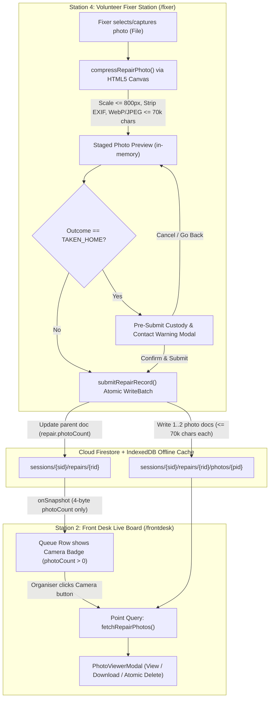

# Fixer Station Item Photo Upload & "Taken Home" Custody Warning

| Metadata | Value |
|---|---|
| **Status** | Goldfish-Validated Draft (Ready for Human Sign-Off) |
| **Issue** | [GitHub Issue #4](https://github.com/rsg98/repair-cafe-manager/issues/4) |
| **Authors** | Human Organiser & Antigravity (Elephant-Goldfish Co-Design) |
| **Created** | 2026-10-17 |
| **Target Cost** | **$0.00 / month** (Strict Google Cloud / Firebase Spark Free Tier) |

---

## Section 0: Problem Statement in Plain English

### 0.1 Operational Need
During a monthly Repair Café session, volunteer fixers record diagnostic notes, parts used, repair duration, item weight, and the repair outcome on the **Volunteer Fixer Station** (`/fixer`). Two critical workflow gaps were identified in [GitHub Issue #4](https://github.com/rsg98/repair-cafe-manager/issues/4):

1. **Item Photo Capture on the Fixer Station:** Fixers and organisers want the option to attach 1–2 photos of the repaired item (e.g., before/after a complex fix, an interesting internal fault, or a completed repair for community impact publicity and grant reporting). Organisers at the Front Desk (`/frontdesk`) also need a lightweight way to view, download, or delete those photos without slowing down the live queue board.
2. **"Taken Home to Finish" (`TAKEN_HOME`) Custody & Contact Warning:** Occasionally a volunteer fixer agrees with a visitor to take a complex item home to finish repairing after the session. Under the Repair Café's Terms & Conditions (`public/terms.md` §6), taking an item off-site releases Repair Café custody and insurance cover and forms a **private agreement** between the volunteer and the visitor. Furthermore, because volunteer tablets are blocked from reading visitor phone numbers (`firestore.rules` / `POL02-Safeguarding.md`) and the Front Desk's copy of visitor PII is permanently scrubbed to `[REDACTED]` when the session is finalised (`finalizeSession`), a fixer who forgets to take down the visitor's contact details in person has no way to contact them later. When a fixer selects `TAKEN_HOME` and clicks submit, the app must intercept submission with a clear confirmation modal reminding them of these obligations before the record is saved.

### 0.2 Financial, Offline, and Legal Constraints
Any solution must operate within three strict boundaries defined in `AGENTS.md`:

- **Zero-Budget ($0.00/month) Storage & Bandwidth Guardrail:**
  - Sutton Repair Café (and forks of this open-source repository) operate on zero recurring budget.
  - Raw smartphone photos (`3 MB – 8 MB` each) would quickly exhaust Firestore's **1 GiB total free storage limit**, exceed Firestore's **1 MiB per-document ceiling**, or incur billable storage/egress charges in UK (`europe-west2`) Cloud Storage buckets.
  - Embedding photo bytes directly inside `sessions/{sessionId}/repairs/{repairId}` would cause the Front Desk's real-time `onSnapshot` listener (`useRepairs.ts`) to re-download every photo in the session whenever *any* field on a repair item changes.
- **Offline-First Community Venue Resilience:**
  - Community halls often suffer from intermittent Wi-Fi. Photo uploads and deletions must work seamlessly with Firestore's `persistentLocalCache` (IndexedDB) using atomic `writeBatch` operations so a fixer can capture a photo and submit a repair record even during a temporary Wi-Fi drop.
- **UK GDPR Article 5(1)(e) & Safeguarding (`POL02-Safeguarding.md`):**
  - Smartphone photos embed EXIF metadata (exact GPS coordinates, device timestamps, phone serial numbers) that must be stripped on-device before upload.
  - Fixers must be reminded at the point of capture to photograph the **item only** (no visitor faces, children, or personal address labels), and both fixers and organisers must be able to delete individual photos if an inappropriate image is ever uploaded by mistake.

### 0.3 Success Criteria
1. Fixers can attach up to **2 photos** per repair item from a tablet/phone camera or gallery, automatically compressed client-side via HTML5 `<canvas>` to $\le 800\text{px}$ longest edge and $\le 70,000$ base64 characters ($\sim 68\text{ KB}$ string / $\sim 52\text{ KB}$ binary) per photo with all EXIF/GPS metadata stripped.
2. Compressed photos are stored in a dedicated Firestore subcollection (`sessions/{sessionId}/repairs/{repairId}/photos/{photoId}`), while the parent `RepairItem` stores only `repair.photoCount: number`, keeping Front Desk `onSnapshot` payloads completely free of base64 image payloads.
3. Server-side `firestore.rules` enforce strict field whitelisting (`.hasOnly(...)`) and size ceilings (`dataUrl.size() <= 70000`) on `photos/{photoId}` documents so no client can bypass compression.
4. Re-looking up a card on `/fixer` (including items returned from PAT 2 or items marked `UNFIXABLE` / `TAKEN_HOME` during the active session) pre-populates the existing repair fields and loads existing saved photos, while switching between cards or cancelling cleanly resets all form and photo state.
5. Selecting `"Taken home to finish"` (`TAKEN_HOME`) and submitting on `/fixer` opens a pre-submit confirmation modal warning the volunteer about the private agreement, insurance boundary, customer contact collection before redaction, and physical card return.
6. Front Desk (`/frontdesk`) rows with `repair.photoCount > 0` display a camera action button that loads the item's photos on demand (`getDocs` point query) into a modal with full-size preview, one-click download, and atomic delete capability.

---

## Section 1: Technical Implementation Plan

### 1.1 Architecture & Data Flow Overview



### 1.2 Domain Data Model (`src/types/index.ts`)

We define `MAX_PHOTOS_PER_REPAIR`, `MAX_PHOTO_DATA_URL_LENGTH`, and `RepairPhoto`, and add `photoCount?: number` to `RepairItem['repair']` (preserving all existing field names such as `outcome: RepairOutcome` and `repairedAt?: number`):

```typescript
// Maximum number of compressed photos allowed per repair item
export const MAX_PHOTOS_PER_REPAIR = 2;

// Maximum character length for a compressed base64 dataUrl (~52 KB raw binary, ~68 KB base64 string)
export const MAX_PHOTO_DATA_URL_LENGTH = 70_000;

export interface RepairPhoto {
  id: string;
  dataUrl: string;          // Compressed data:image/webp;base64,... or data:image/jpeg;base64,...
  mimeType: 'image/webp' | 'image/jpeg';
  width: number;            // Scaled pixel width (1..800)
  height: number;           // Scaled pixel height (1..800)
  sizeBytes: number;        // Exact character length (dataUrl.length, <= 70,000)
  capturedAt: number;       // Unix epoch ms
  uploadedBy: string;       // Fixer name at time of capture (<= 200 chars)
}
```

On `RepairItem['repair']` in `src/types/index.ts`:
```typescript
  repair?: {
    fixerName: string;
    outcome: RepairOutcome;
    repairTimeMinutes?: number;
    diagnosis?: string;
    repairNotes?: string;
    partsUsed?: string;
    photoCount?: number;
    repairedAt?: number;
  };
```

### 1.3 Client-Side Image Compression & EXIF Stripping (`src/utils/imageCompression.ts`)

To guarantee zero external runtime dependencies and deterministic unit testability under Vitest (Node environment), `src/utils/imageCompression.ts` separates pure calculation/validation helpers from the browser DOM `<canvas>` pipeline:

1. **Pure Testable Helpers:**
   - `calculateScaledDimensions(origWidth: number, origHeight: number, maxDimension = 800): { width: number; height: number }`:
     - Throws an `Error` if `origWidth <= 0`, `origHeight <= 0`, or `maxDimension <= 0` or non-finite.
     - If both dimensions are $\le \text{maxDimension}$, returns `{ width: Math.round(origWidth), height: Math.round(origHeight) }`.
     - Otherwise scales proportionally so the longest edge equals `maxDimension` and rounds the shorter edge to `Math.max(1, Math.round(...))`.
   - `validatePhotoDataUrl(dataUrl: string, maxLength = MAX_PHOTO_DATA_URL_LENGTH): { valid: boolean; mimeType?: 'image/webp' | 'image/jpeg'; sizeBytes: number; error?: string }`:
     - Sets `sizeBytes = typeof dataUrl === 'string' ? dataUrl.length : 0`.
     - Verifies the string starts with `data:image/webp;base64,` or `data:image/jpeg;base64,` and has at least 16 base64 characters after the comma.
     - Verifies `sizeBytes <= maxLength`.
   - `canAddMorePhotos(existingCount: number, stagedCount: number, maxPhotos = MAX_PHOTOS_PER_REPAIR): boolean`:
     - Returns `Math.max(0, existingCount) + Math.max(0, stagedCount) < maxPhotos`.
   - `generatePhotoDownloadFilename(cardNumber: number | null | undefined, referenceToken: string, index: number, mimeType: string): string`:
     - `index` is **0-based** (`index = 0` produces `photo-1`).
     - Maps `mimeType === 'image/webp'` to `.webp`, and all other image MIME types to `.jpg`.
     - Sanitises `referenceToken` to alphanumeric and hyphens.
     - Returns `card-${cardNumber}-${safeRef}-photo-${index + 1}.${ext}` when `cardNumber` is a positive number, or `${safeRef}-photo-${index + 1}.${ext}` otherwise.

2. **Browser Canvas Compression Pipeline (`compressRepairPhoto(file: File, uploadedBy: string): Promise<Omit<RepairPhoto, 'id'>>`):**
   - **Pre-Check:** Rejects non-image files (`!file.type.startsWith('image/')`) and files $> 20\text{ MB}$ (`20 * 1024 * 1024` bytes) to prevent mobile browser tab memory exhaustion.
   - **Decode & Cleanup:** Loads the `File` into an `HTMLImageElement` via `URL.createObjectURL(file)`. Always revokes the object URL (`URL.revokeObjectURL`) and clears `img.src = ''` inside a `finally` block. If decoding fails (e.g. unsupported HEIC container on a non-Safari browser), rejects with a clear error: `"Could not decode this image format. Please use a standard JPEG, PNG, or WebP photo."`
   - **4-Pass Iterative Resize, EXIF Strip, and Encoding:**
     - Drawing raw pixel data onto a fresh 2D `HTMLCanvasElement` automatically strips all camera EXIF, GPS location tags, and embedded thumbnails.
     - Evaluates up to 4 passes (`[ { maxDim: 800, quality: 0.65 }, { maxDim: 800, quality: 0.45 }, { maxDim: 600, quality: 0.45 }, { maxDim: 480, quality: 0.38 } ]`) until `dataUrl.length <= MAX_PHOTO_DATA_URL_LENGTH`:
       - Attempts `canvas.toDataURL('image/webp', quality)`. If the browser does not support WebP encoding (returned string does not start with `data:image/webp`), falls back to `canvas.toDataURL('image/jpeg', quality)`.
       - Releases backing WebKit GPU memory immediately on each pass (`canvas.width = 0; canvas.height = 0;`).
     - Final check: calls `validatePhotoDataUrl(dataUrl)` and throws an `Error` if invalid or still over `MAX_PHOTO_DATA_URL_LENGTH`.

### 1.4 Firestore Subcollection Operations (`src/services/repairService.ts`)

1. **Pure Helper `requiresTakeHomeConfirmation(outcome: RepairOutcome): boolean`:**
   - Returns `outcome === 'TAKEN_HOME'`.
2. **Updated `getRepairByCardNumber(sessionId: string, cardNumber: number): Promise<RepairItem | null>`:**
   - Queries `sessions/{sessionId}/repairs` where `cardNumber == cardNumber`.
   - Prefers a non-terminal item (`!isTerminalStatus(data.status)`). If none exists, falls back to any non-`COMPLETED` item (or the first matching card document in the session) so fixers can re-lookup a card marked `UNFIXABLE` or `TAKEN_HOME` during the session to attach a photo or amend notes. Always merges `{ ...(docSnap.data() as RepairItem), id: docSnap.id }`.
3. **`fetchRepairPhotos(sessionId: string, repairId: string): Promise<RepairPhoto[]>`:**
   - Performs a point collection read on `collection(db, 'sessions', sessionId, 'repairs', repairId, 'photos')`, mapping `{ ...(d.data() as RepairPhoto), id: d.id }` and sorting client-side by `capturedAt` ascending (zero composite index overhead).
4. **Atomic Offline-Safe `deleteRepairPhoto(sessionId: string, repairId: string, photoId: string, currentPhotoCount: number): Promise<number>`:**
   - Computes `const nextCount = Math.max(0, currentPhotoCount - 1)`.
   - Uses a single atomic `writeBatch(db)` to:
     - `batch.delete(doc(db, 'sessions', sessionId, 'repairs', repairId, 'photos', photoId))`
     - `batch.update(doc(db, 'sessions', sessionId, 'repairs', repairId), { 'repair.photoCount': nextCount, updatedAt: Date.now() })` (using dot-notation `'repair.photoCount'` so existing `repair` fields are never overwritten).
   - Committing both operations in a single `writeBatch` ensures that even when offline, IndexedDB queues both the photo deletion and parent counter decrement together without hanging on sequential awaits.
5. **Extended `submitRepairRecord(params)`:**
   - Retains the existing single `params` object signature:
     ```typescript
     export async function submitRepairRecord(params: {
       sessionId: string;
       repairId: string;
       fixerName: string;
       outcome: RepairOutcome;
       repairTimeMinutes: number;
       diagnosis: string;
       repairNotes: string;
       partsUsed?: string;
       weightKg?: number;
       isMainsPower: boolean;
       newPhotos?: Array<Omit<RepairPhoto, 'id'>>;
       existingPhotoCount?: number;
     }): Promise<ItemStatus>
     ```
   - Validates `(params.existingPhotoCount ?? 0) + (params.newPhotos?.length ?? 0) <= MAX_PHOTOS_PER_REPAIR`.
   - Validates every entry in `params.newPhotos` via `validatePhotoDataUrl(photo.dataUrl)`.
   - Uses `writeBatch(db)` to atomically create each new photo document in `sessions/{sessionId}/repairs/{repairId}/photos` and update `sessions/{sessionId}/repairs/{repairId}` (including `repair.photoCount = (params.existingPhotoCount ?? 0) + (params.newPhotos?.length ?? 0)` and `repairedAt: now`).

### 1.5 Firestore Security Rules (`firestore.rules`)

Inside `match /sessions/{sessionId}/repairs/{repairId}` in `firestore.rules`, we add a strict schema- and size-bounded rule block for `/photos/{photoId}`:

```javascript
// Compressed item photos uploaded by volunteer fixers (Issue #4)
// Enforces strict field whitelist and 70KB dataUrl limit to protect the 1 GiB Firebase Free Tier
match /photos/{photoId} {
  allow read: if true;
  allow create, update: if isVolunteer()
    && request.resource.data.keys().hasAll([
      'dataUrl', 'mimeType', 'width', 'height', 'sizeBytes', 'capturedAt', 'uploadedBy'
    ])
    && request.resource.data.keys().hasOnly([
      'id', 'dataUrl', 'mimeType', 'width', 'height', 'sizeBytes', 'capturedAt', 'uploadedBy'
    ])
    && request.resource.data.dataUrl is string
    && request.resource.data.dataUrl.size() <= 70000
    && request.resource.data.mimeType in ['image/webp', 'image/jpeg']
    && request.resource.data.width is int
    && request.resource.data.width > 0
    && request.resource.data.width <= 800
    && request.resource.data.height is int
    && request.resource.data.height > 0
    && request.resource.data.height <= 800
    && request.resource.data.sizeBytes is int
    && request.resource.data.sizeBytes > 0
    && request.resource.data.sizeBytes <= 70000
    && request.resource.data.capturedAt is int
    && request.resource.data.uploadedBy is string
    && request.resource.data.uploadedBy.size() <= 200;
  allow delete: if isVolunteer() || isAdmin();
}
```

### 1.6 Fixer Station UI Enhancements (`src/views/FixerStationView.tsx`)

1. **Card Lookup & Re-Lookup Hydration (`handleSearchCard`):**
   - Before searching, clears `stagedPhotos = []`, `existingPhotos = []`, `photoError = null`, and `showTakeHomeModal = false`.
   - When `item` is found:
     - If `item.repair` exists: hydrates `outcome = item.repair.outcome`, `repairTimeMinutes = item.repair.repairTimeMinutes ?? 30`, `diagnosis = item.repair.diagnosis ?? ''`, `repairNotes = item.repair.repairNotes ?? ''`, `partsUsed = item.repair.partsUsed ?? ''`, `weightKg = item.item.weightKg !== undefined ? String(item.item.weightKg) : '1.5'`, and if `!fixerName.trim() && item.repair.fixerName`, sets `fixerName = item.repair.fixerName`.
     - If `item.repair` is `undefined`: explicitly resets `outcome = 'FIXED'`, `repairTimeMinutes = 30`, `diagnosis = ''`, `repairNotes = ''`, `partsUsed = ''`, and `weightKg = item.item.weightKg !== undefined ? String(item.item.weightKg) : '1.5'` so state from a previously viewed card never bleeds into the new card.
     - If `(item.repair?.photoCount ?? 0) > 0`, awaits `fetchRepairPhotos(session.id, item.id)` inside `handleSearchCard` before setting `searching = false` and stores the result in `existingPhotos`.
   - Clicking **Cancel** on the form calls a dedicated `resetFixerWorkspace()` helper that clears `currentItem = null`, `existingPhotos = []`, `stagedPhotos = []`, `diagnosis = ''`, `repairNotes = ''`, `partsUsed = ''`, and `photoError = null`.

2. **Item Photos Upload & Preview Section:**
   - Placed inside the Fixer Log Form below `Parts Used` and above `Repair Outcome`.
   - Displays a UK GDPR & Safeguarding reminder banner:
     > **Photo Guidelines:** Photograph the item only — do not include visitor faces, children, or personal name/address labels. Photos are automatically compressed and stripped of location data.
   - Hidden `<input type="file" accept="image/*" multiple />` resets `e.target.value = ''` immediately in `onChange` so a removed photo can be re-selected if needed.
   - Shows **Add Photo (`Camera`)** button when `canAddMorePhotos(existingPhotos.length, stagedPhotos.length)` is `true` (up to 2 total photos).
   - Renders thumbnails for:
     - **Saved Photos (`existingPhotos`):** Badge `"Saved"`, click to open `PhotoViewerModal`, or click trash button to delete via `deleteRepairPhoto`. Whenever a saved photo is deleted (either via thumbnail trash or inside `PhotoViewerModal`), updates `existingPhotos` state immediately so `existingPhotos.length` stays accurate for subsequent form submission.
     - **New Staged Photos (`stagedPhotos`):** Badge `"New • XX KB"`, click to open full-size preview, or click `X` button to remove before submitting.

3. **Pre-Submit `TAKEN_HOME` Confirmation Modal:**
   - When `requiresTakeHomeConfirmation(outcome)` is `true` and the fixer submits the form, `handleSubmitRepair` opens `showTakeHomeModal = true` instead of immediately writing to Firestore.
   - The modal warns the volunteer across three explicit checklist items:
     1. **Private Agreement Outside Café Insurance (`Terms §6`):** Taking an item off-site releases Repair Café custody and insurance cover. You are entering a private, informal agreement directly with the visitor.
     2. **Take Visitor Contact Details Now (GDPR Redaction):** Volunteers cannot access visitor phone numbers in this app, and the Front Desk's copy is permanently erased (`[REDACTED]`) when today's session closes. **Make sure you have written down the visitor's name and phone/email directly before they leave.**
     3. **Return Physical Card `#N`:** Please ensure physical card `#${currentItem.cardNumber}` is returned to the Front Desk.
   - Modal buttons:
     - **Cancel / Go Back:** Closes the modal (`setShowTakeHomeModal(false)`) without submitting.
     - **Confirm & Submit Record:** Calls `executeSubmitRepair()` to commit the `TAKEN_HOME` record and any staged photos.

4. **PWA Unsaved Work Protection (`isFixerDirty`):**
   - Retains `currentItem !== null` and adds `stagedPhotos.length > 0 || compressingPhoto || showTakeHomeModal || showPhotoViewerModal` so a background Service Worker update never reloads the page while a card or modal is open.

### 1.7 Shared `PhotoViewerModal` & Front Desk Integration (`src/components/common/PhotoViewerModal.tsx` & `src/views/FrontDeskView.tsx`)

1. **`src/components/common/PhotoViewerModal.tsx`:**
   - Props:
     ```typescript
     export interface PhotoViewerModalProps {
       isOpen: boolean;
       onClose: () => void;
       sessionId: string;
       repairItem: RepairItem;
       initialPhotos?: RepairPhoto[];
       onPhotosChange?: (remainingPhotos: RepairPhoto[]) => void;
     }
     ```
   - Loads photos via `fetchRepairPhotos(sessionId, repairItem.id)` when opened (or uses `initialPhotos` if passed).
   - Clamps `activeIndex` to `Math.max(0, remainingPhotos.length - 1)` when a photo is deleted so deleting the second photo (`activeIndex === 1`) never triggers an out-of-bounds crash.
   - Provides one-click **Download Photo** (`generatePhotoDownloadFilename`) and a two-step **Delete Photo** confirmation that calls `deleteRepairPhoto(sessionId, repairItem.id, photo.id, photos.length)` and invokes `onPhotosChange(remaining)`.

2. **`src/views/FrontDeskView.tsx`:**
   - Stores `const [photoModalRepairId, setPhotoModalRepairId] = useState<string | null>(null);` and resolves the live `RepairItem` from `repairs.find((r) => r.id === photoModalRepairId)` so live `photoCount` updates reflect immediately.
   - Includes `photoModalRepairId !== null` in `isFrontDeskDirty`.
   - Renders a `Camera` badge button in the queue table Actions column whenever `(r.repair?.photoCount ?? 0) > 0`.
   - Updates `handleFinalizeSession` confirmation prompt (`FrontDeskView.tsx` via `buildFinalizeSessionPrompt`) so if any items in the session have photos (`repairs.some(r => (r.repair?.photoCount ?? 0) > 0)`), the confirmation dialog clarifies that item photos remain stored in Firebase after closing, while noting they are not currently accessible via the UI once the active session is closed.

---

## Section 2: Alternatives Considered & Ruled Out

| Alternative | Why It Was Ruled Out |
|---|---|
| **1. Firebase Cloud Storage (`firebase/storage` Bucket)** | **Breaks $0.00/month Free Tier & Offline Guarantee:** Google Cloud Storage's 5 GB Always Free tier is restricted to US regions (`us-east1`, `us-west1`, `us-central1`). Because UK Repair Cafés deploy in `europe-west2` (London) for UK GDPR residency, Cloud Storage buckets are billed from byte 1 and require a Blaze billing plan. Furthermore, `firebase/storage` uploads fail immediately when hall Wi-Fi drops instead of queueing in Firestore's IndexedDB `persistentLocalCache`. |
| **2. Storing Base64 Photos Directly Inside `repairs/{repairId}`** | **Multiplies Read Bandwidth on Front Desk:** `FrontDeskView.tsx` maintains a real-time `onSnapshot` listener on `sessions/{sessionId}/repairs`. Embedding two 68 KB strings directly in `RepairItem` would broadcast ~136 KB to every Front Desk tab on every status change. Isolating photos into `repairs/{repairId}/photos/{photoId}` keeps `onSnapshot` payloads tiny (only `photoCount: number`). |
| **3. Post-Submit Toast/Alert for `TAKEN_HOME`** | **Too Late to Prevent Mistakes:** Showing an alert *after* the record is already saved and the form is cleared prevents the fixer from pausing to verify the visitor is still present and willing to share contact details. A pre-submit confirmation modal with **Cancel / Go Back** and **Confirm & Submit** gives the fixer control before custody is formally released. |
| **4. Sequential Non-Batch `deleteDoc` + `updateDoc` for Photo Deletion** | **Hangs Offline & Desynchronises `photoCount`:** Calling `await deleteDoc(photoRef)` followed by `await updateDoc(repairRef)` hangs on the first `await` when hall Wi-Fi is down, leaving `repair.photoCount` out of sync if the tab closes before reconnection. Using a single `writeBatch(db)` queues both mutations atomically in IndexedDB. |

---

## Section 3: Detailed Implementation Plan & File Manifest

| File Path | Action | Responsibility & Planned Changes |
|---|---|---|
| `docs/design/fixer_photos_and_take_home_warning.md` | **Create** | This Elephant-Goldfish engineering design specification. |
| `src/types/index.ts` | **Modify** | Add `MAX_PHOTOS_PER_REPAIR`, `MAX_PHOTO_DATA_URL_LENGTH`, `RepairPhoto` interface, and `photoCount?: number` on `RepairItem['repair']`. |
| `src/utils/imageCompression.ts` | **Create** | Implement pure testable helpers (`calculateScaledDimensions`, `validatePhotoDataUrl`, `canAddMorePhotos`, `generatePhotoDownloadFilename`) and 4-pass browser HTML5 `<canvas>` compression + EXIF stripper (`compressRepairPhoto`) with WebKit GPU memory cleanup. |
| `src/services/repairService.ts` | **Modify** | Extend `submitRepairRecord(params)` to atomically batch-write new `RepairPhoto` docs to `sessions/{sessionId}/repairs/{repairId}/photos` and persist `repair.photoCount`. Add `fetchRepairPhotos`, atomic `deleteRepairPhoto`, and `requiresTakeHomeConfirmation`. Update `getRepairByCardNumber` to allow re-lookup of non-`COMPLETED` cards on `/fixer`. |
| `firestore.rules` | **Modify** | Add `/photos/{photoId}` subcollection security rules enforcing volunteer/admin auth, strict `.hasOnly(...)` field whitelist, dimension bounds (`<= 800`), and `dataUrl.size() <= 70000`. |
| `src/components/common/PhotoViewerModal.tsx` | **Create** | Accessible modal component for Fixer Station and Front Desk to view full-size compressed photos, download with clean filenames, and atomically delete individual photos with index clamping and parent callback sync. |
| `src/views/FixerStationView.tsx` | **Modify** | Hydrate existing `repair` fields and `existingPhotos` on card re-lookup (and cleanly reset when switching cards or cancelling); add photo upload/capture input, GDPR/Safeguarding notice, staged & saved thumbnail gallery; add pre-submit `TAKEN_HOME` custody & contact confirmation modal; update `isFixerDirty`. |
| `src/views/FrontDeskView.tsx` | **Modify** | Display camera button with `photoCount` badge on rows where `(r.repair?.photoCount ?? 0) > 0`; open `PhotoViewerModal` on click; include modal state in `isFrontDeskDirty`; remind organiser to download photos before session finalisation. |
| `tests/imageCompression.test.ts` | **Create** | Unit tests covering `calculateScaledDimensions`, `validatePhotoDataUrl` (valid WebP/JPEG, oversized rejection, invalid MIME rejection), `canAddMorePhotos`, and `generatePhotoDownloadFilename`. |
| `tests/repairService.test.ts` | **Modify** | Add unit tests verifying `requiresTakeHomeConfirmation`, `removeUndefined` compatibility with `photoCount`, and state transition invariants for `TAKEN_HOME`. |
