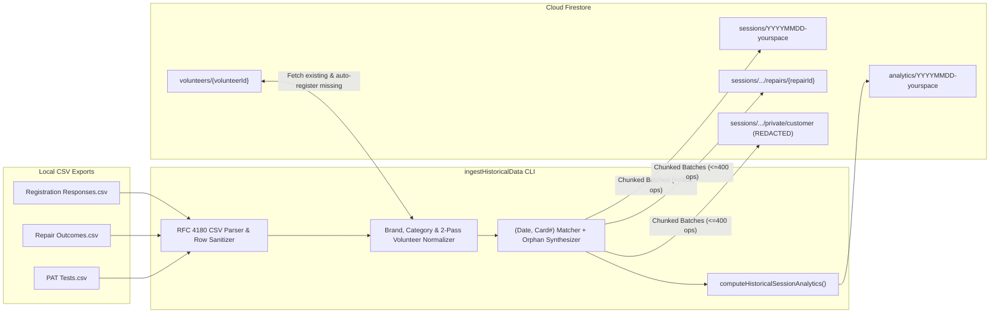

# Design Specification: Historical Google Forms Data Ingestion & Volunteer Merge CLI

- **Status:** Approved
- **Author:** Antigravity & Richard Grime
- **Target Venue Slug:** `YYYYMMDD-yourspace`

---

## Section 1: Context, Scope & Architecture Overview

### 1.1 Background & Problem Statement
Prior to the deployment of the Repair Café Session Management PWA (`repair-cafe-manager`), Sutton Repair Café (operating at YourSpace, Seears Park) recorded session activity across three separate Google Forms exported as CSV tabs:
1. **`Registration Responses`** — Visitor check-in form capturing customer name, age range, item type, item brand, problem description, marketing source, terms acceptance, allocated physical card (`Repair Number`), optional item weight, and ad-hoc organiser notes.
2. **`Repair Outcomes`** — Volunteer fixer log capturing timestamp, allocated `Repair Number`, repairer name(s), defect found, repair outcome (`Repaired?`), repair notes, and approximate duration bucket (`Time Taken to Repair`).
3. **`PAT Tests`** — Electrical safety log capturing timestamp, `Repair Number`, stage label, PAT tester name, item description, insulation class, fuse rating, visual inspection, earth continuity ($\Omega$), insulation resistance ($\text{M}\Omega$), pass/fail result, and comments.

Because physical repair cards (`#100..#148`, `#1..#N`) were reused every month, historical records across the three CSVs must be joined by **session date + card number**, normalized (volunteer names, item brands, categories, power types, repair outcomes, and durations), scrubbed of visitor PII (`customerName: "[REDACTED]"` and `private/customer.firstName: "[REDACTED]"` per UK GDPR Article 5(1)(e)), and written to Cloud Firestore as finalized sessions (`status: 'FINALIZED'`) with pre-aggregated `analytics/{sessionId}` summaries.

Additionally, because historical free-text repairer and PAT tester names will auto-enroll missing volunteers into the `volunteers` collection, organisers need a companion CLI utility (`mergeVolunteers`) to merge any duplicate or variant volunteer records created during ingestion and update all historical session/repair references.

---

### 1.2 Goals
1. **Local CSV Ingestion CLI (`ingestHistoricalData`):**
   - Parse the three local CSV files (`Registration Responses`, `Repair Outcomes`, and `PAT Tests`) using an RFC 4180-compliant state-machine CSV parser that handles embedded newlines, quoted commas, and `#VALUE!` formula rows.
   - Group records into deterministic finalized sessions with ID **`YYYYMMDD-yourspace`** and display name **`"<Month> <Year> - YourSpace"`** (e.g., `20240113-yourspace` $\rightarrow$ `"January 2024 - YourSpace"`).
   - Join registration, fixer outcome, and PAT test records by `(sessionDate, cardNumber)` when `cardNumber !== null`.
   - Detect same-session card reuse / duplicate card collisions: flag and abort by default for review, or when `--force` is supplied, take the first match and drop subsequent duplicate rows.
   - Ingest **orphan records**:
     - Registrations with no matching `Repair Outcomes` row are ingested and assumed **`FIXED`** (`status: 'COMPLETED'`, `repair.outcome: 'FIXED'`), unless explicit organiser notes on the registration row indicate `'UNFIXABLE'`, `'TAKEN_HOME'`, or `'ADVICE_GIVEN'`.
     - `Repair Outcomes` or `PAT Tests` rows with no matching `Registration Responses` row are ingested as synthesized `RepairItem` documents so no historical repair or PAT test is lost from impact metrics.
   - Order PAT tests for the same carded item by **timestamp** to assign `patInitial` (first test) and `patFinal` (last chronological test when $\ge 2$ tests exist for the item).
   - Normalize **brand names** and combine with the item type (`"${canonicalBrand} - ${cleanItemType}"` or `"${cleanItemType}"` when brand is unknown/N/A or already present in the item type) into `item.brandModel`.
   - Normalize **volunteer / repairer / PAT tester names**, match against the existing Firestore `volunteers` collection in a two-pass aggregation, and **auto-register** missing volunteers.
   - Enforce **UK GDPR Article 5(1)(e) Redaction at Ingest Time**: never write raw visitor names to Firestore; write `customerName: "[REDACTED]"` on `RepairItem` and `firstName: "[REDACTED]"` with `redactedAt` on `private/customer`.
   - Compute and write `analytics/{sessionId}` using a pure zero-dependency `computeHistoricalSessionAnalytics` function matching [`calculateSessionAnalytics`](file:///Users/richardgrime/Documents/Projects/repair-cafe-manager/src/services/sessionService.ts#L296-L361) so [`ReportsView.tsx`](file:///Users/richardgrime/Documents/Projects/repair-cafe-manager/src/views/ReportsView.tsx) includes all historical sessions seamlessly.
   - Support `--dry-run` (default) and `--confirm` modes, with all Firestore batch writes stripped of `undefined`/`NaN` via `removeUndefined()` and chunked to $\le 400$ operations per batch.

2. **Volunteer Merge CLI (`mergeVolunteers`):**
   - Provide an administrative CLI script to list registered volunteers (`--list`) and merge a duplicate volunteer record into a canonical target volunteer (`--from <sourceIdOrName> --into <targetIdOrName> [--dry-run | --confirm]`).
   - Consolidate role flags and optional contact/induction fields on `target`, synchronize `settings/system.organizerEmails` if `isOrganiser` is true, and atomically update all historical and active `sessions/*` (`attendingVolunteerIds`, `attendingVolunteers`), `analytics/*` (`volunteerCount`), and `sessions/*/repairs/*` (`repair.fixerName`, `patInitial.testerName`, `patFinal.testerName`) before deleting `volunteers/{sourceId}` in the final batch operation.

---

### 1.3 Non-Goals
- **Direct Google Sheets API / Network Fetching:** The CLI reads local CSV files only; it will not call the Google Sheets API or fetch remote URLs.
- **Modifying `settings/system.activeSessionId`:** Historical ingestion only writes finalized sessions (`status: 'FINALIZED'`) and must never alter the active session pointer in `settings/system`.
- **Ingesting Legacy Demographic / Marketing Fields:** Visitor `Age Range`, `Where did you hear about the Repair Cafe?`, and spreadsheet `UID` formula columns are intentionally ignored.
- **Frontend UI Changes:** No changes to React views or Firestore security rules are required.

---

### 1.4 System Architecture & TypeScript Build Boundaries

Following the established Admin CLI pattern in [`manageSessions.ts`](file:///Users/richardgrime/Documents/Projects/repair-cafe-manager/functions/src/scripts/manageSessions.ts) and [`manageSessionsArgs.ts`](file:///Users/richardgrime/Documents/Projects/repair-cafe-manager/functions/src/scripts/manageSessionsArgs.ts):
- **Build Boundary Constraint:**
  - Root [`tsconfig.json`](file:///Users/richardgrime/Documents/Projects/repair-cafe-manager/tsconfig.json) compiles `["src", "tests"]` without `firebase-admin` or `@types/node`.
  - [`functions/tsconfig.json`](file:///Users/richardgrime/Documents/Projects/repair-cafe-manager/functions/tsconfig.json) compiles `["src"]` to `"outDir": "lib"`. Importing files from `../../../src/` inside `functions/src/` would shift TypeScript's inferred `rootDir` to the repository root and break `functions/lib/index.js`.
  - Therefore, pure zero-dependency modules are placed in `src/utils/` (for Vitest unit tests) and mirrored identically in `functions/src/scripts/` (for the Cloud Functions / Admin CLI build), with zero imports of `firebase/*`, `firebase-admin/*`, or Node built-ins (`fs`, `path`, `process`):
    1. `src/utils/historicalIngestParser.ts` $\leftrightarrow$ `functions/src/scripts/historicalIngestParser.ts`
    2. `src/utils/mergeVolunteersArgs.ts` $\leftrightarrow$ `functions/src/scripts/mergeVolunteersArgs.ts`
- **Admin SDK Entrypoints (`functions/src/scripts/`):**
  - `functions/src/scripts/ingestHistoricalData.ts` — Node 24 CLI script using `firebase-admin/firestore` and `fs/promises`.
  - `functions/src/scripts/mergeVolunteers.ts` — Node 24 CLI script using `firebase-admin/firestore`.



---

## Section 2: Data Model, Normalisation & Matching Rules

### 2.1 CSV Column Schemas & Row Sanitization
1. **`Registration Responses` Columns (0-indexed):**
   - `[0]` `Timestamp` (e.g., `13/01/2024 10:45:16` or `11/05/2024`)
   - `[1]` `Name` (Customer name — **never persisted; redacted immediately**)
   - `[2]` `Age Range` (Ignored)
   - `[3]` `Type of Item` (Item description / type)
   - `[4]` `Item Brand` (Brand string)
   - `[5]` `Problem Description` (Fault description)
   - `[6]` `Where did you hear about the Repair Cafe?` (Ignored)
   - `[7]` `The Repair Cafe is FREE...` (Terms acceptance string)
   - `[8]` `Repair Number` (Allocated physical card number or organiser note)
   - `[9]` `Item Weight` (Weight e.g. `200g`, `20kg`, or organiser note)
   - `[10]` `Assigned` (Optional fixer/organiser note)
   - `[11]` *(Unnamed note column)* (Optional organiser note)
   - `[12]` *(Unnamed column)* (Optional note)
   - `[13]` `UID` (Spreadsheet formula column, e.g., `45304-100` or `#VALUE!` — Ignored)
2. **`Repair Outcomes` Columns (0-indexed):**
   - `[0]` `Timestamp`
   - `[1]` `Repair Number`
   - `[2]` `Repairer Name`
   - `[3]` `Defect Found`
   - `[4]` `Repaired?`
   - `[5]` `How the item was repaired or what prevented repair`
   - `[6]` `Time Taken to Repair`
3. **`PAT Tests` Columns (0-indexed):**
   - `[0]` `Timestamp`
   - `[1]` `Repair Number`
   - `[2]` `Repair Stage`
   - `[3]` `PAT Tester Name`
   - `[4]` `Item Description`
   - `[5]` `Class`
   - `[6]` `Fuse Fitted`
   - `[7]` `Visual Inspection`
   - `[8]` `Earth Continuity (Ohms)`
   - `[9]` `Insulation Resistance (Ohms)`
   - `[10]` `Result`
   - `[11]` `Tester Comments`
4. **Header & Formula-Row Sanitization Predicate:**
   - Skip row `0` (header row).
   - Skip any row where cell `[0]` (`Timestamp`) is empty, whitespace-only, or does not match `/^\d{1,2}\/\d{1,2}\/\d{4}/`. This cleanly skips all blank rows, `#VALUE!` formula rows (lines 421–671 of `Registration Responses`), and stray note-only rows (`curtains 140`), while still capturing valid rows that appear *after* `#VALUE!` blocks (such as the two `11/07/2026` rows at lines 672–673).

---

### 2.2 Session Date Resolution & Off-Saturday Snapping
1. **Timestamp Parsing (`parseUkTimestamp`):**
   - Parse `DD/MM/YYYY HH:mm:ss`, `DD/M/YYYY HH:mm:ss`, or `DD/MM/YYYY` (using `Date.UTC(year, month - 1, day, hour, minute, second)`, defaulting time to `11:00:00` when omitted) into `{ rawDate: 'YYYY-MM-DD', timestampMs: number }`.
2. **Off-Saturday Date Snapping (`resolveHistoricalSessionDate`):**
   - `2024-12-13` $\rightarrow$ **`2024-12-14`**: Snaps the Friday-night registration (`13/12/2024 22:30:28`, Card `102`, Tefal Steam iron) into the Saturday `2024-12-14` session where its `Repair Outcomes` and `PAT Tests` records reside.
   - `2024-06-14` (`Repair Outcomes` rows for Cards `131, 130, 116, 137`) $\rightarrow$ **`2024-05-11`**: Snaps the four late-logged outcome rows into the `2024-05-11` session where those exact four cards were registered at `11/05/2024 11:35:28`.
   - `2024-06-14` (`Registration Responses` row for Card `127`, HP Laptop) $\rightarrow$ **`2024-06-08`** with `cardNumberOverride: null` and `noteOverride: "Original card #127 on 14/06/2024 - Waiting at clothes swap"` so it is preserved in the June 2024 session without colliding with `2024-06-08` Card `127`.
3. **Deterministic `Session` Document Fields:**
   - `id`: `${sessionDate.replace(/-/g, '')}-yourspace` (e.g., `20240113-yourspace`).
   - `name`: `"<MonthName> <YYYY> - YourSpace"` (e.g., `"January 2024 - YourSpace"`).
   - `date`: `sessionDate` (`YYYY-MM-DD`).
   - `status`: `'FINALIZED'`, `isTest: false`.
   - `volunteerPinHash`: `'9af15b336e6a9619928537df30b2e6a2376569fcf9d7e773eccede65606529a0'` (SHA-256 of `'0000'`).
   - `cardRangeStart`: minimum numeric `cardNumber` in session (or `100` if none), `cardRangeEnd`: maximum numeric `cardNumber` in session (or `150` if none).
   - `attendingVolunteers`: `SessionVolunteerSummary[]` (deduplicated by `id`, sorted alphabetically by `name`, excluding `'Unknown'`).
   - `attendingVolunteerIds`: `attendingVolunteers.map((v) => v.id)`.
   - `createdAt`: minimum `timestampMs` among items in the session.
   - `finalizedAt`: maximum `timestampMs` among items in the session.

---

### 2.3 Card Number Extraction & Duplicate Collision Rules
1. **Card Number Parsing (`parseHistoricalCardNumber`):**
   - Trim the raw `Repair Number` cell.
   - If it begins with a positive integer `/^(\d+)/` where value $> 0$ (e.g., `"102"` $\rightarrow$ `102`, `"114rae"` $\rightarrow$ `114`, `"122f"` $\rightarrow$ `122`, `"102a"` $\rightarrow$ `102`), extract that integer as `cardNumber` (ignoring alphanumeric suffixes unless descriptive).
   - If the cell is empty, `"0"`, `"PAPER"`, or `"?"`, return `{ cardNumber: null }`.
   - If the cell contains non-numeric descriptive text (e.g., `"DANGEROUS TO FIX NOT ATTEMPTED"`, `"No number a lady with sewing m/c"`, `"can't repair"`), return `{ cardNumber: null, organizerNote: trimmed }`.
2. **Same-Session Duplicate Card Collisions:**
   - Within a session (`YYYY-MM-DD`), if two or more rows in `Registration Responses` share the same non-null `cardNumber`, or two or more rows in `Repair Outcomes` share the same non-null `cardNumber`:
     - **Default Mode (no `--force`):** Record all collisions in `plan.collisions`, print a structured collision table, and abort before writing to Firestore (exit code `1`).
     - **Force Mode (`--force`):** Keep the **first** row in file order for that `(sessionDate, cardNumber)` and drop subsequent duplicate rows for that card in that file, logging each dropped row in `plan.droppedDuplicates`.

---

### 2.4 Record Joining, Orphan Synthesis & Required `RepairItem` / `PrivateCustomerData` Fields
For each session date (`YYYY-MM-DD`):
1. **Matched Card Items (`cardNumber !== null`):**
   - Join the Registration row (if present), Outcome row (if present), and PAT row(s) (if present) sharing `(sessionDate, cardNumber)`.
   - Deterministic IDs:
     - `repairId`: `hist-${YYYYMMDD}-card-${cardNumber}`
     - `registrationId`: `reg-hist-${YYYYMMDD}-card-${cardNumber}`
     - `referenceToken`: `REF-H${String(cardNumber).padStart(3, '0')}`
2. **Uncarded Items (`cardNumber === null`):**
   - Maintain a single session-wide monotonic counter `uncardedIndex = 1, 2, ...` across uncarded Registration rows, uncarded Outcome rows, and uncarded PAT rows so `repairId`s never collide across sheets:
     - `repairId`: `hist-${YYYYMMDD}-uncarded-${uncardedIndex}`
     - `registrationId`: `reg-hist-${YYYYMMDD}-uncarded-${uncardedIndex}`
     - `referenceToken`: `REF-U${String(uncardedIndex).padStart(3, '0')}`
3. **Orphan Registrations (Registration present, no Outcome row):**
   - Combine any non-empty organiser notes from `Repair Number` (`organizerNote`), `Item Weight` (`organizerNote`), and columns `[10]`, `[11]`, `[12]` into `combinedOrgNotes`.
   - **Outcome & Status Inference from Organiser Notes (`inferOrphanRegistrationOutcome`):**
     - If `combinedOrgNotes` matches `/\b(?:not\s+repai?rable|unable\s+to\s+(?:repair|fix|be\s+fixed)|can'?t\s+(?:repair|do)|couldn'?t\s+fix|dangerous\s+to\s+fix|don'?t\s+repair|non\s+repai?rable|not\s+fixed|motor\s+burnt\s+out)\b/i` $\rightarrow$ `outcome: 'UNFIXABLE'`, `status: 'UNFIXABLE'`.
     - Else if `combinedOrgNotes` matches `/\b(?:taken?\s+home|taking\s+home|taken?\s+for\s+home\s+repair|left\s+for\s+home\s+repair)\b/i` $\rightarrow$ `outcome: 'TAKEN_HOME'`, `status: 'TAKEN_HOME'`.
     - Else if `combinedOrgNotes` matches `/\b(?:advi[cs]e\s+(?:given|offered)|advised)\b/i` $\rightarrow$ `outcome: 'ADVICE_GIVEN'`, `status: 'COMPLETED'`.
     - **Otherwise (Default Orphan Rule):** `outcome: 'FIXED'`, `status: 'COMPLETED'`.
   - If the item also has a PAT row whose last `Result === 'Fail'` and no Outcome row, override to `outcome: 'UNFIXABLE'`, `status: 'UNFIXABLE'`.
   - Set `repair.fixerName`: normalized volunteer name from column `[10]` (`Assigned`) if valid person name, else PAT tester name if PAT row exists, else `'Unknown'`.
   - Set `repair.repairTimeMinutes`: `15`, and `repair.repairNotes`: `combinedOrgNotes || undefined`.
4. **Orphan Outcomes / Orphan PAT Tests (Outcome or PAT present, no Registration row):**
   - Synthesize `item.brandModel` and `item.faultDescription` from the Outcome row (`Defect Found` / `How the item was repaired`) or PAT row (`Item Description`).
   - If only PAT row(s) exist with no Outcome row:
     - If the last PAT row has `Result === 'Fail'` $\rightarrow$ `repair.outcome = 'UNFIXABLE'`, `status = 'UNFIXABLE'`.
     - Otherwise $\rightarrow$ `repair.outcome = 'FIXED'`, `status = 'COMPLETED'`.
     - Set `repair.fixerName = patTesterName` and `repair.repairTimeMinutes = 15`.
5. **Required `PrivateCustomerData` Subcollection Payload (`sessions/{sessionId}/repairs/{repairId}/private/customer`):**
   - Written for every `RepairItem` in the session:
     ```ts
     {
       firstName: '[REDACTED]',
       agreedToTerms: true,
       termsVersion: 'historical-google-form',
       registeredAt: itemTimestampMs,
       submittedAt: itemTimestampMs,
       redactedAt: now,
     }
     ```

---

### 2.5 Outcome, Status, Duration & Weight Mapping

| CSV `Repaired?` Value | Condition on Notes (`How the item was repaired...` / `Defect Found`) | Mapped `RepairOutcome` | Mapped `ItemStatus` |
|---|---|---|---|
| `Yes` | Any | `'FIXED'` | `'COMPLETED'` |
| `No - Repair not possible` | Any | `'UNFIXABLE'` | `'UNFIXABLE'` |
| `Partial Repair and/or Advice Given` | Contains `"advis"` / `"advic"` (case-insensitive) | `'ADVICE_GIVEN'` | `'COMPLETED'` |
| `Partial Repair and/or Advice Given` | Otherwise | `'PARTIAL'` | `'COMPLETED'` |
| `Second Visit Required to Complete Repair` | Contains `"taking home"` / `"taken home"` / `"take home"` | `'TAKEN_HOME'` | `'TAKEN_HOME'` |
| `Second Visit Required to Complete Repair` | Otherwise | `'PARTIAL'` | `'COMPLETED'` |

**Duration Mapping (`Time Taken to Repair` $\rightarrow$ `repairTimeMinutes`):**
- `Less than 10 minutes` | `10 minutes` $\rightarrow$ `10`
- `10 - 20 minutes` $\rightarrow$ `15`
- `20 - 30 minutes` $\rightarrow$ `25`
- `More than 20 minutes` $\rightarrow$ `30`
- `Over 30 minutes` $\rightarrow$ `45`
- Empty / Orphan $\rightarrow$ `15`

**Weight Parsing (`parseHistoricalWeightKg` $\rightarrow$ `item.weightKg`):**
- If the `Item Weight` cell matches `/^\s*(\d+(?:\.\d+)?)\s*(g|kg)\s*$/i`, convert to kilograms (`g` divided by `1000`, `kg` as-is).
- Otherwise, if `Item Weight` is non-empty text, return it as `organizerNote` (merged into `repair.repairNotes`).
- If `Item Weight` had no numeric weight, check `Type of Item` for an embedded weight pattern `/\b(\d+(?:\.\d+)?)\s*(g|kg)\b/i` (e.g., `"Bike - 20kg"` $\rightarrow$ `20.0` kg) and strip `" - 20kg"` from the cleaned item type.

---

### 2.6 PAT 1 & PAT 2 Timestamp Ordering and Measurement Parsing
1. **Chronological Assignment:**
   - For carded items (`cardNumber !== null`), sort all matching PAT rows ascending by `Timestamp` (`testedAt`).
   - **First PAT row (`patRows[0]`)** $\rightarrow$ `RepairItem.patInitial`:
     - `outcome`: `'PASS'` if `Result === 'Pass'`; `'DANGER_DO_NOT_ENERGIZE'` if `Result === 'Fail'` and item's final `status === 'UNFIXABLE'`; otherwise `'FAIL_REPAIRABLE_CORD'`.
   - **Last PAT row (`patRows[patRows.length - 1]` when `patRows.length >= 2`)** $\rightarrow$ `RepairItem.patFinal`:
     - `outcome`: `'PASS'` if `Result === 'Pass'`, else `'FAIL'`.
   - Any item with $\ge 1$ PAT test is assigned `item.powerType = 'MAINS_240V'` and `item.category = 'ELECTRICAL'`.
2. **PAT Field Normalisation:**
   - `Class` $\rightarrow$ `item.applianceClass`: `"Class I"` $\rightarrow$ `'CLASS_I'`, `"Class II"` $\rightarrow$ `'CLASS_II'` (omitted if empty).
   - `Fuse Fitted` $\rightarrow$ `fuseRatingAmps`: `"BS1362 - 3 Amp"` $\rightarrow$ `3`, `"BS1362 - 5 Amp"` $\rightarrow$ `5`, `"BS1362 - 13 Amp"` $\rightarrow$ `13`, all other values (`10 Amp`, `Fuse Inaccessible`) $\rightarrow$ `'OTHER'`.
   - `Visual Inspection` $\rightarrow$ `visualPass`: `true` if `"Pass"` (case-insensitive) or if empty and `Result === 'Pass'`, else `false`.
   - `testVoltageVolts`: `500` (default standard 500V DC test voltage).
   - `Earth Continuity (Ohms)` $\rightarrow$ `earthContinuityOhms`: Reject if cell contains `mohm` or `n/a` or `na` or `pass`; otherwise extract float via `/(?:\d+(?:\.\d+)?|\.\d+)/` (so `">.08"` $\rightarrow$ `0.08`, `"0.14R"` $\rightarrow$ `0.14`).
   - `Insulation Resistance (Ohms)` $\rightarrow$ `insulationResistanceMOhms`: Extract float via `/(?:\d+(?:\.\d+)?|\.\d+)/` (`">200M"` $\rightarrow$ `200`, `">2000"` $\rightarrow$ `2000`; if `"Pass"` $\rightarrow$ `200`; if `"Na"` / empty $\rightarrow$ `0` when `Result === 'Fail'`, else `200`).
   - `Tester Comments` $\rightarrow$ `patInitial.cautionNotes` / `patFinal.certificateNotes` (omitted if empty or `"Na"`).
   - `instrumentSerial`: `"HISTORICAL-PAT"`.

---

### 2.7 Brand Canonicalisation & Word-Boundary Category / Power Classification
1. **Brand Normalisation (`normalizeBrandName`):**
   - Strip placeholders (`"n/a"`, `"na"`, `"none"`, `"no"`, `"not known"`, `"unknown"`, `"unkniwn"`, `"don't know"`, `"dont know"`, `"do not know"`, `"domnt know"`, `"dot know"`, `"not sure"`, `"unsure"`, `"no idea"`, `"no brand"`, `"unbranded"`, `"?"`, `"???"`, `",?"`, `"as above"`, `"various"`, `"mix"`, `"mix of brands"`, `"not"`).
   - Map known variants/typos to canonical brand names (`Russell Hobbs`, `Morphy Richards`, `De'Longhi`, `Philips`, `Black & Decker`, `Dyson`, `Numatic Henry`, `Marks & Spencer`, `Mac Allister`, `KitchenAid`, `NutriBullet`, `Gtech`, `HP`, `Levi's`, `Adidas`, `Epson`, `Bissell`, `Sebo`, `Ambiano`, `Roberts`, `Dualit`, `Kärcher`, `GHD`, `JVC`, `LG`, `IKEA`, `Spear & Jackson`, `SilverCrest`, `Andrew James`, `John Lewis`, `BaByliss`, `DeWalt`, `Cricut`, `Crosley`, `Magimix`, etc.).
   - Combine into `item.brandModel`:
     - If `canonicalBrand` is non-empty and `cleanItemType.toLowerCase()` does not already contain `canonicalBrand.toLowerCase()`: `"${canonicalBrand} - ${cleanItemType}"`.
     - Otherwise: `"${cleanItemType || canonicalBrand || 'Household Item'}"`.
2. **Word-Boundary Category & Power Type Heuristics (`classifyItemCategoryAndPower`):**
   - Evaluated in strict precedence order using word-boundary regexes (`\b...\b/i`) across `itemType` + `faultDescription`:
     1. **PAT Override:** If `hasPatRecord === true` $\rightarrow$ `{ category: 'ELECTRICAL', powerType: 'MAINS_240V' }`.
     2. **Explicit Multi-Word Electrical Overrides:** Matches `/\b(?:electric\s+blanket|under\s*blanket|heated\s+(?:airer|drier)|drysoon|sewing\s+machine|record\s+(?:player|deck)|turntable|vinyl\s+player|carpet\s+(?:cleaner|vleaner)|pressure\s+washer|jet\s+wash|steam\s+(?:iron|cleaner|cooker|oven)|lawn\s*mower|hedge\s*trimmer|strimmer|food\s+(?:processor|mixer|chopper|blender|dehydrator)|stand\s+mixer|hand\s+(?:blender|mixer|vac)|hair\s*(?:dryer|straightener| straighters)|air\s*fryer|coffee\s+(?:machine|mashine|maker|grinder)|bread\s*maker|slow\s+cooker|rice\s+cooker|multi\s+cooker|pressure\s+cooker|water\s+heater|electric\s+fire|sound\s*(?:bar|box)|cd\s+player|dvd|blu\s*ray|blue\s*ray|vhs|vcr|hi\s*fi|av\s+amp|minidisc|minodisc|tape\s+(?:deck|recorder)|cassette|casette|velvetiser|nutri\s*bullet)\b/i` $\rightarrow$ `{ category: 'ELECTRICAL', powerType: 'MAINS_240V' }`.
     3. **Battery / Low-Voltage Toys:** Matches `/\b(?:gameboy|nintendo|2ds|wii|duplo\s+train|play\s*mobile|electronic\s+toy|battery\s+toy|toy\s+(?:train|sink|guitar|disco)|remote\s+control\s+car|whistling\s+marmot|busy\s+board)\b/i` $\rightarrow$ `{ category: 'TOY', powerType: 'BATTERY_LOW_VOLTAGE' }`.
     4. **Non-Powered Toys:** Matches `/\b(?:teddy|doll|squishmallow|soft\s+(?:toy|monkey|you)|hand\s+knitted\s+toy|toy\s+gun|wooden\s+wheeled\s+toy|dog\s+toy|toy)\b/i` $\rightarrow$ `{ category: 'TOY', powerType: 'NOT_APPLICABLE' }`.
     5. **Textiles:** Matches `/\b(?:shirt|t-?shirt|trousers?|jeans|coat|jacket|blazer|dress|skirt|jumper|hoodie|hoody|cardigan|zip|zipper|hem|seam|pocket|curtains?|duvet|towel|towelling|robe|blanket|bag|rucksack|backpack|handbag|holdall|purse|wallet|shoes?|trainers?|gloves?|scarf|hat|cap|bra|tights|leggings|shorts|fleece|vest|dungarees|cushion|dog\s+bed|tent|umbrella|parasol|belt|swim(?:ming)?\s+trunks|pyjama|pjs|garments?|clothes|clothing|velcro|darning|sewing|stitching|alteration)\b/i` $\rightarrow$ `{ category: 'TEXTILES', powerType: 'NOT_APPLICABLE' }`.
     6. **Woodwork / Furniture:** Matches `/\b(?:wooden|stool|chair|table|drawers?|cupboard|chest|carving\s+tray)\b/i` $\rightarrow$ `{ category: 'WOODWORK', powerType: 'NOT_APPLICABLE' }`.
     7. **Mechanical (Non-Electrical):** Matches `/\b(?:bike|bicycle|cycle|pram|buggy|rollator|walker|secateurs?|secatures|secretaries|shears|loppers?|scissors?|suitcase|luggage|trolley|litter\s+picker|glasses|spectacles|saucepan|pan|pot|blind|walking\s+stick|washing\s+airer|drying\s+rack)\b/i` $\rightarrow$ `{ category: 'MECHANICAL', powerType: 'MECHANICAL' }`.
     8. **Battery / Low-Voltage Electrical:** Matches `/\b(?:laptop|macbook|chromebook|ipad|tablet|phone|iphone|headphones?|earphones?|headset|bluetooth|walkie\s+talkie|watch|watches|clock|car\s+key|remote|camera|kindle|shaver|toothbrush|scales|blood\s+pressure|thermostat|light\s+box|usb|solar|battery|cordless|dyson\s+v\d+|dyson\s+dc\d+|halo)\b/i` $\rightarrow$ `{ category: 'ELECTRICAL', powerType: 'BATTERY_LOW_VOLTAGE' }`.
     9. **General Mains Electrical:** Matches `/\b(?:lamp|light|lights|kettle|toaster|hoover|hoovet|vacuum|vaccum|iron|steamer|blender|mixer|microwave|dehumidifiers?|fan|heater|radio|stereo|amplifier|speaker|printer|shredder|mower|karcher|drill|sander|grinder|rotovator|rotorvator|scarifier|chainsaw|brush\s+cutter|concrete\s+breaker|charger|extension|plug|fuseboard|diffuser|purifier|television|tv|projector|cricut|synthesiser|electrical)\b/i` $\rightarrow$ `{ category: 'ELECTRICAL', powerType: 'MAINS_240V' }`.
     10. **Default Fallback:** `{ category: 'OTHER', powerType: 'NOT_APPLICABLE' }`.

---

### 2.8 Two-Pass Volunteer Normalisation & Auto-Registration
1. **Strict Ordering of Name Cleaning (`normalizeVolunteerNames`):**
   - **Step A (Whole-Cell Non-Person / Defect Check):** If the trimmed cell is empty or matches a known non-person entry (`"Back pack buckle repair"`, `"Clock mechanism faulty"`, `"Can't remember"`, `"Blanket no go , electronic faulty customer will try manufacture"`, `"Unknown"`, `"Yellow hoodie"`, `"Hose broken in hosing"`, `"Hum on both loadspeakers"`, `"Bad zip, came open"`, `"Jeans pocket"`, `"Left for home repair"`, `"102"`, `"106"`), return `{ canonicalNames: [], defectNote: trimmed }` (when not `"Unknown"` / `"Can't remember"` / numeric).
   - **Step B (Whole-Cell Canonical Override):** If the trimmed cell matches `"Rae Martin both elements low insulation"`, return `{ canonicalNames: ['Rae Martin'], defectNote: 'Both elements low insulation' }`.
   - **Step C (Compound Name Splitting):** Split on `/\s*(?:&|\/|,|\band\b)\s*/i`.
   - **Step D (Per-Token Canonical Lookup & Deduplication):** Map each token via the canonical volunteer dictionary (`Rae Martin`, `Richard Grime`, `Richard M`, `Luke Colbert`, `Mary Warren`, `Marion Pereira`, `Sue Spenceley-Burch`, `Alex Rocha`, `Tom Brzezinski`, `Dominic Brzezinski`, `Stuart Russell`, `Garreth`, `Charles Barraball`, `Frank Scott`, `Ranji`, `Pradeep`, `Jessica`, `Ian`, `Alice`, `Mel`, `Vaskor`, `Libby`, `Phil`, `Helen`, `Martin`, `Grace`, `Andrew`, `Keith`, `Trevor`) and deduplicate case-insensitively while preserving order.
   - Joined display string for `repair.fixerName` / `testerName`: `canonicalNames.length > 0 ? canonicalNames.join(' & ') : 'Unknown'`.
2. **Two-Pass Resolution Against Firestore `volunteers`:**
   - **Pass 1 (Global Volunteer Aggregation Across All CSVs):**
     - Collect every canonical volunteer name across all parsed `Repair Outcomes`, `PAT Tests`, and `Registration Responses` (`Assigned` column), along with `appearedInPat: boolean` (true if the volunteer appeared as a tester in `PAT Tests`).
     - Match each canonical name against existing Firestore `volunteers`:
       1. Exact case-insensitive full-name match (`v.name.trim().toLowerCase() === canonical.toLowerCase()`).
       2. Single-token first-name match (`!canonical.includes(' ')`) when **exactly one** existing Firestore volunteer has that first name (`v.name.trim().split(/\s+/)[0].toLowerCase() === canonical.toLowerCase()`).
     - If matched to an existing `Volunteer`:
       - If `appearedInPat && !existing.isPatTrained`, queue an update `{ isPatTrained: true, updatedAt: now }` on `volunteers/{existing.id}` and set `isPatTrained: true` in the resolved map.
     - If not matched:
       - Create a deterministic `Volunteer` record with `id = 'vol-hist-' + canonical.toLowerCase().replace(/[^a-z0-9]+/g, '-').replace(/^-|-$/g, '')`:
         ```ts
         {
           id: volunteerId,
           name: canonical,
           emergencyContactName: 'Pending (Historical Import)',
           emergencyContactPhone: '00000000000',
           isOrganiser: false,
           isPatTrained: appearedInPat,
           inducted: true,
           inductedAt: now,
           inductedBy: 'Historical Import',
           createdAt: now,
           updatedAt: now,
         }
         ```
   - **Pass 2 (Session Attendance Embedding):**
     - For each session, collect the unique resolved `Volunteer` records for all fixers and PAT testers active in that session, project them via `toSessionVolunteerSummary()`, sort alphabetically by `name`, and populate `session.attendingVolunteers`, `session.attendingVolunteerIds`, and `analytics.volunteerCount`.

---

## Section 3: Concrete Interfaces, CLI Contracts & Execution Semantics

### 3.1 Exported Pure Interfaces & Signatures (`historicalIngestParser.ts` & `mergeVolunteersArgs.ts`)

```ts
// src/utils/historicalIngestParser.ts (mirrored in functions/src/scripts/historicalIngestParser.ts)
export interface IngestHistoricalCliOptions {
  command: 'ingest' | 'help';
  registrationsPath?: string;
  outcomesPath?: string;
  patPath?: string;
  dryRun: boolean;
  confirm: boolean;
  force: boolean;
  overwrite: boolean;
  projectId?: string;
}

export interface CardCollisionRecord {
  sessionDate: string;
  source: 'registration' | 'outcome';
  cardNumber: number;
  keptRowSummary: string;
  conflictingRowSummary: string;
}

export interface PlannedHistoricalSession {
  session: Session;
  repairs: Array<{
    repairItem: RepairItem;
    privateCustomer: PrivateCustomerData;
  }>;
  analytics: SessionAnalytics;
}

export interface HistoricalIngestionPlan {
  sessions: PlannedHistoricalSession[];
  newVolunteers: Volunteer[];
  upgradedPatVolunteerIds: string[];
  collisions: CardCollisionRecord[];
  droppedDuplicates: CardCollisionRecord[];
}

export function parseIngestHistoricalArgs(argv: string[]): IngestHistoricalCliOptions;
export function parseCsvRecords(csvContent: string): string[][];
export function parseUkTimestamp(raw: string): { rawDate: string; timestampMs: number } | null;
export function resolveHistoricalSessionDate(
  source: 'registration' | 'outcome' | 'pat',
  rawDate: string,
  cardNumber: number | null
): { sessionDate: string; cardNumberOverride?: number | null; noteOverride?: string };
export function parseHistoricalCardNumber(raw: string): { cardNumber: number | null; organizerNote?: string };
export function parseHistoricalWeightKg(
  weightCell: string,
  itemTypeCell?: string
): { weightKg?: number; cleanedItemType: string; organizerNote?: string };
export function parseHistoricalDurationMinutes(raw: string): number;
export function mapHistoricalOutcomeAndStatus(
  repairedCell: string,
  notesCell: string
): { outcome: RepairOutcome; status: ItemStatus };
export function normalizeBrandName(
  rawBrand: string,
  rawItemType: string
): { canonicalBrand: string; brandModel: string };
export function classifyItemCategoryAndPower(
  itemType: string,
  faultDesc: string,
  hasPatRecord: boolean
): { category: ItemCategory; powerType: PowerType };
export function normalizeVolunteerNames(
  rawField: string
): { canonicalNames: string[]; defectNote?: string };
export function computeHistoricalSessionAnalytics(
  sessionId: string,
  sessionName: string,
  sessionDate: string,
  repairs: RepairItem[],
  finalizedAt: number,
  volunteerCount: number,
  isTest?: boolean
): SessionAnalytics;
export function buildHistoricalIngestionPlan(params: {
  registrationsCsv: string;
  outcomesCsv: string;
  patCsv: string;
  existingVolunteers: Volunteer[];
  force?: boolean;
  now?: number;
}): HistoricalIngestionPlan;
```

```ts
// src/utils/mergeVolunteersArgs.ts (mirrored in functions/src/scripts/mergeVolunteersArgs.ts)
export type MergeVolunteersCommand = 'list' | 'merge' | 'help';

export interface MergeVolunteersCliOptions {
  command: MergeVolunteersCommand;
  from?: string;
  into?: string;
  dryRun: boolean;
  confirm: boolean;
  projectId?: string;
}

export interface VolunteerMergePlan {
  updatedTarget: Volunteer;
  deletedSourceId: string;
  updatedSessions: Array<{
    sessionId: string;
    attendingVolunteerIds: string[];
    attendingVolunteers: SessionVolunteerSummary[];
  }>;
  updatedAnalytics: Array<{
    sessionId: string;
    volunteerCount: number;
  }>;
  updatedRepairs: Array<{
    sessionId: string;
    repairId: string;
    updates: {
      'repair.fixerName'?: string;
      'patInitial.testerName'?: string;
      'patFinal.testerName'?: string;
    };
  }>;
}

export function parseMergeVolunteersArgs(argv: string[]): MergeVolunteersCliOptions;
export function findVolunteerByIdOrName(query: string, volunteers: Volunteer[]): Volunteer;
export function rewriteVolunteerNameInField(
  rawField: string | undefined,
  sourceName: string,
  targetName: string
): string | undefined;
export function buildVolunteerMergePlan(params: {
  source: Volunteer;
  target: Volunteer;
  sessions: Session[];
  analytics: SessionAnalytics[];
  repairsBySession: Record<string, RepairItem[]>;
  now?: number;
}): VolunteerMergePlan;
```

---

### 3.2 CLI 1: Historical Data Ingestion (`ingestHistoricalData`)
**NPM Script Entries (`package.json` & `functions/package.json`):**
- Root `package.json`:
  `"ingest-history": "npm --prefix functions run build && node functions/lib/scripts/ingestHistoricalData.js"`
- `functions/package.json`:
  `"ingest-history": "npm run build && node lib/scripts/ingestHistoricalData.js"`

**Execution & Existing Session Semantics:**
1. Parse args via `parseIngestHistoricalArgs(process.argv.slice(2))`. Read the 3 CSV files from disk.
2. Connect to Firestore (`initAdminFirestore`), load existing `volunteers` and existing `sessions` IDs.
3. Build `HistoricalIngestionPlan`. If `plan.collisions.length > 0` and `!options.force`, print the collision table and exit with code `1`.
4. For any planned session whose `session.id` already exists in Firestore:
   - If `!options.overwrite`: skip that session and log `[SKIP] Session <sessionId> already exists (pass --overwrite to replace)`.
   - If `options.overwrite`: before writing the new repairs for that session, list all existing `sessions/{sessionId}/repairs` documents and enqueue bottom-up deletions for their `private/customer` (and `photos`) leaf docs and `repairs/{id}` docs so stale repair IDs from prior runs are removed.
5. In `--dry-run` mode (or when `--confirm` is omitted), print the full summary table (sessions, item counts, outcomes, new volunteers, PAT counts) and exit without writing.
6. When `--confirm` is provided, pass all payloads through `removeUndefined()` and commit in chunks of **$\le 400$ operations per batch** in order:
   - Batch Queue 1: `volunteers/{id}` creates and `isPatTrained` updates.
   - Batch Queue 2: Existing session subcollection cleanup deletes (if `--overwrite`), followed by `repairs/{repairId}` and `repairs/{repairId}/private/customer` sets.
   - Batch Queue 3: Root `sessions/{sessionId}` and `analytics/{sessionId}` sets.

---

### 3.3 CLI 2: Volunteer Merge Utility (`mergeVolunteers`)
**NPM Script Entries (`package.json` & `functions/package.json`):**
- Root `package.json`:
  `"merge-volunteers": "npm --prefix functions run build && node functions/lib/scripts/mergeVolunteers.js"`
- `functions/package.json`:
  `"merge-volunteers": "npm run build && node lib/scripts/mergeVolunteers.js"`

**Execution Semantics:**
1. **Volunteer Lookup (`findVolunteerByIdOrName`):**
   - Match by exact `id` first, then case-insensitive trimmed `name`. If $>1$ volunteers share the same case-insensitive name, throw an error listing their distinct IDs so the caller can specify the exact ID. Reject if `source.id === target.id`.
2. **Field Consolidation on `target`:**
   - Preserve `target`'s fields, falling back to `source`'s `phone`, `email`, `emergencyContactRelationship`, `inductedAt`, and `inductedBy` when undefined on `target`.
   - If `target.emergencyContactName` starts with `'Pending'` and `source.emergencyContactName` does not, use `source`'s emergency contact name and phone.
   - `isOrganiser = target.isOrganiser || source.isOrganiser` (only if the resulting record has a valid `email`), `isPatTrained = target.isPatTrained || source.isPatTrained`, `inducted = target.inducted || source.inducted`.
3. **Token-Safe Name Rewriting (`rewriteVolunteerNameInField`):**
   - Split `repair.fixerName`, `patInitial.testerName`, and `patFinal.testerName` on `/\s*(?:&|\/|,|\band\b)\s*/i`, replace any token matching `source.name` (case-insensitively) with `target.name`, deduplicate tokens case-insensitively while preserving order, and rejoin with `' & '` (preventing substring corruption like `"Alex Rocha Rocha"` or duplicate pairs like `"Jessica & Jessica"`).
4. **Chunked Batch Ordering ($\le 400$ ops/batch):**
   - Queue `volunteers/{target.id}` update, `settings/system.organizerEmails` sync (if `source.isOrganiser || target.isOrganiser`), `sessions/*` updates, `analytics/*` updates, and `repairs/*` updates first.
   - Enqueue `batch.delete(volunteers/{source.id})` as the **very last operation of the final batch chunk** so a mid-run failure never deletes `source` before references are rewritten.

---

## Section 4: Verification & Testing Strategy

### 4.1 Unit Tests (`tests/historicalIngest.test.ts` & `tests/mergeVolunteers.test.ts`)
1. **RFC 4180 CSV Parsing & Sanitization:**
   - Multi-line quoted strings, trailing `#VALUE!` formula rows, and valid rows appearing *after* `#VALUE!` blocks (such as the two `11/07/2026` rows at the end of `Registration Responses`).
2. **Date Parsing & Off-Saturday Snapping:**
   - `13/12/2024 22:30:28` snaps to `2024-12-14` (`20241214-yourspace`) and joins with Card `102`.
   - `14/6/2024 14:00:00` outcomes (`131, 130, 116, 137`) snap to `2024-05-11` (`20240511-yourspace`).
   - `14/06/2024` registration (Card `127`) snaps to `2024-06-08` (`20240608-yourspace`) with `cardNumber: null`.
3. **Card Number Extraction & Collision Handling:**
   - Alphanumeric card tokens (`"114rae"` $\rightarrow$ `114`, `"122f"` $\rightarrow$ `122`, `"102a"` $\rightarrow$ `102`) vs non-numeric notes (`"PAPER"`, `"0"`, `"?"`, `"DANGEROUS TO FIX NOT ATTEMPTED"` $\rightarrow$ `null`).
   - Duplicate card collisions on the same date populate `collisions` when `force === false` and drop subsequent duplicate rows into `droppedDuplicates` when `force === true`.
4. **Orphan Synthesis, Note Inference & PAT Timestamp Ordering:**
   - Orphan registrations default to `outcome: 'FIXED'`, `status: 'COMPLETED'`, while honoring explicit unfixable/taken-home/advice notes and failed PAT overrides.
   - Multiple PAT tests for the same `(sessionDate, cardNumber)` sort chronologically into `patInitial` (first) and `patFinal` (last), and `">.08"` parses to `0.08` $\Omega$.
5. **Word-Boundary Category/Power Heuristics, Brand & Two-Pass Volunteer Normalisation:**
   - `"Laptop"` classifies as `ELECTRICAL` / `BATTERY_LOW_VOLTAGE` (not `TEXTILES`), `"Electric blanket"` classifies as `ELECTRICAL` / `MAINS_240V`.
   - Compound volunteer strings (`"Alice and Marion"`) split into distinct attending volunteers, whole-cell defect strings (`"Bad zip, came open"`) resolve to `"Unknown"` without creating volunteer records, and two-pass aggregation propagates `isPatTrained: true` across all sessions.
6. **Volunteer Merge Transformation (`mergeVolunteers`):**
   - Token-safe rewriting (`"Alex"` $\rightarrow$ `"Alex Rocha"` does not corrupt existing `"Alex Rocha"`, and `"Jes & Jessica"` deduplicates to `"Jessica"`), session attendance deduplication, and `volunteerCount` recalculation.
