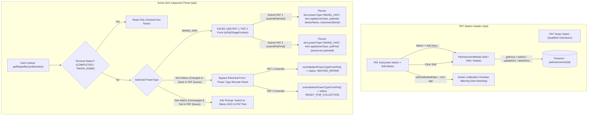

# PAT Station Enhancements: Power Type Override (#23) & PAT Instrument Management (#27)

| Metadata | Value |
|---|---|
| **Status** | Goldfish-Validated Draft (Ready for Human Sign-Off) |
| **Issues** | [GitHub Issue #23](https://github.com/rsg98/repair-cafe-manager/issues/23), [GitHub Issue #27](https://github.com/rsg98/repair-cafe-manager/issues/27) |
| **Authors** | Human Organiser & Antigravity (Elephant-Goldfish Co-Design) |
| **Created** | 2026-10-18 |
| **Target Cost** | **$0.00 / month** (Strict Google Cloud / Firebase Spark Free Tier) |

---

## Section 0: Problem Statement in Plain English

### 0.1 Operational Need
At the **PAT Electrical Safety Station** (`/pat`, Station 3), PAT-qualified volunteers perform pre-repair electrical safety screening (**PAT 1**) and post-repair safety certification (**PAT 2**) on 240V mains household appliances. Two operational friction points were identified in [GitHub Issue #23](https://github.com/rsg98/repair-cafe-manager/issues/23) and [GitHub Issue #27](https://github.com/rsg98/repair-cafe-manager/issues/27):

1. **Visitor Power Type Misclassification ([Issue #23](https://github.com/rsg98/repair-cafe-manager/issues/23)):**
   - **Forward Case (`MAINS_240V` $\rightarrow$ Non-Mains at PAT 1 or PAT 2):** During self-registration (`/register`), visitors frequently misclassify low-voltage, battery-powered, USB-charged, or purely mechanical items as `MAINS_240V` (or register under categories like `TOY` or `OTHER` whose failsafe default in [`getDefaultPowerTypeForCategory`](file:///Users/richardgrime/Documents/Projects/repair-cafe-manager/src/services/repairService.ts#L96-L119) is `MAINS_240V`). When the Front Desk assigns a physical card token, the item is routed to `WAITING_PAT1` (or, if a fixer later marks a misclassified item as `FIXED`, to `WAITING_PAT2`). Currently, the PAT tester on `/pat` has no way to change `item.powerType` and would have to fabricate dummy BS 1363 plug fuse, earth continuity, and insulation resistance measurements just to move the item to `WAITING_REPAIR` or `READY_FOR_COLLECTION` — polluting session PAT analytics (`mainsItemsCount` and `patTestedCount`).
   - **Reverse Case (Non-Mains $\rightarrow$ `MAINS_240V` at `/pat`):** Conversely, a visitor may register a 240V mains appliance (or an item with a detachable 240V mains wall adapter/lead) as `BATTERY_LOW_VOLTAGE` or `OTHER`. The Front Desk assigns a card and routes it to `WAITING_REPAIR` (or a fixer repairs it and moves it to `READY_FOR_COLLECTION` before realizing it has a 240V mains lead). When the PAT tester looks up the card on `/pat`, they must be able to switch `item.powerType` to `MAINS_240V`, complete the full BS 1363 PAT 1 (pre-repair) or PAT 2 (post-repair) electrical inspection, and have the item's `powerType` atomically updated to `MAINS_240V` so future repair outcomes (`FIXED` / `PARTIAL`) automatically enforce mandatory post-repair `WAITING_PAT2` certification.

2. **Structured PAT Instrument Registry & Calibration Tracking ([Issue #27](https://github.com/rsg98/repair-cafe-manager/issues/27)):**
   - Currently, `/pat` renders a free-text input (`PAT Instrument S/N`) stored only in browser `localStorage`. Volunteers have to manually type serial numbers, typos occur across tablets, and the café has no visibility into whether a PAT testing instrument is within its annual calibration/service interval.
   - The station needs a shared **PAT Instrument Registry** (`patInstruments` collection in Firestore) presented as a touch-friendly dropdown on `/pat`, complete with an `"+ Add New PAT Instrument..."` option and an `"Edit"` button next to the dropdown that opens a modal dialog recording:
     - **Display Name** (e.g., `"Richard's Tester"`, mutable if ownership changes)
     - **Manufacturer** (e.g., `"Seaward"`, `"Kewtech"`, `"Martindale"`)
     - **Model** (optional, e.g., `"PrimeTest 100"`)
     - **Serial Number** (required, constant hardware identifier)
     - **Last Service / Calibration Date** (required ISO date `YYYY-MM-DD`)
     - **Notes** (optional)
   - If an instrument's `lastCalibratedDate` is older than `PAT_TESTER_SERVICE_INTERVAL` (configured in [`src/config/cafe.config.ts`](file:///Users/richardgrime/Documents/Projects/repair-cafe-manager/src/config/cafe.config.ts) with a default of **12 months**), the UI must display a non-blocking amber warning (`⚠️` prefix in the dropdown option and an `<AlertTriangle>` warning banner beside the selector).
   - **Audit Traceability & Multi-Operator Support:** When a PAT 1 or PAT 2 record is submitted, the constant **`serialNumber`** of the selected instrument must be persisted on `RepairItem` (`patInitial.instrumentSerial` or `patFinal.instrumentSerial`), because `displayName` is mutable whereas `serialNumber` is immutable. Furthermore, the system must cleanly support cases where **different volunteers (`testerName`) and/or different PAT instruments (`instrumentSerial`)** perform PAT 1 and PAT 2 on the same `RepairItem` without PAT 2 overwriting PAT 1's recorded operator or instrument, while displaying PAT 1's historical summary when the item returns for PAT 2.

### 0.2 Financial, Offline, and Security Constraints
All changes must adhere strictly to the architectural guardrails in [`AGENTS.md`](file:///Users/richardgrime/Documents/Projects/repair-cafe-manager/AGENTS.md):
- **$0.00 / Month Firebase Free Tier Guardrail:**
  - Volunteer stations (`/pat`, `/fixer`) must **never** attach wide real-time `onSnapshot` collection listeners. The PAT Instrument list must be loaded via a lightweight one-time `getDocs` fetch when `/pat` unlocks (backed by Firestore's `persistentLocalCache` IndexedDB cache) and updated in local React state when a volunteer adds, edits, or deletes an instrument.
- **Offline-First Community Venue Resilience:**
  - In Firebase Modular SDK v10 with `persistentLocalCache`, Promises returned by `setDoc`, `updateDoc`, and `deleteDoc` only resolve upon server acknowledgement even though the write is immediately committed to local IndexedDB. To prevent `PatInstrumentModal` or `/pat` actions from hanging when hall Wi-Fi drops, Firestore writes in `patInstrumentService.ts` use an offline-safe commit wrapper (`commitFirestoreWriteWithOfflineFallback`) that resolves once queued locally when offline, and `PatStationView` never wipes a cached `localStorage` `pat_instrument_serial` if `instruments` is empty due to an offline cold start.
- **Volunteer PIN Authentication (`isVolunteer()`):**
  - PAT station tablets authenticate using the daily 4-digit volunteer PIN (`role == 'volunteer'`), or via `useVolunteerPin`'s offline SHA-256 fallback. Therefore, `firestore.rules` for `/patInstruments/{instrumentId}` must permit `read: if true` (matching `sessions` and `repairs` so offline-unlocked tablets never hit `PERMISSION_DENIED` on read) and `create, update, delete: if isVolunteer()` with strict schema, immutability, and string-length validation.
- **Accurate Impact & Safety Analytics:**
  - [`functions/src/finalizeSession.ts`](file:///Users/richardgrime/Documents/Projects/repair-cafe-manager/functions/src/finalizeSession.ts#L124-L172) and [`src/services/sessionService.ts`](file:///Users/richardgrime/Documents/Projects/repair-cafe-manager/src/services/sessionService.ts#L232-L279) (`calculateSessionAnalytics`) count `mainsItemsCount` via `item.item?.powerType === 'MAINS_240V'` and `patTestedCount` / `patFailedCount`. Rerouting a misclassified non-mains item at PAT 1 must update `item.powerType`, clear any accidental `patInitial` via `deleteField()`, and skip creating `patInitial` so neither counter is inflated; meanwhile, items tested only at PAT 2 (after a reverse override) must also be counted in `patTestedCount` (`Boolean(item.patInitial || item.patFinal)`).

### 0.3 Success Criteria
1. **Forward Power Type Override (Mains $\rightarrow$ Non-Mains):** When an item on `/pat` has its Power Type changed from `MAINS_240V` to any non-mains option (`BATTERY_LOW_VOLTAGE`, `MECHANICAL`, `NOT_APPLICABLE`, or `OTHER`), the BS 1363 electrical measurement inputs are replaced with a clear reroute explanation panel and a single action button:
   - In **PAT 1**: `"Update Power Type & Route to Waiting Repair"` updates `item.powerType`, sets `item.applianceClass: 'NOT_APPLICABLE'`, removes any stale `patInitial`, and transitions `status` to `'WAITING_REPAIR'` without requiring a PAT tester name or instrument serial.
   - In **PAT 2**: `"Update Power Type & Route to Ready for Collection"` updates `item.powerType`, sets `item.applianceClass: 'NOT_APPLICABLE'`, removes any stale `patFinal`, and transitions `status` to `'READY_FOR_COLLECTION'` while preserving any existing `patInitial` record intact.
2. **Reverse Power Type Override (Non-Mains $\rightarrow$ Mains):** When a non-mains item is looked up on `/pat`, it initially shows an informational prompt explaining that it is currently classified as non-mains and inviting the volunteer to switch Power Type to `MAINS_240V` if it requires a PAT test. When switched to `MAINS_240V`, the full BS 1363 PAT 1 (if pre-repair) or PAT 2 (if post-repair, detected via `isPat2StageForItem`) measurement form is displayed, and submitting the PAT record atomically persists `item.powerType: 'MAINS_240V'` and `item.applianceClass` alongside the `patInitial` / `patFinal` record and next lifecycle status.
3. **PAT Instrument Dropdown & Modal:** `/pat` replaces the free-text serial number input with a `<select>` dropdown of registered `PatInstrument` records (plus `"+ Add New PAT Instrument..."`) and an `"Edit"` button enabled whenever a registered instrument is selected. Selecting `"+ Add New PAT Instrument..."` opens `PatInstrumentModal` in Add mode (and reverts the dropdown cleanly if cancelled). Clicking `"Edit"` opens `PatInstrumentModal` pre-populated with the selected instrument, supporting Save and Delete/Retire.
4. **Calibration Warning (`PAT_TESTER_SERVICE_INTERVAL = 12` months):** Any instrument whose `lastCalibratedDate` is strictly older than `PAT_TESTER_SERVICE_INTERVAL` calendar months displays a `⚠️` prefix in the dropdown `<option>` and renders a non-blocking amber warning banner with the last service date when selected.
5. **Constant Serial Number Traceability & Independent PAT 1 / PAT 2 Records:** Selecting an instrument stores its immutable `serialNumber` in `instrumentSerial` (`localStorage` key `'pat_instrument_serial'`), which is saved to `patInitial.instrumentSerial` on PAT 1 and `patFinal.instrumentSerial` on PAT 2. When an item is looked up for PAT 2, a read-only summary of its PAT 1 inspection (including PAT 1's `testerName`, `instrumentSerial`, `outcome`, and measurements) is shown for reference, PAT 1's `fuseRatingAmps` and `testVoltageVolts` pre-populate the PAT 2 defaults, and the PAT 2 form records the currently active PAT 2 volunteer's `testerName` and `instrumentSerial` without mutating `patInitial`.

---

## Section 1: Technical Implementation Plan

### 1.1 Architecture & Workflow Overview



### 1.2 Configuration & Domain Data Models (`src/config/cafe.config.ts` & `src/types/index.ts`)

1. **Service Interval Constant (`src/config/cafe.config.ts`):**
   - Export `export const PAT_TESTER_SERVICE_INTERVAL = 12;` (in calendar months) and add `patTesterServiceIntervalMonths: number;` to `CafeConfig` (initialized to `PAT_TESTER_SERVICE_INTERVAL` in `cafeConfig`).

2. **PAT Instrument Interfaces & `patFinal.testVoltageVolts` (`src/types/index.ts`):**
   - Add `testVoltageVolts?: 250 | 500;` to `RepairItem['patFinal']` so post-repair DC test voltage is persisted alongside `patInitial.testVoltageVolts`.
   - Add `PatInstrument` and `PatInstrumentInput`:
     ```typescript
     /**
      * Registered PAT testing instrument stored at `patInstruments/{instrumentId}` (Issue #27).
      * Note: `RepairItem.patInitial.instrumentSerial` and `RepairItem.patFinal.instrumentSerial`
      * store `serialNumber` (constant hardware identifier) rather than `displayName` (mutable).
      */
     export interface PatInstrument {
       id: string;
       displayName: string;        // e.g., "Richard's Tester" (mutable owner/friendly label)
       manufacturer: string;       // e.g., "Seaward", "Kewtech", "Martindale"
       model?: string;             // Optional model name, e.g., "PrimeTest 100"
       serialNumber: string;       // Constant unique manufacturer serial number
       lastCalibratedDate: string; // ISO 8601 calendar date "YYYY-MM-DD"
       notes?: string;             // Optional service/adapter notes
       createdAt: number;          // Unix epoch ms
       updatedAt: number;          // Unix epoch ms
     }

     /**
      * Form input payload for creating or updating a PAT testing instrument (Issue #27).
      */
     export interface PatInstrumentInput {
       displayName: string;
       manufacturer: string;
       model?: string;
       serialNumber: string;
       lastCalibratedDate: string; // "YYYY-MM-DD"
       notes?: string;
     }
     ```

3. **Shared Human-Readable Power Type Options (`src/services/repairService.ts`):**
   - Export `POWER_TYPE_OPTIONS` matching the exact options and labels in [`CustomerRegisterView.tsx`](file:///Users/richardgrime/Documents/Projects/repair-cafe-manager/src/views/CustomerRegisterView.tsx#L379-L383), plus a pure lookup helper `getPowerTypeLabel(powerType: PowerType): string`:
     ```typescript
     export const POWER_TYPE_OPTIONS: ReadonlyArray<{ value: PowerType; label: string }> = [
       { value: 'MAINS_240V', label: 'Mains 240V Plug-in (Requires PAT Test)' },
       { value: 'BATTERY_LOW_VOLTAGE', label: 'Battery / USB / Low Voltage DC' },
       { value: 'NOT_APPLICABLE', label: 'Not Applicable (Non-powered)' },
       { value: 'MECHANICAL', label: 'Mechanical' },
       { value: 'OTHER', label: 'Other' },
     ];
     ```

### 1.3 PAT Instrument Service (`src/services/patInstrumentService.ts`)

To keep business logic pure and 100% unit-testable in Vitest without Firestore mocks, `src/services/patInstrumentService.ts` provides both pure validation/calibration helpers and Firestore CRUD operations:

1. **Pure Validation Helper `validatePatInstrumentInput(input: PatInstrumentInput, referenceDate: Date = new Date()): { valid: boolean; error?: string }`:**
   - Trims strings and validates:
     - `displayName` is non-empty and $\le 100$ chars (`"Display name is required."` / `"Display name must be 100 characters or fewer."`).
     - `manufacturer` is non-empty and $\le 100$ chars (`"Manufacturer is required."` / `"Manufacturer must be 100 characters or fewer."`).
     - `serialNumber` is non-empty and $\le 100$ chars (`"Serial number is required."` / `"Serial number must be 100 characters or fewer."`).
     - `model` (if provided) is $\le 100$ chars (`"Model must be 100 characters or fewer."`).
     - `notes` (if provided) is $\le 500$ chars (`"Notes must be 500 characters or fewer."`).
     - `lastCalibratedDate`:
       - Must match `/^\d{4}-\d{2}-\d{2}$/`.
       - Parses `[year, month, day]` and constructs `d = new Date(Date.UTC(year, month - 1, day))` and verifies `d.getUTCFullYear() === year && d.getUTCMonth() + 1 === month && d.getUTCDate() === day` so impossible calendar dates like `2026-02-31` are rejected (`"Please enter a valid service/calibration date (YYYY-MM-DD)."`).
       - Compares `d.getTime()` against `Date.UTC(referenceDate.getFullYear(), referenceDate.getMonth(), referenceDate.getDate())` (local calendar date of `referenceDate` mapped to UTC midnight, avoiding BST timezone drift) and rejects future dates (`"Service/calibration date cannot be in the future."`).

2. **Pure Duplicate Serial Check `hasDuplicatePatInstrumentSerial(serialNumber: string, existingInstruments: ReadonlyArray<Pick<PatInstrument, 'id' | 'serialNumber'>>, excludeId?: string): boolean`:**
   - Normalises `serialNumber.trim().toLowerCase()`.
   - Returns `true` if any instrument in `existingInstruments` with `inst.id !== excludeId` has the same normalised `serialNumber`.

3. **Pure Calibration Expiry Check `isPatInstrumentCalibrationOverdue(lastCalibratedDate: string, serviceIntervalMonths: number = PAT_TESTER_SERVICE_INTERVAL, referenceDate: Date = new Date()): boolean`:**
   - Parses `lastCalibratedDate` (`YYYY-MM-DD`) into `[year, month, day]` and verifies exact calendar round-trip (`d.getUTCFullYear() === year && d.getUTCMonth() + 1 === month && d.getUTCDate() === day`). If invalid, returns `true`.
   - Computes target month and clamps `day` to the last day of the target month so leap-day (`2024-02-29` + 12 months $\rightarrow$ `2025-02-28`) and 31-day month additions never overflow into the next month:
     ```typescript
     const targetMonthIndex = month - 1 + serviceIntervalMonths;
     const lastDayOfTargetMonth = new Date(Date.UTC(year, targetMonthIndex + 1, 0)).getUTCDate();
     const clampedDay = Math.min(day, lastDayOfTargetMonth);
     const dueUtcMs = Date.UTC(year, targetMonthIndex, clampedDay);
     const refUtcMs = Date.UTC(
       referenceDate.getFullYear(),
       referenceDate.getMonth(),
       referenceDate.getDate()
     );
     return refUtcMs > dueUtcMs;
     ```

4. **Pure Dropdown Option Formatter `formatPatInstrumentOptionLabel(instrument: Pick<PatInstrument, 'displayName' | 'manufacturer' | 'model' | 'serialNumber' | 'lastCalibratedDate'>, serviceIntervalMonths: number = PAT_TESTER_SERVICE_INTERVAL, referenceDate: Date = new Date()): string`:**
   - Computes `overdue = isPatInstrumentCalibrationOverdue(instrument.lastCalibratedDate, serviceIntervalMonths, referenceDate)`.
   - Formats base label: `${instrument.displayName} — ${instrument.manufacturer}${instrument.model ? ` ${instrument.model}` : ''} (S/N: ${instrument.serialNumber})`.
   - If `overdue` is `true`, prefixes with `'⚠️ '` and suffixes with `' [Service Overdue]'`.

5. **Firestore CRUD Operations (`patInstruments/{instrumentId}`):**
   - Uses an internal helper `commitFirestoreWriteWithOfflineFallback(writePromise: Promise<void>, timeoutMs = 1500): Promise<void>` that awaits `writePromise` normally when `navigator.onLine !== false`, or races `writePromise` against a short timer when offline so writes queued into IndexedDB (`persistentLocalCache`) resolve immediately without hanging the modal UI.
   - `listPatInstruments(): Promise<PatInstrument[]>`: One-time `getDocs(collection(db, 'patInstruments'))`, maps `{ id: d.id, ...(d.data() as Omit<PatInstrument, 'id'>) }`, and sorts alphabetically by `displayName.localeCompare(b.displayName)`.
   - `createPatInstrument(input: PatInstrumentInput, existingInstruments: ReadonlyArray<Pick<PatInstrument, 'id' | 'serialNumber'>> = [], referenceDate: Date = new Date()): Promise<PatInstrument>`:
     - Validates via `validatePatInstrumentInput(input, referenceDate)` and checks `hasDuplicatePatInstrumentSerial(input.serialNumber, existingInstruments)`.
     - Normalises optional fields (`model: input.model?.trim() || undefined`, `notes: input.notes?.trim() || undefined`), creates a doc in `collection(db, 'patInstruments')` with `createdAt: now, updatedAt: now`, writes via `setDoc(ref, removeUndefined(record))`, and returns the saved `PatInstrument`.
   - `updatePatInstrument(id: string, input: PatInstrumentInput, options?: { existingCreatedAt?: number; existingInstruments?: ReadonlyArray<Pick<PatInstrument, 'id' | 'serialNumber'>>; referenceDate?: Date }): Promise<PatInstrument>`:
     - Validates via `validatePatInstrumentInput(input, options?.referenceDate)` and checks `hasDuplicatePatInstrumentSerial(input.serialNumber, options?.existingInstruments || [], id)`.
     - Preserves `createdAt = options?.existingCreatedAt ?? now`.
     - Updates `doc(db, 'patInstruments', id)` via `updateDoc` (passing `deleteField()` for `model` or `notes` when cleared to empty strings, and including `createdAt` and `updatedAt: now`), and returns the clean `PatInstrument` object.
   - `deletePatInstrument(id: string): Promise<void>`: Deletes `doc(db, 'patInstruments', id)` via `deleteDoc`.

### 1.4 Stage Detection, Power Type Override & PAT Submission Updates (`src/services/repairService.ts`)

1. **Pure Helper `isPat2StageForItem(item: Pick<RepairItem, 'status' | 'repair' | 'patFinal'> | null | undefined): boolean`:**
   - Determines whether an item looked up at `/pat` is in the post-repair **PAT 2** stage:
     ```typescript
     export function isPat2StageForItem(
       item: Pick<RepairItem, 'status' | 'repair' | 'patFinal'> | null | undefined
     ): boolean {
       if (!item) return false;
       const hasCompletedRepair =
         item.repair?.outcome === 'FIXED' ||
         item.repair?.outcome === 'PARTIAL';
       return (
         item.status === 'WAITING_PAT2' ||
         item.status === 'IN_PAT2' ||
         Boolean(item.patFinal) ||
         (hasCompletedRepair && item.status === 'READY_FOR_COLLECTION')
       );
     }
     ```
   - This handles standard `WAITING_PAT2` / `IN_PAT2` items, items re-looked up after PAT 2 (`Boolean(item.patFinal)`), and **Reverse Override after Repair** items (where an item registered as non-mains was repaired with outcome `FIXED` / `PARTIAL` and moved to `READY_FOR_COLLECTION`, then brought to `/pat` to be switched to `MAINS_240V` and certified for PAT 2).

2. **Pure Helper `calculateNextStatusOnPowerTypeOverride(newPowerType: PowerType, isPat2Stage: boolean): ItemStatus`:**
   - When `newPowerType === 'MAINS_240V'`: returns `isPat2Stage ? 'WAITING_PAT2' : 'WAITING_PAT1'`.
   - When `newPowerType !== 'MAINS_240V'`: returns `isPat2Stage ? 'READY_FOR_COLLECTION' : 'WAITING_REPAIR'`.

3. **Pure Update Payload Builders & Firestore Actions (`src/services/repairService.ts`):**
   - `buildPowerTypeOverrideUpdate(params: { newPowerType: Exclude<PowerType, 'MAINS_240V'>; isPat2Stage: boolean; now?: number }): { nextStatus: ItemStatus; updatePayload: Record<string, unknown> }`:
     - Throws an `Error` if `(params.newPowerType as PowerType) === 'MAINS_240V'` (`"Mains 240V items must complete a PAT inspection via submitPatInitial or submitPatFinal."`).
     - Computes `nextStatus = calculateNextStatusOnPowerTypeOverride(params.newPowerType, params.isPat2Stage)` (`'WAITING_REPAIR'` for PAT 1, `'READY_FOR_COLLECTION'` for PAT 2).
     - Returns `updatePayload` setting `status: nextStatus`, `'item.powerType': params.newPowerType`, `'item.applianceClass': 'NOT_APPLICABLE'`, and `updatedAt: now`.
   - `overrideItemPowerTypeFromPat(params: { sessionId: string; repairId: string; newPowerType: Exclude<PowerType, 'MAINS_240V'>; isPat2Stage: boolean }): Promise<ItemStatus>`:
     - Calls `buildPowerTypeOverrideUpdate(params)` and adds `patInitial: deleteField()` when `!params.isPat2Stage` (or `patFinal: deleteField()` when `params.isPat2Stage`) so any accidentally recorded PAT result for that stage is cleanly removed while preserving `patInitial` if overridden at PAT 2.
     - Persists via `updateDoc(doc(db, 'sessions', params.sessionId, 'repairs', params.repairId), payload)` and returns `nextStatus`.
   - `buildPatInitialUpdate(params)` & `submitPatInitial(params)`:
     ```typescript
     export async function submitPatInitial(params: {
       sessionId: string;
       repairId: string;
       testerName: string;
       instrumentSerial: string;
       visualPass: boolean;
       fuseRatingAmps: 3 | 5 | 13 | 'OTHER';
       testVoltageVolts: 250 | 500;
       earthContinuityOhms?: number;
       insulationResistanceMOhms: number;
       outcome: PatInitialOutcome;
       cautionNotes?: string;
       powerType?: PowerType;
       applianceClass?: ApplianceClass;
     }): Promise<ItemStatus>
     ```
     - Destructures `sessionId`, `repairId`, `powerType`, and `applianceClass` out of `params` before constructing `patInitial: { ...patData, testedAt: now }`.
     - Persists `status: nextStatus`, `patInitial`, `'item.powerType': powerType ?? 'MAINS_240V'`, and (when `applianceClass` is provided) `'item.applianceClass': applianceClass`, plus `updatedAt: now`.
   - `buildPatFinalUpdate(params)` & `submitPatFinal(params)`:
     ```typescript
     export async function submitPatFinal(params: {
       sessionId: string;
       repairId: string;
       testerName: string;
       instrumentSerial: string;
       visualPass: boolean;
       fuseRatingAmps: 3 | 5 | 13 | 'OTHER';
       testVoltageVolts?: 250 | 500;
       earthContinuityOhms?: number;
       insulationResistanceMOhms: number;
       outcome: PatFinalOutcome;
       certificateNotes?: string;
       powerType?: PowerType;
       applianceClass?: ApplianceClass;
     }): Promise<ItemStatus>
     ```
     - Destructures `sessionId`, `repairId`, `powerType`, and `applianceClass` out of `params` before constructing `patFinal: { ...patData, testedAt: now }`.
     - Persists `status: nextStatus`, `patFinal`, `'item.powerType': powerType ?? 'MAINS_240V'`, and (when `applianceClass` is provided) `'item.applianceClass': applianceClass`, plus `updatedAt: now`.
     - Never modifies `patInitial`, guaranteeing that PAT 1 and PAT 2 preserve independent `testerName` and `instrumentSerial` values when different volunteers or instruments perform PAT 1 and PAT 2 on the same item.

### 1.5 Session Analytics Consistency (`src/services/sessionService.ts` & `functions/src/finalizeSession.ts`)

In both [`src/services/sessionService.ts`](file:///Users/richardgrime/Documents/Projects/repair-cafe-manager/src/services/sessionService.ts#L271-L279) (`calculateSessionAnalytics`) and [`functions/src/finalizeSession.ts`](file:///Users/richardgrime/Documents/Projects/repair-cafe-manager/functions/src/finalizeSession.ts#L164-L172):
- Count an item in `patTestedCount` if `Boolean(item.patInitial || item.patFinal)` is `true` (so an item that skipped PAT 1 because it was misclassified as non-mains, and was later reverse-overridden to `MAINS_240V` and tested at PAT 2, is still counted as PAT tested).
- Count an item in `patFailedCount` if `item.patInitial?.outcome === 'FAIL_REPAIRABLE_CORD' || item.patInitial?.outcome === 'DANGER_DO_NOT_ENERGIZE' || item.patFinal?.outcome === 'FAIL'`.

### 1.6 PAT Instrument Management Modal (`src/components/pat/PatInstrumentModal.tsx`)

A clean, accessible modal component following the design language of `VolunteerRegisterPanel` / `PoliciesModal`:
- **Props:**
  ```typescript
  export interface PatInstrumentModalProps {
    isOpen: boolean;
    mode: 'add' | 'edit';
    initialInstrument?: PatInstrument | null;
    existingInstruments: PatInstrument[];
    onClose: () => void;
    onSaved: (savedInstrument: PatInstrument, mode: 'add' | 'edit') => void;
    onDeleted?: (deletedInstrumentId: string) => void;
  }
  ```
- **Fields:**
  - `Display Name *` (text input, e.g., `"Richard's Tester"`)
  - `Manufacturer *` (text input, e.g., `"Seaward"`)
  - `Model` (optional text input, e.g., `"PrimeTest 100"`)
  - `Serial Number *` (monospace text input, validated for uniqueness via `hasDuplicatePatInstrumentSerial`)
  - `Last Service / Calibration Date *` (`<input type="date" />`, `YYYY-MM-DD`, defaults to today's local date in `add` mode; shows live amber warning note if `isPatInstrumentCalibrationOverdue(lastCalibratedDate)` is `true`)
  - `Notes` (optional textarea, e.g., `"Includes IEC lead adapter"`)
- **Actions:**
  - **Save Instrument (`createPatInstrument` / `updatePatInstrument`):** Validates input and duplicate serial numbers, persists to Firestore, calls `onSaved(savedInstrument, mode)`.
  - **Delete / Retire Instrument (in `edit` mode only):** Two-step inline confirmation (`"Are you sure you want to remove this PAT instrument from the dropdown list? Past repair records using S/N {serialNumber} will retain their recorded serial number."`) that calls `deletePatInstrument(initialInstrument.id)` and invokes `onDeleted(initialInstrument.id)`.
  - **Cancel:** Calls `onClose()`.

### 1.7 PAT Station View Enhancements (`src/views/PatStationView.tsx`)

1. **Loading & Selecting PAT Instruments (`PatStationView.tsx`):**
   - State:
     - `instruments: PatInstrument[]` (loaded once when `isUnlocked` becomes `true` via `listPatInstruments()`).
     - `loadingInstruments: boolean`.
     - `instrumentModalState: { isOpen: boolean; mode: 'add' | 'edit' }`.
   - `instrumentSerial` stores the selected instrument's `serialNumber` string in `localStorage` (`'pat_instrument_serial'`).
   - `selectedInstrument` is derived via `useMemo(() => instruments.find(i => i.serialNumber === instrumentSerial) || null, [instruments, instrumentSerial])`.
   - **Offline-Safe Validation of Cached Serial:** When `instruments` finishes loading, only clear `instrumentSerial` if `instruments.length > 0` and no instrument in `instruments` matches `instrumentSerial`. (If `instruments.length === 0` due to an offline cold start or empty collection, preserve any cached `instrumentSerial` until instruments are added or loaded.)
   - **Dropdown & Edit Button UI:**
     - Native `<select aria-label="Select PAT Instrument" value={selectedInstrument ? selectedInstrument.serialNumber : ''}>`:
       - Placeholder `<option value="">{loadingInstruments ? 'Loading PAT Instruments...' : 'Select PAT Instrument...'}</option>`
       - One `<option key={inst.id} value={inst.serialNumber}>` per instrument in `instruments`, formatted with `formatPatInstrumentOptionLabel(inst)`.
       - Sentinel option `<option value="__ADD_NEW__">+ Add New PAT Instrument...</option>`.
     - `onChange` handler:
       - If `e.target.value === '__ADD_NEW__'`, opens `PatInstrumentModal` in `'add'` mode without mutating `instrumentSerial`.
       - Otherwise calls `setInstrumentSerial(e.target.value)`.
     - **Edit Button:** Placed adjacent to the `<select>`, enabled whenever `selectedInstrument !== null`, opening `PatInstrumentModal` in `'edit'` mode.
     - **Modal Callbacks:**
       - `onSaved(saved)`: Inserts or replaces `saved` in `instruments` (sorted by `displayName`), sets `setInstrumentSerial(saved.serialNumber)`, and closes the modal.
       - `onDeleted(deletedId)`: Removes `deletedId` from `instruments`, sets `setInstrumentSerial(remaining.length === 1 ? remaining[0].serialNumber : '')`, and closes the modal.
   - **Overdue Calibration Warning Banner:**
     - When `selectedInstrument && isPatInstrumentCalibrationOverdue(selectedInstrument.lastCalibratedDate)` is `true`, renders a non-blocking amber warning banner in the Station Header with `<AlertTriangle>`:
       > **Calibration / Service Overdue:** **{selectedInstrument.displayName}** (S/N: `{selectedInstrument.serialNumber}`) was last serviced on **{selectedInstrument.lastCalibratedDate}** (more than {PAT_TESTER_SERVICE_INTERVAL} months ago). You may continue testing, but please arrange recalibration or select another instrument.
   - **Validation Alert on Submit:**
     - If `!testerName.trim() || !instrumentSerial.trim()`, alerts `"Please select your PAT tester name and PAT testing instrument."`.

2. **Power Type Selector, Smart Hydration & Bidirectional Override Workflow (`PatStationView.tsx`):**
   - Computes `isPat2 = isPat2StageForItem(currentItem)` and `isTerminalItem = currentItem?.status === 'COMPLETED' || currentItem?.status === 'TAKEN_HOME'`.
   - Inside `handleSearchCard`, when `item` is found:
     - Sets `selectedPowerType = item.item.powerType`.
     - Sets `applianceClass = item.item.applianceClass && item.item.applianceClass !== 'NOT_APPLICABLE' ? item.item.applianceClass : 'CLASS_I'`.
     - Hydrates form defaults from `item.patFinal` (when `isPat2StageForItem(item)` is `true`) or `item.patInitial` (blocking cross-card state bleed while preserving `fuseRatingAmps` and `testVoltageVolts` from PAT 1 during PAT 2):
       - `visualPass = (itemIsPat2 ? item.patFinal?.visualPass : item.patInitial?.visualPass) ?? true`
       - `fuseRatingAmps = item.patFinal?.fuseRatingAmps ?? item.patInitial?.fuseRatingAmps ?? 13`
       - `testVoltageVolts = item.patFinal?.testVoltageVolts ?? item.patInitial?.testVoltageVolts ?? 500`
       - `earthContinuityOhms = itemIsPat2 ? String(item.patFinal?.earthContinuityOhms ?? item.patInitial?.earthContinuityOhms ?? '0.05') : String(item.patInitial?.earthContinuityOhms ?? '0.05')`
       - `insulationResistanceMOhms = itemIsPat2 ? String(item.patFinal?.insulationResistanceMOhms ?? item.patInitial?.insulationResistanceMOhms ?? '20.0') : String(item.patInitial?.insulationResistanceMOhms ?? '20.0')`
       - `initialOutcome = item.patInitial?.outcome ?? 'PASS'`
       - `finalOutcome = item.patFinal?.outcome ?? 'PASS'`
       - `cautionNotes = (itemIsPat2 ? item.patFinal?.certificateNotes : item.patInitial?.cautionNotes) ?? ''`
     - Never overwrites the station header's `testerName` or `instrumentSerial` on card lookup so the active PAT 2 volunteer and their selected PAT instrument are recorded on `patFinal`.
   - **Read-Only PAT 1 Summary Card:**
     - Whenever `currentItem.patInitial` exists, displays a concise read-only summary card showing PAT 1's `outcome`, `testerName`, `instrumentSerial`, `fuseRatingAmps`, `testVoltageVolts`, `earthContinuityOhms`, `insulationResistanceMOhms`, and `cautionNotes`.
   - **Power Type Dropdown & Routing Branches (when `!isTerminalItem`):**
     - Interactive `<select aria-label="Power Type" value={selectedPowerType} onChange={(e) => setSelectedPowerType(e.target.value as PowerType)}>` rendered in the card inspection panel using `POWER_TYPE_OPTIONS`.
     - **Branch 1 (`selectedPowerType === 'MAINS_240V'`):**
       - If `currentItem.item.powerType !== 'MAINS_240V'`, shows a notice that submitting this PAT test will update the item's Power Type to **Mains 240V Plug-in (Requires PAT Test)**.
       - Renders the full BS 1363 PAT 1 / PAT 2 measurement form.
       - Submitting calls `submitPatInitial` (or `submitPatFinal` when `isPat2`) with `powerType: 'MAINS_240V'` and `applianceClass`.
     - **Branch 2 (`selectedPowerType !== 'MAINS_240V'`):**
       - Computes `needsPowerTypeReroute = selectedPowerType !== currentItem.item.powerType || currentItem.status === 'WAITING_PAT1' || currentItem.status === 'IN_PAT1' || currentItem.status === 'WAITING_PAT2' || currentItem.status === 'IN_PAT2'`.
       - If `!needsPowerTypeReroute` (i.e., a non-mains item already in `WAITING_REPAIR` or `READY_FOR_COLLECTION` was looked up at `/pat` and the volunteer has not changed its Power Type yet):
         - Renders an informational card explaining that the item is currently registered as **{getPowerTypeLabel(selectedPowerType)}** (`{currentItem.status}`) and does not require a 240V PAT test unless its Power Type above is changed to **Mains 240V Plug-in (Requires PAT Test)**.
       - If `needsPowerTypeReroute` is `true`:
         - Renders the **Non-Mains Power Type Reroute Panel** with **Cancel** and primary action button (`"Update Power Type & Route to Waiting Repair"` for PAT 1, or `"Update Power Type & Route to Ready for Collection"` for PAT 2), which calls `overrideItemPowerTypeFromPat` and displays a confirmation banner using `getPowerTypeLabel(selectedPowerType)`.

### 1.8 Firestore Security Rules (`firestore.rules`)

Add a top-level `/patInstruments/{instrumentId}` match block in [`firestore.rules`](file:///Users/richardgrime/Documents/Projects/repair-cafe-manager/firestore.rules):

```javascript
// PAT Testing Instruments Registry (Issue #27)
// Public read (like sessions/repairs) supports offline-unlocked station tablets; writes restricted to isVolunteer()
match /patInstruments/{instrumentId} {
  allow read: if true;
  allow create: if isVolunteer()
    && request.resource.data.keys().hasAll([
      'displayName', 'manufacturer', 'serialNumber', 'lastCalibratedDate', 'createdAt', 'updatedAt'
    ])
    && request.resource.data.keys().hasOnly([
      'id', 'displayName', 'manufacturer', 'model', 'serialNumber', 'lastCalibratedDate', 'notes', 'createdAt', 'updatedAt'
    ])
    && (!('id' in request.resource.data) || (request.resource.data.id is string && request.resource.data.id == instrumentId))
    && request.resource.data.displayName is string
    && request.resource.data.displayName.size() > 0
    && request.resource.data.displayName.size() <= 100
    && request.resource.data.manufacturer is string
    && request.resource.data.manufacturer.size() > 0
    && request.resource.data.manufacturer.size() <= 100
    && request.resource.data.serialNumber is string
    && request.resource.data.serialNumber.size() > 0
    && request.resource.data.serialNumber.size() <= 100
    && request.resource.data.lastCalibratedDate is string
    && request.resource.data.lastCalibratedDate.matches('^\\d{4}-\\d{2}-\\d{2}$')
    && (!('model' in request.resource.data) || (request.resource.data.model is string && request.resource.data.model.size() <= 100))
    && (!('notes' in request.resource.data) || (request.resource.data.notes is string && request.resource.data.notes.size() <= 500))
    && request.resource.data.createdAt is int
    && request.resource.data.updatedAt is int;
  allow update: if isVolunteer()
    && request.resource.data.keys().hasAll([
      'displayName', 'manufacturer', 'serialNumber', 'lastCalibratedDate', 'createdAt', 'updatedAt'
    ])
    && request.resource.data.keys().hasOnly([
      'id', 'displayName', 'manufacturer', 'model', 'serialNumber', 'lastCalibratedDate', 'notes', 'createdAt', 'updatedAt'
    ])
    && (!('id' in request.resource.data) || (request.resource.data.id is string && request.resource.data.id == instrumentId))
    && request.resource.data.displayName is string
    && request.resource.data.displayName.size() > 0
    && request.resource.data.displayName.size() <= 100
    && request.resource.data.manufacturer is string
    && request.resource.data.manufacturer.size() > 0
    && request.resource.data.manufacturer.size() <= 100
    && request.resource.data.serialNumber is string
    && request.resource.data.serialNumber.size() > 0
    && request.resource.data.serialNumber.size() <= 100
    && request.resource.data.lastCalibratedDate is string
    && request.resource.data.lastCalibratedDate.matches('^\\d{4}-\\d{2}-\\d{2}$')
    && (!('model' in request.resource.data) || (request.resource.data.model is string && request.resource.data.model.size() <= 100))
    && (!('notes' in request.resource.data) || (request.resource.data.notes is string && request.resource.data.notes.size() <= 500))
    && request.resource.data.createdAt is int
    && request.resource.data.createdAt == resource.data.createdAt
    && request.resource.data.updatedAt is int;
  allow delete: if isVolunteer();
}
```

---

## Section 2: Alternatives Considered & Ruled Out

| Alternative | Why It Was Ruled Out |
|---|---|
| **1. Storing `displayName` Instead of `serialNumber` on `RepairItem` (`patInitial` / `patFinal`)** | **Breaks Hardware Audit Traceability:** As confirmed during co-design, a PAT tester's friendly display name (e.g. `"Richard's Tester"`) is mutable if the instrument is lent or transferred to another volunteer. The manufacturer's `serialNumber` is immutable and unique across the café's fleet, making `serialNumber` the authoritative key to record on `patInitial.instrumentSerial` and `patFinal.instrumentSerial`. |
| **2. Restricting `patInstruments` Writes to `isAdmin()` (Google Sign-In Organisers Only)** | **Blocks Issue #27 UX at the PAT Station:** The PAT Station tablet (`/pat`) is unlocked via the daily 4-digit volunteer PIN (`isVolunteer()`), not Google Organiser Sign-In. Requiring `isAdmin()` would cause `"Permission Denied"` errors whenever a PAT tester clicks `"+ Add New PAT Instrument..."` or `"Edit"` on `/pat`. Using `isVolunteer()` with strict schema validation in `firestore.rules` allows PIN-authenticated PAT volunteers to manage instruments directly. |
| **3. Attaching a Real-Time `onSnapshot` Listener to `patInstruments`** | **Violates $0.00/Month Free Tier Guardrail (`AGENTS.md` §8.1):** Only the Front Desk Live Board is permitted to attach a collection `onSnapshot` listener. PAT instruments change rarely (typically once a year upon recalibration or when a new volunteer brings a tester). A one-time `getDocs` call on station unlock plus local state updates on modal save/delete costs 1 read per station session. |
| **4. Blocking PAT Test Submission When Instrument Calibration Is Overdue** | **Disrupts Live Event Operations:** A volunteer may have just had their tester calibrated and forgotten to update the date, or it may be 1 day past 12 months with no spare tester in the hall. Issue #27 specifies a visual amber warning triangle rather than a hard block. |
| **5. Creating a Dummy `patInitial` Record When Overriding `MAINS_240V` $\rightarrow$ Non-Mains** | **Corrupts Session Safety Analytics:** `finalizeSession.ts` and `sessionService.ts` (`calculateSessionAnalytics`) compute `patTestedCount` from `Boolean(item.patInitial || item.patFinal)` and `mainsItemsCount` from `item.item?.powerType === 'MAINS_240V'`. Writing a dummy `patInitial` record for a battery or mechanical toy would falsely inflate the number of PAT tests performed. |

---

## Section 3: Detailed Implementation Plan & File Manifest

| File Path | Action | Responsibility & Planned Changes |
|---|---|---|
| `docs/design/pat_station_enhancements.md` | **Create** | This Elephant-Goldfish engineering design specification for Issues #23 and #27. |
| `src/config/cafe.config.ts` | **Modify** | Export `PAT_TESTER_SERVICE_INTERVAL = 12` (months) and add `patTesterServiceIntervalMonths: number` to `CafeConfig` and `cafeConfig`. |
| `src/types/index.ts` | **Modify** | Add `PatInstrument` and `PatInstrumentInput` interfaces for the `patInstruments/{instrumentId}` Firestore collection (Issue #27), and add optional `testVoltageVolts?: 250 | 500` to `RepairItem['patFinal']`. |
| `src/services/patInstrumentService.ts` | **Create** | Implement pure testable helpers (`validatePatInstrumentInput`, `hasDuplicatePatInstrumentSerial`, `isPatInstrumentCalibrationOverdue`, `formatPatInstrumentOptionLabel`) and offline-resilient Firestore CRUD functions (`listPatInstruments`, `createPatInstrument`, `updatePatInstrument`, `deletePatInstrument`). |
| `src/services/repairService.ts` | **Modify** | Export `POWER_TYPE_OPTIONS`, `getPowerTypeLabel`, `isPat2StageForItem`, `calculateNextStatusOnPowerTypeOverride`, pure payload builders (`buildPowerTypeOverrideUpdate`, `buildPatInitialUpdate`, `buildPatFinalUpdate`), and Firestore action `overrideItemPowerTypeFromPat`. Extend `submitPatInitial` and `submitPatFinal` to accept optional `powerType` and `applianceClass` and persist `'item.powerType'` and `'item.applianceClass'` atomically alongside `patInitial` / `patFinal` (preserving independent PAT 1 and PAT 2 tester/instrument records). |
| `src/services/sessionService.ts` | **Modify** | Update `calculateSessionAnalytics` so `patTestedCount` checks `Boolean(item.patInitial || item.patFinal)` and `patFailedCount` includes `item.patFinal?.outcome === 'FAIL'`. |
| `functions/src/finalizeSession.ts` | **Modify** | Update `finalizeSession` analytics loop so `patTestedCount` checks `Boolean(data.patInitial || data.patFinal)` and `patFailedCount` includes `data.patFinal?.outcome === 'FAIL'`. |
| `src/components/pat/PatInstrumentModal.tsx` | **Create** | Modal dialog for adding, editing, and retiring/deleting a `PatInstrument` record, with validation, duplicate serial number prevention, and inline calibration status feedback. |
| `src/views/PatStationView.tsx` | **Modify** | Replace free-text serial number input with `<select>` dropdown of `PatInstrument` items + `"+ Add New PAT Instrument..."` sentinel + `"Edit"` button + non-blocking amber overdue calibration warning banner. Add interactive `PowerType` selector on the active item card supporting both Forward (`MAINS_240V` $\rightarrow$ non-mains reroute without PAT measurements) and Reverse (non-mains $\rightarrow$ `MAINS_240V` full PAT form) workflows, smart PAT 1 $\rightarrow$ PAT 2 field hydration, and a read-only PAT 1 summary card during PAT 2. |
| `src/views/CustomerRegisterView.tsx` | **Modify** | Import and render `POWER_TYPE_OPTIONS` from `src/services/repairService.ts` so registration and PAT station power type labels stay 100% synchronised. |
| `firestore.rules` | **Modify** | Add `/patInstruments/{instrumentId}` security rule block allowing `read: if true` and `create, update, delete: if isVolunteer()` with strict schema, `createdAt` immutability, and field size validation. |
| `tests/patInstrumentService.test.ts` | **Create** | Comprehensive Vitest unit tests for `validatePatInstrumentInput`, `hasDuplicatePatInstrumentSerial`, `isPatInstrumentCalibrationOverdue` (boundary dates, leap years, 12-month threshold, malformed dates), and `formatPatInstrumentOptionLabel`. |
| `tests/stateMachine.test.ts` | **Modify** | Add unit tests for `calculateNextStatusOnPowerTypeOverride` and `isPat2StageForItem` across PAT 1, PAT 2, and post-repair reverse-override states. |
| `tests/repairService.test.ts` | **Modify** | Add unit tests verifying `buildPowerTypeOverrideUpdate`, `buildPatInitialUpdate`, `buildPatFinalUpdate`, `getPowerTypeLabel`, and independent PAT 1 / PAT 2 operator & instrument serial preservation. |
