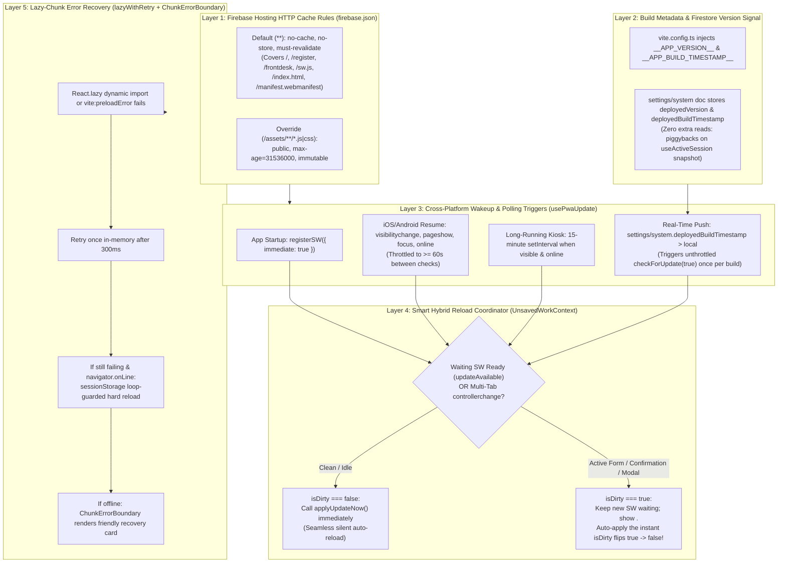

# Cross-Platform PWA Update & Version Synchronization Mechanism (Issue #18)

## 0. Problem Statement & Root-Cause Diagnosis

During a monthly Repair Café session, 5 physical stations operate concurrently across heterogeneous hardware and operating systems:
1. **Station 1 (`/register`):** Public visitors scanning the entrance QR code on personal iOS Safari and Android Chrome browsers, plus the entrance check-in tablet.
2. **Station 2 (`/frontdesk`):** Organisers on desktop/laptop browsers (Chrome, Edge, Safari) or tablets managing card assignment, volunteer attendance, and checkout.
3. **Station 3 (`/pat`):** Electrical safety testers using tablets (often installed as a standalone Home Screen PWA).
4. **Station 4 (`/fixer`):** Volunteer repairers using tablets or mobile phones (browser or standalone PWA).
5. **Station 5 (`/reports`):** Public and organiser analytics viewing.

### Why Clients Currently Get Stuck on Stale Versions
An audit of the repository identified **five root causes** that prevent updates from propagating reliably across Web, iOS/iPadOS, and Android:

1. **1-Year Immutable HTTP Caching of `/sw.js` in `firebase.json` (Critical Bug):**
   In `firebase.json` (lines 25–34), `"source": "**/*.@(js|css)"` sets `Cache-Control: max-age=31536000` (1 year). Because Vite outputs `/sw.js`, `/registerSW.js`, and `/workbox-*.js` at the root of `dist/` with `.js` extensions (while hashed application bundles live under `dist/assets/*.js`), Firebase Hosting serves `/sw.js` with a 1-year browser and CDN cache header. Furthermore, Firebase Hosting matches `headers` globs against the **incoming request URL path** (before `rewrites`), meaning SPA entry routes like `/`, `/register`, `/frontdesk`, `/pat`, `/fixer`, and `/reports` currently fall back to Firebase Hosting's default 1-hour CDN cache.
2. **Missing Service Worker Registration & Lifecycle Binding (`vite.config.ts` & `src/`):**
   `vite.config.ts` sets `registerType: 'autoUpdate'`, which generates `dist/registerSW.js`, yet `virtual:pwa-register` is never imported anywhere in `src/`. No `controllerchange` listener is bound to reload the client, and no periodic or visibility-based `registration.update()` checks ever run after initial page load.
3. **Unhandled Lazy-Chunk 404s After Redeployment (`src/App.tsx`):**
   `src/App.tsx` (lines 13–29) lazy-loads all 5 station views via raw `React.lazy(() => import(...))`. When a new build is deployed and Workbox purges outdated precaches, any open client that navigates to a station route it has not visited yet requests the old content-hashed chunk (`/assets/PatStationView-<oldhash>.js`), which fails with `TypeError: Failed to fetch dynamically imported module` and leaves the screen blank.
4. **iOS / iPadOS WebKit & Android WebAPK Standalone Freeze Behavior:**
   Installed Home Screen PWAs on iOS/iPadOS and Android do not reload when users switch apps or lock the tablet screen—the OS freezes the WebView in memory. Resuming the app fires `visibilitychange` (`document.visibilityState === 'visible'`), `pageshow`, `focus`, and `online`, none of which are currently wired to `registration.update()`. Furthermore, `index.html` and `vite.config.ts` lack PNG icons (`apple-touch-icon.png`, `192x192`, `512x512`) and Apple standalone meta tags required for proper iOS Home Screen installation.
5. **Risk of Mid-Form Data Loss on Volunteer & Visitor Screens:**
   Stations 1, 2, 3, and 4 hold unsaved work in React `useState` (visitor registration inputs and post-submit `REF-XXXX` confirmation tokens, PAT safety test measurements and post-submit routing banners, fixer diagnosis notes, and Front Desk modals). An unconditional `window.location.reload()` mid-entry would wipe unsaved inputs or erase critical post-submit confirmation/routing screens.

---

## 1. Technical Implementation Plan

### 1.1 High-Level Architecture: 5-Layer Defense-in-Depth



### 1.2 Layer 1: Firebase Hosting HTTP Cache-Control (`firebase.json`)
- **Why:** Service Worker updates only work if the browser and CDN never serve stale copies of `/sw.js`, `/workbox-*.js`, `/index.html`, `/manifest.webmanifest`, or any rewritten SPA route (`/`, `/register`, `/frontdesk`, `/pat`, `/fixer`, `/reports`).
- **Rule Ordering in `firebase.json`:**
  In Firebase Hosting, `headers` rules are evaluated in order against the **request URL path** (prior to `rewrites`), and later rules override earlier rules for the same header key:
  1. **`"source": "**"` (Default Rule for All Routes & Root Files):**
     - `Cross-Origin-Opener-Policy: same-origin-allow-popups`
     - `Cache-Control: no-cache, no-store, must-revalidate`
     - This ensures `/`, `/register`, `/frontdesk`, `/pat`, `/fixer`, `/reports`, `/index.html`, `/sw.js`, `/registerSW.js`, `/workbox-*.js`, and `/manifest.webmanifest` are **never** cached at the Firebase CDN edge or browser HTTP cache.
  2. **`"source": "/assets/**/*.@(js|css)"` (Override for Content-Hashed Bundles):**
     - `Cache-Control: public, max-age=31536000, immutable`
     - Safely caches Vite's content-hashed JS/CSS bundles in `/assets/` for 1 year.

### 1.3 Layer 2: `vite.config.ts` Build Metadata, Workbox Prompt Mode, & iOS/Android PWA Assets
1. **Compile-Time Build Constants (`vite.config.ts` & `src/vite-env.d.ts`):**
   - Read `version` from `package.json` and the short git commit SHA (via `child_process.execSync('git rev-parse --short HEAD')` with a safe fallback to `'local'` if git is unavailable) to define:
     - `__APP_VERSION__: JSON.stringify("${pkg.version}+${gitSha}")` (e.g., `"0.1.0+3a5f2b1"`)
     - `__APP_BUILD_TIMESTAMP__: JSON.stringify(Date.now())`
   - Declare `__APP_VERSION__`, `__APP_BUILD_TIMESTAMP__`, and `declare module 'virtual:pwa-register'` in `src/vite-env.d.ts`.
   - Keep `vite.config.ts` outside `tsconfig.json`'s `"include": ["src", "tests"]` array so `tsc` does not require `@types/node`.
2. **Workbox Lifecycle Control (`registerType: 'prompt'` without `clientsClaim`):**
   - Switch `VitePWA` in `vite.config.ts` from `registerType: 'autoUpdate'` to `registerType: 'prompt'` with `injectRegister: null`.
   - **Critical `vite-plugin-pwa` Rule:** In `workbox: { ... }`, configure `globPatterns: ['**/*.{js,css,html,svg,png,md}']` and `cleanupOutdatedCaches: true`, and **do NOT set `clientsClaim: true` or `skipWaiting: true`**. In `vite-plugin-pwa`'s `generateSW` mode, setting `workbox.clientsClaim: true` or `workbox.skipWaiting: true` suppresses automatic injection of the `self.addEventListener('message', (event) => { if (event.data && event.data.type === 'SKIP_WAITING') self.skipWaiting(); })` listener into `sw.js`, which would break `updateServiceWorker(true)`.
   - By keeping the newly installed Service Worker in the `waiting` state until `usePwaUpdate` calls `updateServiceWorker(true)`, the old precache is **not** evicted while a volunteer is mid-form, AND when the station is idle (`isDirty === false`), `usePwaUpdate` immediately calls `updateServiceWorker(true)` for a seamless automatic reload.
3. **iOS / Android Standalone PWA Icons & Meta Tags (`public/` & `index.html`):**
   - Provide `public/apple-touch-icon.png` (180×180), `public/pwa-192x192.png` (192×192), and `public/pwa-512x512.png` (512×512), and reference them in `vite.config.ts` (`includeAssets` and separate `purpose: 'any'` and `purpose: 'maskable'` entries in `manifest.icons` per W3C Web App Manifest / Lighthouse best practices) and `index.html` (`<link rel="apple-touch-icon">`, `<meta name="apple-mobile-web-app-capable" content="yes">`, `<meta name="mobile-web-app-capable" content="yes">`, `<meta name="apple-mobile-web-app-status-bar-style" content="default">`, `<meta name="apple-mobile-web-app-title" content="Sutton Repair Café">`).

### 1.4 Layer 3 & Layer 4: Cross-Platform Detection & Smart Hybrid Reload Coordinator

#### 1.4.1 Pure Update & Version Comparison Service (`src/services/pwaUpdateService.ts`)
To ensure 100% deterministic unit testing in Vitest's Node environment (`npm test`), all version comparison, throttling, loop-prevention, and publish eligibility rules are implemented as pure functions in `src/services/pwaUpdateService.ts`:
- `UPDATE_CHECK_THROTTLE_MS = 60_000` (60 seconds minimum between visibility/focus update checks).
- `UPDATE_POLL_INTERVAL_MS = 15 * 60_000` (15 minutes periodic timer for active kiosk tablets).
- `RELOAD_LOOP_GUARD_MS = 30_000` (30 seconds minimum between automatic reloads, persisted in `sessionStorage` under key `'rcm_last_auto_reload_ts'`, to guarantee the app can never enter an infinite reload loop).
- `shouldThrottleUpdateCheck(lastCheckMs: number, nowMs: number, force?: boolean): boolean`
- `isRemoteVersionNewer(localVersion: string, localBuildTimestamp: number, remoteSettings?: SystemSettings | null): { isNewer: boolean; isBelowMinVersion: boolean; remoteVersion?: string; remoteBuildTimestamp?: number }`
  - Compares `remoteSettings.deployedBuildTimestamp > localBuildTimestamp` (with a 5-second tolerance window for clock skew during build/publish) or `remoteSettings.deployedVersion !== localVersion` when `remoteSettings.deployedBuildTimestamp >= localBuildTimestamp`.
  - Also evaluates optional `remoteSettings.minSupportedVersion` using semver comparison (`compareSemver(localBaseSemver, minSupportedVersion) < 0`).
- `shouldPublishAppVersion(localVersion: string, localBuildTimestamp: number, remoteSettings?: SystemSettings | null, isDev?: boolean): boolean`
  - Returns `false` whenever `isDev` is `true` (defaulting to `Boolean(import.meta.env?.DEV)`) so running `vite dev` locally never overwrites production `settings/system` with a local timestamp.
  - Returns `true` when an authenticated admin client is running a newer build (`localBuildTimestamp > (remoteSettings?.deployedBuildTimestamp ?? 0)` or `remoteSettings?.deployedVersion !== localVersion && localBuildTimestamp >= (remoteSettings?.deployedBuildTimestamp ?? 0)`).
- `canAttemptSafeReload(lastReloadTimestampRaw: string | null, nowMs: number, cooldownMs?: number): boolean`
  - Prevents back-to-back reload loops within `RELOAD_LOOP_GUARD_MS` (30s).

#### 1.4.2 Unsaved Work Guard Context (`src/context/UnsavedWorkContext.tsx`)
A lightweight React Context tracks whether any mounted station view or modal currently has unsaved user input or an active post-submit confirmation/routing banner:
- Exposes `useUnsavedWork()` returning `{ isDirty: boolean; setDirtyWork: (id: string, dirty: boolean) => void }` and a convenience hook `useRegisterUnsavedWork(isDirty: boolean, id?: string)` (which uses `React.useId()` when `id` is omitted and automatically clears `setDirtyWork(resolvedId, false)` on unmount).
- **Station & Modal Dirty Expressions:**
  - **Station 1 (`src/views/CustomerRegisterView.tsx`):**
    ```ts
    const isDirty =
      submitting ||
      submissionResult !== null ||
      Boolean(firstName.trim()) ||
      Boolean(contactPhone.trim()) ||
      items.some((i) => Boolean(i.brandModel.trim()) || Boolean(i.faultDescription.trim())) ||
      agreedToTerms;
    ```
    *Note:* Keeping `submissionResult !== null` protected ensures the visitor's `REF-XXXX` confirmation screen is never wiped by an auto-reload before they show it to the Front Desk or click "Register Another Item".
  - **Station 2 (`src/views/FrontDeskView.tsx`, `SessionAttendanceBar.tsx`, `VolunteerRegisterPanel.tsx`):**
    - `FrontDeskView.tsx`: `showNewSessionModal || creatingSession || selectedRepairId !== null || contactModalData !== null || showPoliciesModal || Boolean(searchTerm.trim()) || isFinalizing`
    - `SessionAttendanceBar.tsx`: `showAttendanceModal || savingAttendance || Boolean(emergencyVolunteer) || loadingEmergency`
    - `VolunteerRegisterPanel.tsx`: `showFormModal || saving || Boolean(selectedEmergencyVolunteer)`
  - **Station 3 (`src/views/PatStationView.tsx`):**
    ```ts
    const isDirty =
      currentItem !== null ||
      submittingTest ||
      searching ||
      Boolean(searchCardNumber.trim()) ||
      Boolean(successBanner) ||
      showPoliciesModal;
    ```
  - **Station 4 (`src/views/FixerStationView.tsx`):**
    ```ts
    const isDirty =
      currentItem !== null ||
      submittingRepair ||
      searching ||
      Boolean(searchCardNumber.trim()) ||
      Boolean(successBanner) ||
      showPoliciesModal;
    ```
  - **Station PIN Modal (`src/components/common/PinModal.tsx`):**
    ```ts
    useRegisterUnsavedWork(isOpen && (pin.length > 0 || submitting), 'pin-modal');
    ```
  - **Station 5 (`src/views/ReportsView.tsx`):** Read-only analytics; `isDirty` is always `false`.

#### 1.4.3 Cross-Platform Update Hook (`src/hooks/usePwaUpdate.ts`) & Listener Leak Fix (`src/hooks/useActiveSession.ts`)
1. **Fix Pre-Existing Listener Leak in `src/hooks/useActiveSession.ts`:**
   - Currently, `useActiveSession.ts` returns `() => unsubSession()` inside the `onSnapshot(doc(db, 'settings', 'system'), ...)` callback, which Firestore ignores—causing a leaked `sessions/{id}` listener every time `settings/system` updates.
   - Refactor `useActiveSession.ts` to maintain `let unsubSession: (() => void) | null = null` in the `useEffect` closure, clean up `if (unsubSession) { unsubSession(); unsubSession = null; }` before subscribing to a session, and unsubscribe both `unsubSettings()` and `unsubSession?.()` on unmount. Also expose `systemSettings: SystemSettings | null` alongside `{ session, allowRegistration, systemSettings, loading, error }`.
2. **Lifecycle & Multi-Tab Coordination in `src/hooks/usePwaUpdate.ts`:**
   - **Service Worker Registration:** Calls `registerSW({ immediate: true, onNeedRefresh, onRegisteredSW, onRegisterError })` from `virtual:pwa-register`.
   - **Cache-Busting Update Check (`checkForUpdate(force?: boolean)`):**
     - Respects `shouldThrottleUpdateCheck` unless `force === true`.
     - Follows the official `vite-plugin-pwa` pattern: when `navigator.onLine` is true, fetches `swScriptUrl` with `{ cache: 'no-store', headers: { cache: 'no-store', 'cache-control': 'no-cache' } }` before calling `await registration.update()`.
   - **Wakeup & Polling Listeners (Web, iOS Standalone, Android WebAPK):**
     - `document.addEventListener('visibilitychange', ...)` when `document.visibilityState === 'visible'`
     - `window.addEventListener('pageshow', ...)`
     - `window.addEventListener('focus', ...)`
     - `window.addEventListener('online', ...)`
     - `setInterval` every 15 minutes when `document.visibilityState === 'visible'` and `navigator.onLine`
   - **Multi-Tab `controllerchange` Handling:**
     - Tracks whether the page had an initial `navigator.serviceWorker.controller` at mount time (`hadControllerRef`).
     - Listens to `navigator.serviceWorker.addEventListener('controllerchange', ...)`. If another open tab calls `SKIP_WAITING`, `registration.waiting` becomes `null` in this tab and `controllerchange` fires.
     - If `controllerchange` fires when `hadControllerRef.current === true`:
       - Sets `hasControllerChangedRef.current = true` and `setUpdateAvailable(true)`.
       - If `!isDirty`, immediately triggers a `canAttemptSafeReload`-guarded `window.location.reload()`.
       - If `isDirty`, holds the reload until `isDirty` becomes `false` or the user clicks "Update Now".
   - **Applying the Update (`applyUpdateNow()`):**
     - Records `sessionStorage.setItem(RELOAD_STORAGE_KEY, String(Date.now()))`.
     - If `registrationRef.current?.waiting` exists, calls `updateServiceWorker(true)` and sets a 1500ms fallback timer that calls `window.location.reload()` in case `controllerchange` does not fire.
     - If `registrationRef.current?.waiting` is `null` (e.g., another tab already activated the new SW or SW is unsupported), calls `window.location.reload()` directly.
   - **Firestore `settings/system` Version Signal Integration (`Zero Extra Reads`):**
     - Consumes `systemSettings` from `useActiveSession()`.
     - When `isRemoteVersionNewer(__APP_VERSION__, __APP_BUILD_TIMESTAMP__, systemSettings)` returns `isNewer: true`:
       - Sets `isMandatoryUpdate = isBelowMinVersion`.
       - Checks `lastCheckedRemoteVersionRef.current !== "${remoteVersion}_${remoteBuildTimestamp}"`. If not yet checked for this remote build and `!updateAvailable`, immediately triggers an unthrottled `checkForUpdate(true)`.
       - **Crucial Safeguard:** Never reloads or shows `<UpdateBanner />` on `isRemoteVersionNewer` alone before the new Service Worker has finished installing (`updateAvailable === true`), unless Service Workers are unsupported (`!('serviceWorker' in navigator)`). This prevents premature reload loops while the new SW is still downloading precache assets.
   - **Automatic Version Stamp Publishing (Zero Extra Reads):**
     - When an authenticated organiser (`isAdmin === true`) is on `/frontdesk` (`FrontDeskView.tsx`) and `shouldPublishAppVersion(__APP_VERSION__, __APP_BUILD_TIMESTAMP__, systemSettings)` is `true`, calls `publishAppVersionToSystemSettings()` once (`setDoc(doc(db, 'settings', 'system'), { deployedVersion: __APP_VERSION__, deployedBuildTimestamp: __APP_BUILD_TIMESTAMP__ }, { merge: true })`).
     - Also piggybacks `deployedVersion: __APP_VERSION__` and `deployedBuildTimestamp: __APP_BUILD_TIMESTAMP__` onto existing writes in `syncOrganiserEmailsToSystemSettings()` (`src/services/volunteerService.ts`) and `createSession()` (`src/services/sessionService.ts`) when `!import.meta.env.DEV`.

### 1.5 Layer 5: Resilient Lazy-Chunk Loading (`src/utils/lazyWithRetry.ts` & `src/components/common/ChunkErrorBoundary.tsx`)
1. **`src/utils/lazyWithRetry.ts`:**
   - `isChunkLoadError(error: unknown): boolean`: Detects dynamic import and CSS preload failures (`Failed to fetch dynamically imported module`, `Importing a module script failed` on iOS WebKit, `error loading dynamically imported module`, `Unable to preload CSS`, `ChunkLoadError`).
   - `loadChunkWithRetry<T>(importer: () => Promise<T>, chunkKey?: string, env?: ChunkRetryEnv): Promise<T>`:
     - Attempts `await importer()`.
     - On chunk load error, waits 300ms and retries `await importer()` once in memory.
     - If the retry still fails and `isOnline` is `true`, checks `canAttemptSafeReload` in `sessionStorage` (`'rcm_last_auto_reload_ts'`). If allowed, records the timestamp, calls `reload()` (`window.location.reload()`), and returns a never-resolving promise while the browser navigates so React does not flash an error boundary during reload.
     - If offline or within the 30s reload cooldown, rethrows the error to `ChunkErrorBoundary`.
   - `lazyWithRetry<T extends React.ComponentType<any>>(importer: () => Promise<{ default: T }>, chunkKey?: string): React.LazyExoticComponent<T>`: Wraps `React.lazy(() => loadChunkWithRetry(importer, chunkKey))`.
   - Also attaches a global `window.addEventListener('vite:preloadError', ...)` helper `registerVitePreloadErrorHandler` so Vite sub-chunk / CSS preload 404s trigger the same safe reload / update recovery path.
2. **`src/components/common/ChunkErrorBoundary.tsx`:**
   - Wraps `<Suspense>` in `src/App.tsx`. If a station route chunk fails while offline or after a reload cooldown, renders a clear card ("Station Update Required — Reconnect to Wi-Fi and tap Reload Station") with a **"Reload Station"** button that calls `window.location.reload()`.

### 1.6 Non-Blocking Update Banner & Footer Version Stamp (`src/components/common/UpdateBanner.tsx` & `src/App.tsx`)
- **`<UpdateBanner />`:**
  - Rendered at the top of `src/App.tsx` (below `<OfflineIndicator />`) **only** when `updateAvailable && isDirty` (since when `isDirty === false`, `usePwaUpdate` auto-applies the update immediately).
  - Displays: *"A new version of the app is ready. It will install automatically as soon as you finish this form, or you can update now."* with an **"Update Now"** button (`onClick={applyUpdateNow}`) and a **"Later"** dismiss button (hidden if `isMandatoryUpdate === true`).
  - Also note on `PatStationView` and `FixerStationView`: adding a **"Dismiss"** (`×`) button on the green `successBanner` lets a volunteer dismiss the routing banner once read, which flips `isDirty` from `true` $\rightarrow$ `false` and automatically applies any waiting update!
- **Global Footer Version Badge (`src/App.tsx`):**
  - Displays `v{__APP_VERSION__}` alongside the existing attribution in the global `<footer>` of `src/App.tsx`, with a subtle `"Update ready"` pill button if an update is waiting.

---

## 2. Alternatives Considered & Trade-Offs

| Option | Description | Pros | Cons / Why Rejected |
|---|---|---|---|
| **Option A: Pure `registerType: 'autoUpdate'` (`skipWaiting: true`)** | Immediately activate every new Service Worker and reload `window` on `controllerchange`. | Simplest configuration. | **Rejected:** Causes mid-form data loss if a reload happens while a volunteer is typing PAT/Fixer notes, wiped `REF-XXXX` confirmation tokens, or lazy-chunk 404 crashes if `controllerchange` does not reload. |
| **Option B: Manual Prompt Only (`registerType: 'prompt'`)** | Never reload automatically; always require volunteers to click an "Update" toast. | Zero risk of interrupting forms. | **Rejected:** Volunteers at busy repair stations ignore toast banners, leaving tablets on stale versions all afternoon. |
| **Option C: Smart Hybrid Lifecycle + `settings/system` Version Signal + `lazyWithRetry` (Selected)** | Uses `registerType: 'prompt'` under the hood so the new SW waits while `isDirty === true`, but automatically triggers `updateServiceWorker(true)` when `isDirty === false` (or the instant `isDirty` becomes `false`). Combines `visibilitychange`/`pageshow`/`focus`/`online` checks with `settings/system` version signalling and `lazyWithRetry`. | Zero data loss, zero confirmation-screen loss, zero user friction when idle, instant cross-device propagation, **$0.00/month** (0 extra Firestore reads). | Slightly more state coordination (mitigated by clean separation into `UnsavedWorkContext` and `pwaUpdateService.ts`). |

---

## 3. Detailed Implementation Plan & File Manifest

### 3.1 Build, Hosting & Static Assets
1. **`firebase.json` (Modify):**
   - Set `"source": "**"` headers to include both `Cross-Origin-Opener-Policy: same-origin-allow-popups` and `Cache-Control: no-cache, no-store, must-revalidate` (covering all rewritten SPA entry routes `/`, `/register`, `/frontdesk`, `/pat`, `/fixer`, `/reports` as well as `/index.html`, `/sw.js`, `/registerSW.js`, `/workbox-*.js`, and `/manifest.webmanifest`).
   - Set `"source": "/assets/**/*.@(js|css)"` header to `Cache-Control: public, max-age=31536000, immutable`.
2. **`vite.config.ts` (Modify):**
   - Compute `appVersion` (`${pkg.version}+${gitShortSha}`) and `buildTimestamp` (`Date.now()`).
   - Inject `__APP_VERSION__` and `__APP_BUILD_TIMESTAMP__` via `define`.
   - Set `VitePWA` to `registerType: 'prompt'`, `injectRegister: null`, `includeAssets: ['favicon.svg', 'apple-touch-icon.png', 'pwa-192x192.png', 'pwa-512x512.png']`, `workbox: { globPatterns: ['**/*.{js,css,html,svg,png,md}'], cleanupOutdatedCaches: true }` (omitting `clientsClaim` and `skipWaiting`), and update `manifest.icons` to include `pwa-192x192.png`, `pwa-512x512.png` (`purpose: 'any'`), `pwa-512x512.png` (`purpose: 'maskable'`), and `favicon.svg`.
3. **`index.html` (Modify):**
   - Add `<link rel="apple-touch-icon" sizes="180x180" href="/apple-touch-icon.png" />`, `<meta name="apple-mobile-web-app-capable" content="yes" />`, `<meta name="mobile-web-app-capable" content="yes" />`, `<meta name="apple-mobile-web-app-status-bar-style" content="default" />`, and `<meta name="apple-mobile-web-app-title" content="Sutton Repair Café" />`.
4. **`public/apple-touch-icon.png`, `public/pwa-192x192.png`, `public/pwa-512x512.png` (Create):**
   - Generate crisp emerald-green (`#15803d`) Repair Café wrench PNG icons at 180×180, 192×192, and 512×512.

### 3.2 TypeScript Types & Environment Declarations
5. **`src/vite-env.d.ts` (Modify):**
   - Declare global constants `__APP_VERSION__: string` and `__APP_BUILD_TIMESTAMP__: number` and module `'virtual:pwa-register'`.
6. **`src/types/index.ts` (Modify):**
   - Extend `SystemSettings` with optional fields:
     - `deployedVersion?: string;`
     - `deployedBuildTimestamp?: number;`
     - `minSupportedVersion?: string;`

### 3.3 Core Update Services, Context, & Hooks
7. **`src/services/pwaUpdateService.ts` (Create):**
   - Pure helper functions and constants:
     - `APP_VERSION` (`typeof __APP_VERSION__ !== 'undefined' ? __APP_VERSION__ : '0.0.0-dev'`)
     - `APP_BUILD_TIMESTAMP` (`typeof __APP_BUILD_TIMESTAMP__ !== 'undefined' ? Number(__APP_BUILD_TIMESTAMP__) : 0`)
     - `UPDATE_CHECK_THROTTLE_MS = 60_000`
     - `UPDATE_POLL_INTERVAL_MS = 15 * 60_000`
     - `RELOAD_LOOP_GUARD_MS = 30_000`
     - `RELOAD_STORAGE_KEY = 'rcm_last_auto_reload_ts'`
     - `compareSemver(a: string, b: string): number`
     - `shouldThrottleUpdateCheck(lastCheckMs: number, nowMs: number, force?: boolean): boolean`
     - `isRemoteVersionNewer(localVersion: string, localBuildTimestamp: number, remoteSettings?: SystemSettings | null): RemoteVersionCheckResult`
     - `shouldPublishAppVersion(localVersion: string, localBuildTimestamp: number, remoteSettings?: SystemSettings | null, isDev?: boolean): boolean`
     - `canAttemptSafeReload(lastReloadTimestampRaw: string | null, nowMs: number, cooldownMs?: number): boolean`
8. **`src/utils/lazyWithRetry.ts` (Create):**
   - Export `isChunkLoadError(err: unknown): boolean`, `loadChunkWithRetry<T>(importer: () => Promise<T>, chunkKey?: string, env?: ChunkRetryEnv): Promise<T>`, `lazyWithRetry<T extends React.ComponentType<any>>(importer: () => Promise<{ default: T }>, chunkKey?: string): React.LazyExoticComponent<T>`, and `registerVitePreloadErrorHandler(onPreloadError: () => void): () => void`.
9. **`src/context/UnsavedWorkContext.tsx` (Create):**
   - Export `UnsavedWorkProvider`, `useUnsavedWork()`, and `useRegisterUnsavedWork(isDirty: boolean, id?: string)`.
10. **`src/hooks/useActiveSession.ts` (Modify):**
    - Fix the nested `unsubSession` listener leak by managing `let unsubSession: (() => void) | null = null` inside `useEffect` and cleaning up both `unsubSettings` and `unsubSession` properly.
    - Expose `systemSettings: SystemSettings | null` in the returned state object `{ session, allowRegistration, systemSettings, loading, error }`.
11. **`src/hooks/usePwaUpdate.ts` (Create):**
    - Integrates `registerSW` from `virtual:pwa-register`, `navigator.serviceWorker` `controllerchange` listener, `registerVitePreloadErrorHandler`, visibility/pageshow/focus/online listeners, 15-minute interval timer, `systemSettings` version skew detection (deduplicated per remote build via `lastCheckedRemoteVersionRef`), and `useUnsavedWork().isDirty`.
    - Returns `{ updateAvailable: boolean; isMandatoryUpdate: boolean; isDirty: boolean; appVersion: string; applyUpdateNow: () => Promise<void>; checkForUpdate: (force?: boolean) => Promise<void>; dismissBanner: () => void; bannerDismissed: boolean }`.
12. **`src/services/volunteerService.ts` & `src/services/sessionService.ts` (Modify):**
    - Export `publishAppVersionToSystemSettings(): Promise<void>` in `src/services/sessionService.ts` so authenticated organisers can sync `deployedVersion` and `deployedBuildTimestamp` to `settings/system` with `setDoc(..., { merge: true })`.
    - Piggyback `deployedVersion: APP_VERSION` and `deployedBuildTimestamp: APP_BUILD_TIMESTAMP` (when `!import.meta.env.DEV`) in `syncOrganiserEmailsToSystemSettings()` and `createSession()`.

### 3.4 UI Components & Station Integrations
13. **`src/components/common/UpdateBanner.tsx` (Create):**
    - Accessible banner displayed when `updateAvailable && isDirty && (!bannerDismissed || isMandatoryUpdate)`.
14. **`src/components/common/ChunkErrorBoundary.tsx` (Create):**
    - React Error Boundary catching chunk load errors that could not be auto-reloaded (e.g., while offline) with a "Reload Station" button.
15. **`src/App.tsx` (Modify):**
    - Wrap the app in `<UnsavedWorkProvider>`.
    - Replace raw `React.lazy(...)` imports for the 5 views with `lazyWithRetry(...)`.
    - Wrap `<Suspense>` in `<ChunkErrorBoundary>`.
    - Render `<UpdateBanner />` below `<OfflineIndicator />`.
    - Render `v{appVersion}` in the global `<footer>`.
16. **Station Views & Modal Components (Modify to call `useRegisterUnsavedWork`):**
    - `src/views/CustomerRegisterView.tsx`
    - `src/views/FrontDeskView.tsx` (plus automatic admin version publish when `isAdmin && shouldPublishAppVersion(APP_VERSION, APP_BUILD_TIMESTAMP, systemSettings)`)
    - `src/components/frontdesk/SessionAttendanceBar.tsx`
    - `src/components/frontdesk/VolunteerRegisterPanel.tsx`
    - `src/views/PatStationView.tsx` (plus dismiss button on `successBanner`)
    - `src/views/FixerStationView.tsx` (plus dismiss button on `successBanner`)
    - `src/components/common/PinModal.tsx`

### 3.5 Unit Tests
17. **`tests/pwaUpdateService.test.ts` (Create):**
    - Comprehensive Vitest unit tests covering:
      - `compareSemver` and `isRemoteVersionNewer` (newer timestamp, same timestamp + different version, clock skew tolerance, `minSupportedVersion` breach).
      - `shouldPublishAppVersion` (empty remote settings, older remote timestamp, up-to-date remote settings, `isDev = true` suppression).
      - `shouldThrottleUpdateCheck` (within 60s window, after 60s window, `force = true` bypass).
      - `canAttemptSafeReload` (null storage, expired cooldown, active cooldown loop prevention).
      - `isChunkLoadError` and `loadChunkWithRetry` (Chrome/Safari/Firefox dynamic import and CSS preload error messages, in-memory retry success on transient failure, online safe-reload trigger, reload cooldown loop guard, offline error rethrow).
