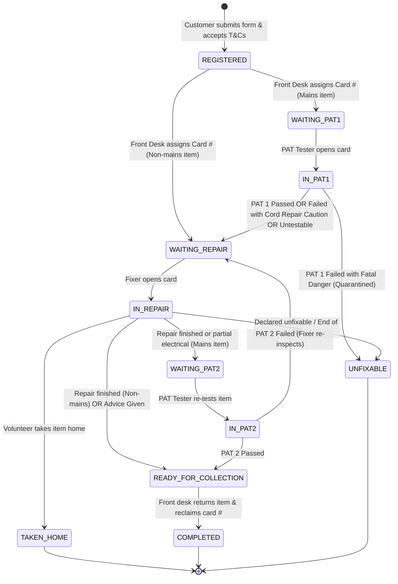

# Design Document: Repair Cafe Session Management System

## Section 0: Problem Statement in Plain English

### 0.1 Context & Background
Repair Cafes (such as Sutton Repair Cafe operating out of Seears Park) are community-driven, non-profit initiatives where local residents bring broken household items—small appliances, electronics, clothing, bicycles, and homewares—to be repaired alongside skilled volunteer "fixers." These events run on a recurring monthly cadence, staffed entirely by volunteers with no fixed organizational income. Their mission is twofold: diverting waste from landfills to reduce environmental impact and reviving practical repair skills within the community.

Other independent repair cafes across the UK and internationally operate under very similar models, but with separate organizing committees and zero shared budgets.

### 0.2 The Existing Toolchain & Operational Pain Points
The current operational workflow relies on a loose assembly of consumer cloud tools: Google Forms for customer registration and volunteer repair logs, a shared Google Sheet for front desk queue coordination, and Google Looker Studio (formerly Data Studio) for monthly reporting dashboards. While free to run, this setup introduces severe operational friction during high-energy, crowded sessions:

1. **Disconnected, Multi-Form Bottlenecks:** When a visitor arrives, they fill out an initial registration form. The front desk must manually match that submission in a spreadsheet, assign a physical numbered token card (e.g., #1 through #50), and track its progress. Later, the volunteer fixer fills out a completely separate Google Form, re-entering the card number. Mismatches, typos, and out-of-sync sheet rows are frequent.
2. **Reused Token Collision:** The physical numbered cards given to visitors are reused every month to avoid ongoing printing and stationery costs. Because card numbers are not globally unique, tracking them in standard flat spreadsheets across multiple months inevitably leads to accidental overwrites or historical data pollution unless organizers manually create new tabs every session.
3. **The Non-Linear Electrical / PAT Testing Safety Gate:** Mains-powered appliances present serious safety and liability risks. In accordance with safety standards, any mains device must undergo Portable Appliance Testing (PAT) *twice*: first before a volunteer fixer handles it (to check earth continuity and identify hazardous faults), and second after the repair is completed (to certify that the item is safe to return to the public). In a spreadsheet or standard form, there is no enforcement mechanism to prevent an un-tested mains appliance from bypassing the initial PAT tester, nor to prevent an item from being handed back to a customer without a passing post-repair PAT certificate.
4. **Failure Modes & Cord Repairs:** Many items brought to a repair cafe fail their initial PAT test precisely *because* their power cord is frayed or the plug is broken. Rejecting them outright would defeat the cafe's purpose. However, fixers need clear, immediate visibility into *why* an item failed PAT 1 (e.g., "Insulation failure due to split outer sheath") and strict safety protocols to ensure they never energize hazardous items with live mains voltage before repairing the safety fault.
5. **Volunteer Privacy & Digital Literacy:** Repair volunteers range widely in digital experience. Forcing volunteers to create accounts, memorize passwords, or deal with multi-factor authentication creates immediate resistance and often causes them to abandon digital logging altogether. Furthermore, displaying a public drop-down menu of all registered volunteer names risks leaking personal volunteer names to visitors or unauthenticated users.
6. **GDPR & PII Lifecycle Drift:** To comply with UK GDPR and data protection principles, customer contact details (such as phone numbers or first names collected for on-day queue notifications) must only be kept for the duration of the event. Currently, contact information remains indefinitely in old Google Sheets and form responses because there is no automated redaction or archiving process. Furthermore, customer phone numbers must never be broadcast across volunteer screens where they are not needed.
7. **Spotty Venue Connectivity:** Venues such as park pavilions and community halls frequently suffer from poor cellular reception and saturated, unreliable Wi-Fi. A purely cloud-dependent web application that freezes or drops input when connection flickers causes immediate queue paralysis.
8. **Informal "Taken Home" Arrangements:** In cases where an item cannot be finished during a 2-hour window, a volunteer may offer to take the item home to complete the fix. This creates an informal agreement directly between the volunteer and the customer, which falls outside the Repair Cafe's insurance and organizational custody. The system must explicitly record this handoff and release the cafe from custody without leaving the item stranded in the active queue.
9. **Single-Tenant Open-Source Portability:** To allow other independent repair cafes to benefit without sharing infrastructure or risking cross-tenant billing liability, the codebase must be designed for single-tenant, fork-and-deploy usage. Each cafe must be able to deploy their own independent Firebase instance at zero cost, configured with their own branding, logo, and legal Terms & Conditions.

### 0.3 The Objective
The goal is to design and build an integrated, touch-friendly, offline-resilient web application (PWA) backed by Google Firebase that replaces Google Forms, Google Sheets, and Looker Studio. The solution must:
- Operate permanently at **zero monetary cost** by running strictly within Google Cloud/Firebase free tier limits, protected by architectural read optimizations and budget alerts.
- Support **single-tenant deployment via GitHub clone/fork**, allowing any repair cafe to deploy their own isolated Firebase backend with their own branding, logo, and mandatory Terms & Conditions acceptance.
- Unify customer check-in, front desk token triage, PAT testing workflows, and volunteer repair logging into a single cohesive system.
- Enforce the mandatory pre- and post-repair PAT testing safety gates for all mains-powered devices, with clear isolation between cord repairs and un-energizable hazards.
- Provide real-time queue visibility for front desk organizers while remaining 100% offline-capable when local venue Wi-Fi drops.
- Automatically scrub customer PII upon session close while preserving anonymous item telemetry, repair outcomes, and diverted waste weights for long-term historical reporting.

---

## Section 1: Technical Implementation Plan

### 1.1 High-Level Architecture & Single-Tenant Deployment
The system is built as a single-tenant, open-source **Progressive Web App (PWA)** backed by **Google Firebase**. Each repair cafe organization deploys its own isolated Firebase project from the GitHub repository, eliminating any possibility of cross-organization data leakage or shared billing liabilities.

```
┌──────────────────────────────────────────────────────────────────────────────────┐
│                         CLIENT TIER (PWA IN BROWSER)                             │
│                                                                                  │
│   ┌────────────────┐ ┌────────────────┐ ┌────────────────┐ ┌──────────────────┐  │
│   │ Customer View  │ │   PAT Station  │ │  Fixer Station │ │ Front Desk Board │  │
│   │ (/register)    │ │   (/pat)       │ │  (/fixer)      │ │ (/desk)          │  │
│   │ - Public Form  │ │ - Class I/II   │ │ - Card Lookup  │ │ - Google Auth    │  │
│   │ - T&C Consent  │ │ - Station PIN  │ │ - Station PIN  │ │ - Card # Assign  │  │
│   │ - 1-Time Read  │ │ - Safety Alerts│ │ - Outcomes/Log │ │ - Session Close  │  │
│   └───────┬────────┘ └───────┬────────┘ └───────┬────────┘ └────────┬─────────┘  │
│           │                  │                  │                   │            │
│           ▼                  ▼                  ▼                   ▼            │
│   ┌──────────────────────────────────────────────────────────────────────────┐  │
│   │       LOCAL PERSISTENCE ENGINE (Service Worker & IndexedDB Cache)        │  │
│   │       Enables 100% offline functionality during venue Wi-Fi drops        │  │
│   │       Zero Customer PII Cached on Volunteer Devices                      │  │
│   └─────────────────────────────────────┬────────────────────────────────────┘  │
└─────────────────────────────────────────┼────────────────────────────────────────┘
                                          │ Scoped Sync
                                          ▼
┌──────────────────────────────────────────────────────────────────────────────────┐
│                     ISOLATED FIREBASE INSTANCE (PER CAFE)                        │
│                                                                                  │
│   ┌───────────────────────┐  ┌──────────────────────┐  ┌─────────────────────┐  │
│   │    Firebase Auth      │  │   Cloud Firestore    │  │  Cloud Functions    │  │
│   │ Google Sign-In (Desk) │  │ PII in Subcollection │  │ - PIN Auth Minting  │  │
│   │ PIN Auth (Volunteers) │  │ /private/customer    │  │ - GDPR Auto-Scrubber│  │
│   └───────────────────────┘  └──────────────────────┘  └─────────────────────┘  │
│   ┌──────────────────────────────────────────────────────────────────────────┐  │
│   │  GCP Billing & Read Optimization: Single-item reads + £1.00 budget alerts │  │
│   └──────────────────────────────────────────────────────────────────────────┘  │
└──────────────────────────────────────────────────────────────────────────────────┘
```

### 1.2 Configuration & Cafe Branding
Each deployed instance reads its identity from a central, clean configuration file (`src/config/cafe.config.ts`):
* `cafeName`: e.g., "Sutton Repair Café"
* `tagline`: e.g., "Fixing things together in Seears Park"
* `logoUrl`: Path to cafe logo image or inline SVG.
* `primaryColor` / `accentColor`: Theme styling applied dynamically via Tailwind/CSS variables.
* `termsAndConditions`: Relative path (e.g., `"/terms.md"`) or external URL to a Markdown document specifying the cafe's specific legal disclaimer, house rules, safety policies, and limitation of liability.
* `contactEmail` & `websiteUrl`: External links for volunteer coordination and public info.
* `defaultCardRange`: Configurable physical token range (e.g., 1 to 100, expandable during live sessions).
* `allowMultiItemRegistration`: Boolean flag (`true` | `false`). Controls whether a customer can register multiple items in a single check-in submission. Default is `false` for Sutton Repair Cafe to ensure queue fairness among visitors; other independent cafes can enable (`true`) if permitted by their local queue policy.

### 1.3 User Interfaces & Role Flows

#### 1. Customer Self-Registration (`/register` — Public)
* Loaded via QR code on posters or at an entrance tablet.
* **Fields:** First Name, Contact Mobile (optional, strictly for on-day collection), Item Category, Brand & Model, Fault Description, Power Type (*Mains 240V*, *Battery / Low Voltage*, *Mechanical / Non-Powered*, *Clothing / Fabric*, *Other*).
* **Multi-Item Configuration & Queue Fairness:** Governed by `cafe.config.ts.allowMultiItemRegistration`:
  - When disabled (`false`, Sutton Repair Cafe default): The registration form strictly restricts visitors to registering **one item per check-in** to guarantee fairness in the queue (`1 item = 1 check-in = 1 token card`).
  - When enabled (`true`): Allows checking in multiple items (1 to 4 items) under a single `registrationId` for cafes that permit multi-item batching.
* **Terms & Conditions Acceptance:** Customers must view the cafe's specific Terms & Conditions and check a mandatory box.
* **Confirmation Screen (Read-Optimized):** Displays a short alphanumeric reference code (e.g., `REF-A38F`) via a one-time read (`getDoc`), avoiding recurring snapshot read quotas.

#### 2. Front Desk Operations Board (`/desk` — Authenticated via Google Sign-In)
* **Session Management:** Creates the active session, sets the 4-digit daily volunteer PIN, and designates the system active session in `settings/system`.
* **Triage & Card Assignment:** Links `referenceToken` registrations to physical token cards (#1..#N).
  - Automatically flags mains devices for `WAITING_PAT1`.
  - Routes non-mains devices to `WAITING_REPAIR`.
  - **Offline Device Partitioning:** When offline, individual tablets use pre-configured card ranges (Tablet A: 1–50, Tablet B: 51–100) to eliminate split-brain overwrites.
* **Live Status Board:** Maintains a real-time Firestore collection listener (`onSnapshot`) for active queue visibility.
* **Checkout & Completion:** Confirms item collection, retrieves the physical card token, and marks the item `COMPLETED`.
* **Session Finalization:** Triggers the backend `finalizeSession` Cloud Function to scrub PII and compile analytics.

#### 3. PAT Testing Station (`/pat` — Authenticated via Session Volunteer PIN)
* **Authentication:** Volunteers enter the 4-digit daily session PIN. A Cloud Function (`verifyVolunteerPin`) mints a Firebase custom auth token with claim `{ role: 'volunteer' }`, securing Firestore rules without requiring personal volunteer accounts.
* **Class-Adaptive Form:**
  - Logs PAT tester instrument serial number and calibration expiry date once per session.
  - **Visual & Fuse Rating:** Mandatory check of plug integrity, flex cord grip, and plug fuse rating (3A vs 5A vs 13A per BS 1363).
  - **Class I (Earthed Chassis):** Requires Earth Continuity ($\le 0.1\,\Omega + \text{cord}$) and selectable test voltage (250V vs 500V DC) for Insulation Resistance ($\ge 1.0\,\text{M}\Omega$).
  - **Class II (Double Insulated):** Visual check + Insulation Resistance ($\ge 2.0\,\text{M}\Omega$).
  - **Leads & Adapters:** Continuity, polarity, and insulation.
* **Safety Classifications & Outcomes:**
  - `PASS`: Moves item to `WAITING_REPAIR`.
  - `FAIL_REPAIRABLE_CORD`: Tester notes cord damage; moves item to `WAITING_REPAIR` with an **Amber Caution Banner** (de-energized repair only).
  - `DANGER_DO_NOT_ENERGIZE`: Severe internal fault/short; moves item to `UNFIXABLE` (quarantined; cannot be energized).
  - `UNTESTABLE`: Item cannot be safely connected (e.g., missing proprietary power brick or raw wires); moves to `WAITING_REPAIR` with inspection notes.
* **PAT 2 (Post-Repair):** Mains items must be re-tested after repair. Moves item to `READY_FOR_COLLECTION` on pass, or returns to `WAITING_REPAIR` on fail.

#### 4. Volunteer Fixer Station (`/fixer` — Authenticated via Session Volunteer PIN)
* Authenticated using the daily PIN (`role: 'volunteer'`).
* Card search point-query (`getDoc`) by Card Number (#1..#N).
* Fixer enters first name (stored in browser `localStorage`).
* Displays high-visibility safety alert banners if PAT 1 failed or required caution.
* **Outcome Recording & State Mapping:**
  - `FIXED` (Mains) $\rightarrow$ `WAITING_PAT2`
  - `FIXED` (Non-mains) $\rightarrow$ `READY_FOR_COLLECTION`
  - `PARTIAL` (Mains) $\rightarrow$ `WAITING_PAT2` (if electrical work done) or `READY_FOR_COLLECTION` (if advice/mechanical only)
  - `ADVICE_GIVEN` $\rightarrow$ `READY_FOR_COLLECTION`
  - `UNFIXABLE` $\rightarrow$ `UNFIXABLE`
  - `TAKEN_HOME` $\rightarrow$ `TAKEN_HOME` (logs volunteer name and releases cafe custody)
* **Repair Metrics & Logging:** Records diagnosis, repair notes, parts used, item weight in kg, and **repair time in minutes** (`repairTimeMinutes`, e.g., 15, 30, 45, 60 min) via a quick single-tap selector or numeric input, avoiding the need for volunteers to track or supply separate start and end timestamps.

#### 5. Reporting & Community Impact Dashboard (`/reports` — Authenticated)
* Replaces Looker Studio with zero recurring fees.
* Renders real-time metrics across past sessions: success rate (%), total weight diverted (kg), category distributions, and CSV export.

---

### 1.4 Item Lifecycle State Machine



---

### 1.5 Data Protection & PII Isolation Architecture

To comply with UK GDPR and ensure zero data leakage:

```
Firestore Document Hierarchy:
sessions/{sessionId}/repairs/{repairId}
├── cardNumber: 12
├── referenceToken: "REF-A38F"
├── registrationId: "REG-9912"
├── item: { category: "ELECTRICAL", makeModel: "Dualit Toaster", ... }
├── status: "IN_REPAIR"
├── patInitial: { visualPass: true, fuseRatingAmps: 13, outcome: "PASS" }
└── private/customer                       <--- ISOLATED SUBCOLLECTION
    ├── firstName: "David"                 (Accessible ONLY to Admin / Front Desk)
    ├── contactPhone: "07987654321"        (Purged to "[REDACTED]" on finalize)
    └── agreedToTerms: true
```

* **Zero Volunteer PII Exposure:** Volunteer devices authenticated with `role: 'volunteer'` **never query or receive** `private/customer`. Customer contact information is never cached on volunteer hardware.
* **Automated Cloud Purge:** On session closure, Cloud Function `finalizeSession` scrubs `firstName` and `contactPhone` in `private/customer` to `"[REDACTED]"`.
* **Front Desk Cache Clearance:** Upon session finalization, the Front Desk application explicitly terminates Firestore and clears IndexedDB persistence to eliminate local snapshots.

---

## Section 2: Alternatives Considered & Ruled Out

### 2.1 Multi-Tenant SaaS vs. Single-Tenant Open-Source Repository
* **Considered:** Building a shared multi-tenant SaaS.
* **Ruled Out:** Cross-tenant liability, shared billing risks, and privacy exposure. Single-tenant fork-and-deploy ensures complete isolation and zero shared cost.

### 2.2 Unauthenticated Public Stations vs. Daily Session PIN Auth Token
* **Considered:** Open unauthenticated `/pat` and `/fixer` endpoints.
* **Ruled Out:** Allows visitors or malicious actors on venue Wi-Fi to tamper with records or falsify safety passes.
* **Selected Decision:** A Cloud Function verifies a daily 4-digit PIN and mints a Firebase Auth token with `{ role: 'volunteer' }`. This provides cryptographic rule validation with zero volunteer account overhead.

### 2.3 Global Real-Time Listeners vs. Targeted Point Queries
* **Considered:** Attaching `onSnapshot` real-time listeners across all devices.
* **Ruled Out:** 50 customer phones + 20 volunteer tablets listening simultaneously threatens the 50k reads/day free tier quota.
* **Selected Decision:** Only the Front Desk board uses a live collection query. Customer confirmations and Volunteer lookups use targeted one-time reads (`getDoc`).

---

## Section 3: Detailed Implementation Plan & File Manifest

### 3.1 Technology Stack & Dependencies

#### Frontend Dependencies (`package.json`)
```json
{
  "name": "repair-cafe-manager",
  "version": "1.0.0",
  "type": "module",
  "scripts": {
    "dev": "vite",
    "build": "tsc && vite build",
    "test": "vitest"
  },
  "dependencies": {
    "chart.js": "^4.4.2",
    "clsx": "^2.1.1",
    "firebase": "^10.11.0",
    "lucide-react": "^0.372.0",
    "react": "^18.3.1",
    "react-chartjs-2": "^5.2.0",
    "react-dom": "^18.3.1",
    "react-router-dom": "^6.23.0",
    "tailwind-merge": "^2.3.0"
  },
  "devDependencies": {
    "@types/react": "^18.3.1",
    "@types/react-dom": "^18.3.1",
    "@vitejs/plugin-react": "^4.2.1",
    "autoprefixer": "^10.4.19",
    "postcss": "^8.4.38",
    "tailwindcss": "^3.4.3",
    "typescript": "^5.4.5",
    "vite": "^5.2.10",
    "vite-plugin-pwa": "^0.20.0",
    "vitest": "^1.6.0"
  }
}
```

#### Cloud Functions Dependencies (`functions/package.json`)
```json
{
  "name": "repair-cafe-functions",
  "version": "1.0.0",
  "main": "lib/index.js",
  "scripts": {
    "build": "tsc",
    "serve": "npm run build && firebase emulators:start --only functions",
    "deploy": "firebase deploy --only functions"
  },
  "dependencies": {
    "firebase-admin": "^12.1.0",
    "firebase-functions": "^5.0.0"
  },
  "devDependencies": {
    "typescript": "^5.4.5"
  }
}
```

---

### 3.2 Data Models & TypeScript Interfaces (`src/types/index.ts`)

```typescript
export interface SystemSettings {
  activeSessionId: string | null;
  updatedAt: number;
}

export interface Session {
  id: string; // e.g. "2026-10-seears"
  name: string; // "October 2026 - Seears Park"
  date: string; // ISO 8601
  status: 'ACTIVE' | 'FINALIZED';
  volunteerPinHash: string; // SHA-256 hash of daily 4-digit PIN
  cardRangeStart: number;
  cardRangeEnd: number;
  createdAt: number;
  finalizedAt?: number;
}

export interface CustomerRegistrationSubmission {
  registrationId: string;
  referenceToken: string; // e.g. "REF-A38F"
  customer: {
    firstName: string;
    contactPhone?: string;
    agreedToTerms: boolean;
    termsVersion: string;
  };
  items: Array<{
    category: 'ELECTRICAL' | 'ELECTRONIC' | 'MECHANICAL' | 'TEXTILE' | 'WOODWORK' | 'TOY' | 'OTHER';
    brandModel: string;
    faultDescription: string;
    powerType: 'MAINS_240V' | 'BATTERY_LOW_VOLTAGE' | 'MECHANICAL' | 'TEXTILE' | 'OTHER';
    applianceClass?: 'CLASS_I' | 'CLASS_II' | 'CLASS_III' | 'LEADS_ADAPTER' | 'NOT_APPLICABLE';
  }>;
}

export interface RepairItem {
  id: string;
  sessionId: string;
  registrationId: string;
  referenceToken: string;
  cardNumber?: number; // Physical token #1..#N
  
  item: {
    category: 'ELECTRICAL' | 'ELECTRONIC' | 'MECHANICAL' | 'TEXTILE' | 'WOODWORK' | 'TOY' | 'OTHER';
    brandModel: string;
    faultDescription: string;
    powerType: 'MAINS_240V' | 'BATTERY_LOW_VOLTAGE' | 'MECHANICAL' | 'TEXTILE' | 'OTHER';
    applianceClass?: 'CLASS_I' | 'CLASS_II' | 'CLASS_III' | 'LEADS_ADAPTER' | 'NOT_APPLICABLE';
    weightKg?: number;
  };

  status: 
    | 'REGISTERED'
    | 'WAITING_PAT1'
    | 'IN_PAT1'
    | 'WAITING_REPAIR'
    | 'IN_REPAIR'
    | 'WAITING_PAT2'
    | 'IN_PAT2'
    | 'READY_FOR_COLLECTION'
    | 'COMPLETED'
    | 'TAKEN_HOME'
    | 'UNFIXABLE';

  patInitial?: {
    testedAt: number;
    testerName: string;
    instrumentSerial: string;
    visualPass: boolean;
    fuseRatingAmps: 3 | 5 | 13 | 'OTHER';
    testVoltageVolts: 250 | 500;
    earthContinuityOhms?: number;
    insulationResistanceMOhms: number;
    outcome: 'PASS' | 'FAIL_REPAIRABLE_CORD' | 'DANGER_DO_NOT_ENERGIZE' | 'UNTESTABLE';
    cautionNotes?: string;
  };

  repair?: {
    repairTimeMinutes?: number; // Total duration in minutes (e.g., 15, 30, 45, 60)
    fixerName: string;
    diagnosis?: string;
    repairNotes?: string;
    partsUsed?: string;
    outcome: 'FIXED' | 'PARTIAL' | 'UNFIXABLE' | 'ADVICE_GIVEN' | 'TAKEN_HOME';
  };

  patFinal?: {
    testedAt: number;
    testerName: string;
    instrumentSerial: string;
    visualPass: boolean;
    fuseRatingAmps: 3 | 5 | 13 | 'OTHER';
    earthContinuityOhms?: number;
    insulationResistanceMOhms: number;
    outcome: 'PASS' | 'FAIL';
    certificateNotes?: string;
  };
}

export interface PrivateCustomerData {
  firstName: string; // Redacted to "[REDACTED]" on finalize
  contactPhone?: string; // Redacted to "[REDACTED]" on finalize
  agreedToTerms: boolean;
  termsVersion: string;
  submittedAt: number;
}

export interface SessionAnalytics {
  sessionId: string;
  sessionName: string;
  date: string;
  totalItems: number;
  repairedCount: number;
  partialCount: number;
  unfixableCount: number;
  adviceCount: number;
  takenHomeCount: number;
  totalRepairTimeMinutes: number;
  averageRepairTimeMinutes: number;
  successRatePercent: number;
  totalWeightDivertedKg: number;
  categoryBreakdown: Record<string, number>;
  mainsItemsCount: number;
  patTestedCount: number;
  patFailureRatePercent: number;
}
```

---

### 3.3 Concrete Firestore Security Rules (`firestore.rules`)

```javascript
rules_version = '2';
service cloud.firestore {
  match /databases/{database}/documents {

    // Helper functions
    function isAdmin() {
      return request.auth != null && request.auth.token.email != null;
    }

    function isVolunteer() {
      return request.auth != null && (request.auth.token.role == 'volunteer' || isAdmin());
    }

    // System Settings (Active Session Pointer)
    match /settings/system {
      allow read: if true;
      allow write: if isAdmin();
    }

    // Sessions Collection
    match /sessions/{sessionId} {
      allow read: if true;
      allow create, update, delete: if isAdmin();

      // Repairs Subcollection
      match /repairs/{repairId} {
        // Public registration can create initial repair document
        allow create: if true;
        // Anyone authenticated as volunteer or admin can view repair records
        allow read: if true;
        // Volunteer or admin can update status, PAT results, and repair notes
        allow update: if isVolunteer();
        allow delete: if isAdmin();

        // Customer Private Contact Info Subcollection (GDPR Protected)
        match /private/customer {
          // Public check-in can create private contact record
          allow create: if true;
          // ONLY Admin (Front Desk) can read customer contact details
          allow read: if isAdmin();
          // Write restricted to admin or Cloud Functions
          allow update, delete: if isAdmin();
        }
      }
    }

    // Analytics Collection (Historical summaries without PII)
    match /analytics/{sessionId} {
      allow read: if true;
      allow write: if isAdmin();
    }
  }
}
```

---

### 3.4 Cloud Functions Specification (`functions/src/index.ts`)

#### 1. Volunteer PIN Verification (`verifyVolunteerPin`)
```typescript
import { onCall, HttpsError } from "firebase-functions/v2/https";
import * as admin from "firebase-admin";
import * as crypto from "crypto";

admin.initializeApp();

export const verifyVolunteerPin = onCall(async (request) => {
  const { sessionId, pin } = request.data;
  if (!sessionId || !pin) {
    throw new HttpsError("invalid-argument", "Missing sessionId or PIN");
  }

  const sessionSnap = await admin.firestore().doc(`sessions/${sessionId}`).get();
  if (!sessionSnap.exists) {
    throw new HttpsError("not-found", "Session not found");
  }

  const sessionData = sessionSnap.data()!;
  const submittedHash = crypto.createHash("sha256").update(pin.trim()).digest("hex");

  if (submittedHash !== sessionData.volunteerPinHash) {
    throw new HttpsError("permission-denied", "Incorrect PIN");
  }

  // Mint custom token with volunteer role claim
  const customToken = await admin.auth().createCustomToken(`volunteer-${sessionId}`, {
    role: "volunteer",
    sessionId: sessionId
  });

  return { token: customToken };
});
```

#### 2. Session Finalizer & GDPR Scrubber (`finalizeSession`)
```typescript
export const finalizeSession = onCall(async (request) => {
  if (!request.auth || !request.auth.token.email) {
    throw new HttpsError("unauthenticated", "Admin authentication required");
  }

  const { sessionId } = request.data;
  const db = admin.firestore();
  const sessionRef = db.doc(`sessions/${sessionId}`);
  const sessionSnap = await sessionRef.get();

  if (!sessionSnap.exists) {
    throw new HttpsError("not-found", "Session not found");
  }

  const repairsSnap = await sessionRef.collection("repairs").get();
  
  // Aggregate statistics
  let totalItems = 0;
  let repairedCount = 0;
  let partialCount = 0;
  let unfixableCount = 0;
  let adviceCount = 0;
  let takenHomeCount = 0;
  let totalRepairTimeMinutes = 0;
  let totalWeightKg = 0;
  let mainsCount = 0;
  let patTestedCount = 0;
  let patFailedCount = 0;
  const categoryBreakdown: Record<string, number> = {};

  // Chunked batch updates to respect the 500-write limit
  const batchSize = 400;
  let currentBatch = db.batch();
  let operationCount = 0;

  for (const doc of repairsSnap.docs) {
    const data = doc.data();
    totalItems++;
    const cat = data.item?.category || "OTHER";
    categoryBreakdown[cat] = (categoryBreakdown[cat] || 0) + 1;
    totalWeightKg += data.item?.weightKg || 0;

    if (data.item?.powerType === "MAINS_240V") mainsCount++;
    if (data.patInitial) {
      patTestedCount++;
      if (data.patInitial.outcome.startsWith("FAIL")) patFailedCount++;
    }

    const outcome = data.repair?.outcome;
    if (outcome === "FIXED") repairedCount++;
    else if (outcome === "PARTIAL") partialCount++;
    else if (outcome === "UNFIXABLE") unfixableCount++;
    else if (outcome === "ADVICE_GIVEN") adviceCount++;
    else if (outcome === "TAKEN_HOME") takenHomeCount++;

    if (data.repair?.repairTimeMinutes) {
      totalRepairTimeMinutes += data.repair.repairTimeMinutes;
    }

    // Redact Customer PII in subcollection
    const customerRef = doc.ref.collection("private").doc("customer");
    currentBatch.set(customerRef, {
      firstName: "[REDACTED]",
      contactPhone: "[REDACTED]",
      redactedAt: Date.now()
    }, { merge: true });

    operationCount++;
    if (operationCount >= batchSize) {
      await currentBatch.commit();
      currentBatch = db.batch();
      operationCount = 0;
    }
  }

  if (operationCount > 0) {
    await currentBatch.commit();
  }

  // Save aggregated analytics document
  const analyticsData = {
    sessionId,
    sessionName: sessionSnap.data()?.name,
    date: sessionSnap.data()?.date,
    totalItems,
    repairedCount,
    partialCount,
    unfixableCount,
    adviceCount,
    takenHomeCount,
    totalRepairTimeMinutes,
    averageRepairTimeMinutes: (repairedCount + partialCount) > 0 ? Math.round(totalRepairTimeMinutes / (repairedCount + partialCount)) : 0,
    successRatePercent: totalItems > 0 ? Math.round((repairedCount / totalItems) * 100) : 0,
    totalWeightDivertedKg: Math.round(totalWeightKg * 10) / 10,
    categoryBreakdown,
    mainsItemsCount: mainsCount,
    patTestedCount,
    patFailureRatePercent: patTestedCount > 0 ? Math.round((patFailedCount / patTestedCount) * 100) : 0
  };

  await db.doc(`analytics/${sessionId}`).set(analyticsData);

  // Mark session finalized
  await sessionRef.update({
    status: "FINALIZED",
    finalizedAt: Date.now()
  });

  // Clear active session pointer if it matches
  const settingsRef = db.doc("settings/system");
  const settingsSnap = await settingsRef.get();
  if (settingsSnap.data()?.activeSessionId === sessionId) {
    await settingsRef.update({ activeSessionId: null, updatedAt: Date.now() });
  }

  return { success: true, analytics: analyticsData };
});
```

---

### 3.5 Complete File Manifest

| File Path | Description & Rationale |
| :--- | :--- |
| `src/config/cafe.config.ts` | Central single-tenant configuration (Cafe name, logo, theme, T&Cs, card range). |
| `firebase.json` | Firebase configuration for Hosting rewrites, Firestore rules, and Functions. |
| `firestore.rules` | Security rules implementing role-based access for Public, Volunteer token, and Google Admin. |
| `firestore.indexes.json` | Firestore composite indexes for querying items by status and card number. |
| `vite.config.ts` | Build setup including `vite-plugin-pwa` with Workbox offline caching. |
| `tailwind.config.js` | Tailwind theme configuration referencing branding CSS variables. |
| `package.json` | Complete frontend dependencies (React 18, React Router v6, Firebase v10, Tailwind, Vitest). |
| `tsconfig.json` | TypeScript configuration with strict mode. |
| `src/types/index.ts` | Domain TypeScript schemas (Session, RepairItem, PrivateCustomerData, SessionAnalytics). |
| `src/services/firebase.ts` | Firebase App, Auth, and Firestore initialization with `persistentLocalCache`. |
| `src/services/sessionService.ts` | Functions to manage sessions, resolve active session pointer, and call `finalizeSession`. |
| `src/services/repairService.ts` | Functions to create multi-item registrations, assign cards, update status, and log PAT/repairs. |
| `src/services/analyticsService.ts` | Analytics query service and CSV exporter for historical reporting. |
| `src/hooks/useActiveSession.ts` | Real-time subscription hook to `settings/system` and the active session. |
| `src/hooks/useRepairs.ts` | Real-time queue subscription hook for Front Desk with offline fallback. |
| `src/hooks/useAuth.ts` | React hook managing Google Sign-In state for Front Desk organizers. |
| `src/hooks/useVolunteerPin.ts` | React hook managing 4-digit PIN authentication via `verifyVolunteerPin` Cloud Function. |
| `src/hooks/useNetworkStatus.ts` | Hook tracking online/offline browser status. |
| `src/components/layout/Header.tsx` | Header bar showing cafe branding, active session name, and offline status. |
| `src/components/layout/Navigation.tsx` | Navigation bar routing between screens. |
| `src/components/common/StatusBadge.tsx` | Visual status badges for items in the queue. |
| `src/components/common/SafetyBanner.tsx` | High-visibility Amber/Red safety alerts for PAT 1 hazards. |
| `src/components/common/CardToken.tsx` | Visual card badge (#1..#N) with status indicator. |
| `src/components/common/PinModal.tsx` | 4-digit numeric keypad for volunteer station authentication. |
| `src/components/common/TermsModal.tsx` | Scrollable modal presenting cafe Terms & Conditions with mandatory acceptance. |
| `src/components/common/OfflineNotice.tsx` | Non-intrusive offline status banner. |
| `src/views/CustomerRegisterView.tsx` | Public registration wizard supporting multi-item entry and generating reference tokens. |
| `src/views/FrontDeskView.tsx` | Authenticated Front Desk queue manager with card assignment and session controls. |
| `src/views/PatStationView.tsx` | PAT station interface with class-adaptive forms, fuse rating check, and hazard flags. |
| `src/views/FixerStationView.tsx` | Volunteer fixer interface with safety alerts, outcome logging, and "Taken Home" protocol. |
| `src/views/ReportsView.tsx` | Built-in analytics dashboard replacing Looker Studio with charts and CSV export. |
| `functions/package.json` | Cloud Functions dependencies (`firebase-admin`, `firebase-functions` v2). |
| `functions/tsconfig.json` | Cloud Functions TypeScript configuration. |
| `functions/src/index.ts` | Cloud Functions entry point exporting `verifyVolunteerPin` and `finalizeSession`. |
| `README.md` | Single-tenant deployment guide for other repair cafes to fork and deploy to Firebase. |
| `docs/BUDGET_ALERTS.md` | Guide for setting up GCP Billing budget alerts to guarantee £0.00 spend. |
| `docs/design/repair_cafe_management_system.md` | Complete design document source of truth. |
