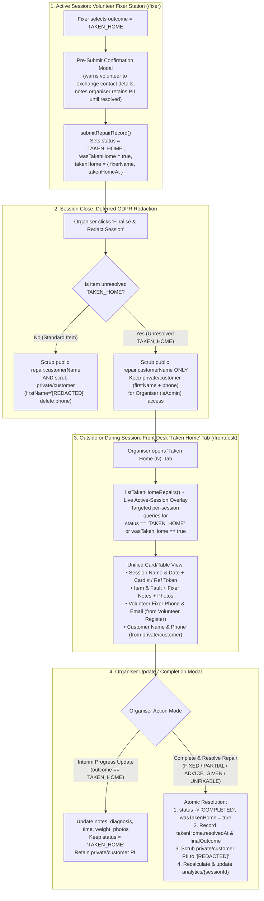

# Organiser Management & Deferred GDPR Redaction for "Taken Home" Repairs

| Metadata | Value |
|---|---|
| **Status** | Goldfish-Validated Draft (Ready for Human Sign-Off — Phase 3 Step 9) |
| **Target Path** | `docs/design/taken_home_organiser_management.md` |
| **Authors** | Human Organiser & Antigravity (Elephant-Goldfish Co-Design) |
| **Created** | 2026-11-08 |
| **Target Cost** | **$0.00 / month** (Strict Google Cloud / Firebase Spark Free Tier) |

---

## Section 0: Problem Statement in Plain English

### 0.1 Operational Need & User Problem

During a monthly Repair Café session, a volunteer fixer occasionally agrees with a visitor to take a complex or time-consuming item home to finish repairing after the event (`TAKEN_HOME`). Under the Repair Café's House Rules (`public/terms.md`), taking an item off-site releases Repair Café custody and insurance cover and forms a private arrangement between the volunteer and the visitor.

In practice, however, visitors frequently contact the Repair Café days or weeks after the session to ask about the status of their item — either because they misplaced the volunteer's contact details or because they have been unable to reach the volunteer directly. Today, when an organiser logs into the Front Desk (`/frontdesk`) between monthly sessions to help with such an enquiry, they hit three operational walls:

1. **No Cross-Session Visibility Outside an Active Event:** The Front Desk (`/frontdesk`) only displays the repair queue for the currently active session (`settings/system.activeSessionId`). Between monthly events — or once a session is closed — organisers have no screen in the application to view items that were taken home across past sessions.
2. **Immediate GDPR Scrubbing Erases Taken-Home Visitor Contact Details:** When an organiser clicks **Finalise & Redact Session** at the end of an event, the system unconditionally scrubs visitor contact details (`customerName` on the repair record and `firstName` / `contactPhone` in the restricted `private/customer` subdocument) to `[REDACTED]` for **every** item in the session — including unresolved `TAKEN_HOME` items. Consequently, the organiser cannot verify which visitor owns a taken-home item or look up the visitor's phone number to reconnect them with the volunteer.
3. **No Way to Log Interim Progress or Final Outcomes After the Session:** When a volunteer eventually finishes a taken-home repair (or reports back with an interim status update), the organiser currently has no way to record interim progress notes, log the final outcome (`FIXED`, `PARTIAL`, `ADVICE_GIVEN`, or `UNFIXABLE`), update off-site repair time or final landfill weight diverted, or attach photos. Furthermore, because session impact analytics (`analytics/{sessionId}`) are calculated only once at session close, any taken-home item that is later successfully repaired remains permanently counted only in `takenHomeCount` rather than contributing to `repairedCount` / `partialCount`, `successRatePercent`, `averageRepairTimeMinutes` (`totalAssessed`), and updated weight/time totals on **Community Impact Reports** (`/reports`) and grant CSV exports.

### 0.2 Legal, Safety, and Financial Constraints

Any solution must operate strictly within the architectural guardrails established in `AGENTS.md`:

- **UK GDPR Article 5(1)(e) Storage Limitation & Role Segregation:**
  - Volunteer tablets (`isVolunteer()`) and unauthenticated devices must **never** have access to visitor PII in finalised sessions. Therefore, when a session is finalised, `customerName` on the public/volunteer-readable `sessions/{sessionId}/repairs/{repairId}` document must still be redacted to `"[REDACTED]"` for all items, including `TAKEN_HOME` items.
  - For unresolved `TAKEN_HOME` items only, the visitor's `firstName` and `contactPhone` must be retained strictly inside the organiser-only `sessions/{sessionId}/repairs/{repairId}/private/customer` subdocument (`allow read: if isAdmin()`).
  - The moment an organiser resolves a taken-home item with a final outcome (`FIXED`, `PARTIAL`, `ADVICE_GIVEN`, or `UNFIXABLE`), the system must immediately scrub `private/customer` (`firstName: "[REDACTED]"`, delete `contactPhone`, and stamp `redactedAt`) so personal data is kept no longer than necessary.
  - Checkpoint 2 of the pre-submit `TAKEN_HOME` confirmation modal on the Volunteer Fixer Station (`/fixer`) must be updated to accurately reflect that organiser-only visitor contact details are retained until the taken-home repair is resolved.
- **Off-Site Custody & PAT Electrical Safety Boundary:**
  - Because a taken-home item leaves Repair Café custody under a private arrangement and is returned directly between the volunteer and visitor outside of a live session, completing its repair record via the organiser Taken Home workflow transitions its lifecycle `status` directly to `COMPLETED` (even for `MAINS_240V` items) rather than routing it into `WAITING_PAT2` inside an archived past session.
- **Zero-Budget ($0.00/month) Firebase Spark Free Tier Guardrail:**
  - Querying taken-home items across sessions on `/frontdesk` must use on-demand filtered reads backed by Firestore's `persistentLocalCache` (IndexedDB) — and overlay live active-session `repairs` in memory with zero extra Firestore reads — rather than opening persistent collection-wide `onSnapshot` listeners across historical sessions.

### 0.3 Success Criteria

1. **Deferred GDPR Redaction on Session Close:** Finalising a session (via both the `finalizeSession` Cloud Function and the client-side `finalizeSessionDirectly` fallback) redacts `customerName` to `"[REDACTED]"` on all `repairs/{repairId}` documents, scrubs `private/customer` for all standard items, and **retains `private/customer` (`firstName` and `contactPhone`) strictly for unresolved `TAKEN_HOME` items**.
2. **Front Desk "Taken Home" Sub-Tab (`/frontdesk`):** Google-authenticated organisers (`isAdmin`) have a dedicated **Taken Home** sub-tab on `/frontdesk` (with a live badge count of unresolved items) that works both during and outside of an active session.
3. **Unified Organiser Context (Customer + Volunteer Contacts):** Each unresolved taken-home item displays its parent session name/date, card/reference token, item description, fixer diagnosis/notes, photo viewer access, the **Customer's retained first name & phone number** (from `private/customer`, with graceful `Redacted (GDPR)` fallback for legacy/historical items), and the **Volunteer Fixer's phone number & email** (automatically matched from the Volunteer Register, including compound fixer names like `"Alice & Bob"`).
4. **Interim Progress Notes vs. Final Resolution:** Organisers can open a repair management modal for any taken-home item to either:
   - **Save Interim Progress Notes (`TAKEN_HOME`):** Update diagnosis, repair notes, duration, weight, or photos while keeping the item in `TAKEN_HOME` status and retaining `private/customer` PII, or
   - **Complete & Resolve Repair Record (`FIXED` / `PARTIAL` / `ADVICE_GIVEN` / `UNFIXABLE`):** Record the final repair outcome, transition `status` to `COMPLETED` (while preserving `wasTakenHome: true` and resolution audit metadata), and **immediately scrub `private/customer` PII to `[REDACTED]`**.
5. **Resolved History Toggle:** The Taken Home tab includes a toggle (`Show Resolved History`) allowing organisers to view previously resolved taken-home items with their final outcome, resolution date, and `Redacted (GDPR)` customer PII indicator.
6. **Automatic Session Impact Analytics Recalculation:** When an organiser updates or resolves a taken-home item belonging to a finalised session, `analytics/{sessionId}` is automatically recalculated (preserving the session's original `finalizedAt` timestamp, `volunteerCount`, and `isTest` flag) so `takenHomeCount`, `repairedCount` / `partialCount` / `unfixableCount` / `adviceCount`, `totalWeightDivertedKg`, `totalRepairTimeMinutes`, `averageRepairTimeMinutes`, and `successRatePercent` are immediately accurate on `/reports` and in grant CSV exports.
7. **Updated Fixer Station Modal Copy:** Checkpoint 2 of the pre-submit `TAKEN_HOME` confirmation modal on `/fixer` is updated to explain that while volunteers must still exchange contact details directly with the visitor, organisers retain visitor contact details in restricted storage until the taken-home repair is resolved.

---

## Section 1: Technical Implementation Plan

### 1.1 System Overview & End-to-End Flow



### 1.2 Data Model Extensions (`src/types/index.ts`)

We extend `src/types/index.ts` with `TakenHomeMetadata`, `TakenHomeRepairEntry`, and two optional fields on `RepairItem` (`wasTakenHome?: boolean` and `takenHome?: TakenHomeMetadata`):

```typescript
/**
 * Audit metadata tracking an item taken home by a volunteer fixer under a private arrangement
 * and its subsequent resolution by a Repair Café organiser.
 */
export interface TakenHomeMetadata {
  // Name of the volunteer fixer who took the item home
  fixerName: string;
  // Unix epoch timestamp (ms) when the item was first marked TAKEN_HOME
  takenHomeAt: number;
  // Unix epoch timestamp (ms) when an organiser completed and resolved the repair record
  resolvedAt?: number;
  // Email address of the organiser who resolved the taken-home item
  resolvedBy?: string;
  // Final repair outcome logged upon resolution (FIXED, PARTIAL, ADVICE_GIVEN, or UNFIXABLE)
  finalOutcome?: Exclude<RepairOutcome, 'TAKEN_HOME'>;
}

/**
 * Enriched taken-home repair record combining a RepairItem with its parent Session context
 * for cross-session organiser display on the Front Desk (/frontdesk).
 */
export interface TakenHomeRepairEntry {
  repairItem: RepairItem;
  sessionId: string;
  sessionName: string;
  sessionDate: string;
  sessionStatus: 'ACTIVE' | 'FINALIZED';
  isTestSession: boolean;
}
```

On `RepairItem` in `src/types/index.ts`:
```typescript
  // True if the item was taken home by a volunteer fixer (preserved after resolution to COMPLETED)
  wasTakenHome?: boolean;
  // Audit trail for taken-home custody release and subsequent organiser resolution
  takenHome?: TakenHomeMetadata;
```

### 1.3 Pure Domain Helpers (`src/services/repairService.ts`)

1. **Plain-Object Guard in `removeUndefined<T>(obj: T): T`:**
   - Update `removeUndefined` so that non-plain objects (where `Object.getPrototypeOf(obj) !== Object.prototype && Object.getPrototypeOf(obj) !== null`, such as Firestore `FieldValue` sentinels returned by `deleteField()`) pass through untouched rather than having their prototype stripped via `Object.entries`.

2. **`isUnresolvedTakenHomeItem(item: Pick<RepairItem, 'status' | 'repair'> | null | undefined): boolean`**
   - Returns `true` when `item != null && (item.status === 'TAKEN_HOME' || (item.status !== 'COMPLETED' && item.repair?.outcome === 'TAKEN_HOME'))`.

3. **`isResolvedTakenHomeItem(item: Pick<RepairItem, 'status' | 'wasTakenHome' | 'takenHome' | 'repair'> | null | undefined): boolean`**
   - Returns `true` when `item != null && !isUnresolvedTakenHomeItem(item) && (Boolean(item.wasTakenHome) || Boolean(item.takenHome))`.

4. **`isCustomerPiiRedacted(pii: Pick<PrivateCustomerData, 'firstName' | 'redactedAt'> | null | undefined): boolean`**
   - Returns `true` when `!pii || !pii.firstName || pii.firstName.trim() === '' || pii.firstName === '[REDACTED]' || Boolean(pii.redactedAt)`.
   - Ensures legacy/historical `TAKEN_HOME` items whose `private/customer` record was already redacted before this feature render a `Redacted (GDPR)` badge rather than displaying literal `"[REDACTED]"` as a visitor's first name.

5. **`calculateNextStatusOnOrganiserTakenHomeUpdate(outcome: RepairOutcome): ItemStatus`**
   - Returns `'TAKEN_HOME'` when `outcome === 'TAKEN_HOME'` (interim progress update mode).
   - Returns `'COMPLETED'` for all final outcomes (`'FIXED'`, `'PARTIAL'`, `'ADVICE_GIVEN'`, `'UNFIXABLE'`), regardless of `powerType`.

6. **`buildOrganiserTakenHomeUpdatePayload(params)`**
   ```typescript
   export function buildOrganiserTakenHomeUpdatePayload(params: {
     fixerName: string;
     outcome: RepairOutcome;
     repairTimeMinutes: number;
     diagnosis: string;
     repairNotes: string;
     partsUsed?: string;
     weightKg?: number;
     totalPhotoCount: number;
     existingTakenHome?: TakenHomeMetadata;
     organizerEmail?: string;
     now?: number;
   }): {
     nextStatus: ItemStatus;
     shouldRedactCustomerPii: boolean;
     repairUpdates: Record<string, unknown>;
   }
   ```
   - Normalises `const timestamp = params.now ?? Date.now();` and `const trimmedFixer = params.fixerName.trim();`.
   - Computes `const nextStatus = calculateNextStatusOnOrganiserTakenHomeUpdate(params.outcome);` and `const shouldRedactCustomerPii = params.outcome !== 'TAKEN_HOME';`.
   - Builds `takenHomePayload: TakenHomeMetadata`:
     - When `params.outcome === 'TAKEN_HOME'`: `{ fixerName: trimmedFixer, takenHomeAt: params.existingTakenHome?.takenHomeAt ?? timestamp }`.
     - When `params.outcome !== 'TAKEN_HOME'`: `{ fixerName: trimmedFixer, takenHomeAt: params.existingTakenHome?.takenHomeAt ?? timestamp, resolvedAt: timestamp, resolvedBy: params.organizerEmail?.trim() || undefined, finalOutcome: params.outcome }`.
   - Builds `repairUpdates` (sanitised with `removeUndefined`):
     - `status: nextStatus`
     - `wasTakenHome: true`
     - `takenHome: takenHomePayload`
     - `repair: { fixerName: trimmedFixer, outcome: params.outcome, repairTimeMinutes: params.repairTimeMinutes, diagnosis: params.diagnosis.trim(), repairNotes: params.repairNotes.trim(), partsUsed: params.partsUsed?.trim() || undefined, photoCount: Math.max(0, params.totalPhotoCount), repairedAt: timestamp }`
     - `updatedAt: timestamp`
     - When `shouldRedactCustomerPii` is `true`: includes `customerName: '[REDACTED]'`.
     - When `params.weightKg !== undefined && !Number.isNaN(params.weightKg) && params.weightKg > 0`: sets `'item.weightKg': params.weightKg`; otherwise sets `'item.weightKg': deleteField()` so clearing the weight input removes any previously saved weight.

7. **`matchVolunteerByFixerName(fixerName: string | undefined, volunteers: Volunteer[]): Volunteer | null`**
   - Normalises whitespace and case (`s.trim().toLowerCase().replace(/\s+/g, ' ')`).
   - First checks for a whole-string match against `volunteers`.
   - If no whole-string match is found and `fixerName` contains compound separators (`/\s*(?:&|\/|,|\band\b)\s*/i`, e.g. `"Alice Tester & Bob Builder"`), splits into individual names and returns the first matching `Volunteer` record (or `null` if none match).

8. **`mergeActiveSessionTakenHomeEntries(persistedEntries: TakenHomeRepairEntry[], activeSession: Session | null, activeRepairs: RepairItem[]): TakenHomeRepairEntry[]`**
   - Pure helper that replaces any entries belonging to `activeSession.id` with live entries derived from `activeRepairs` (filtering `activeRepairs` to items where `isUnresolvedTakenHomeItem(r) || isResolvedTakenHomeItem(r)`).
   - Guarantees that if a volunteer on `/fixer` marks an item `TAKEN_HOME` during a live session, the Front Desk `Taken Home (N)` badge and tab list reflect it immediately via the existing `useRepairs` snapshot with **0 extra Firestore reads**.

9. **`sortAndFilterTakenHomeEntries(entries: TakenHomeRepairEntry[], options?: { searchTerm?: string; includeResolved?: boolean; customerPiiByRepairKey?: Record<string, PrivateCustomerData | null> }): TakenHomeRepairEntry[]`**
   - Filters `entries` by `includeResolved` (default `false`: keeps only `isUnresolvedTakenHomeItem(entry.repairItem)`; when `true`, keeps both unresolved and `isResolvedTakenHomeItem(entry.repairItem)`).
   - Matches `searchTerm` against `brandModel`, `faultDescription`, `referenceToken`, `cardNumber` (`#N` or `N`), `sessionName`, `repair.fixerName`, `takenHome.fixerName`, or unredacted `PrivateCustomerData.firstName` / `contactPhone` (looked up in `customerPiiByRepairKey` by `` `${entry.sessionId}/${entry.repairItem.id}` ``).
   - Sorts unresolved items first (oldest `takenHome.takenHomeAt ?? createdAt` ascending), followed by resolved items (newest `takenHome.resolvedAt ?? updatedAt` descending).

### 1.4 Deferred GDPR Redaction at Session Finalisation (`functions/src/finalizeSession.ts` & `src/services/sessionService.ts`)

1. **Cloud Function (`functions/src/finalizeSession.ts`):**
   - Extend `RedactionPair`:
     ```typescript
     interface RedactionPair {
       repairRef: DocumentReference;
       privateRef: DocumentReference;
       retainPrivateCustomerPii: boolean;
       markWasTakenHome: boolean;
     }
     ```
   - In `tallyRepairDoc(acc, docSnap)`:
     - Compute `const isTakenHome = data.status === "TAKEN_HOME" || (data.status !== "COMPLETED" && data.repair?.outcome === "TAKEN_HOME");`.
     - Push `{ repairRef: docSnap.ref, privateRef: docSnap.ref.collection("private").doc("customer"), retainPrivateCustomerPii: isTakenHome, markWasTakenHome: isTakenHome }`.
   - In `commitRedactionPairsInChunks(pairs)`:
     - Always update `pair.repairRef`: `batch.update(pair.repairRef, pair.markWasTakenHome ? { customerName: "[REDACTED]", wasTakenHome: true } : { customerName: "[REDACTED]" });`.
     - Only update `pair.privateRef` (`{ firstName: "[REDACTED]", contactPhone: FieldValue.delete(), redactedAt: FieldValue.serverTimestamp() }`) when `!pair.retainPrivateCustomerPii`.

2. **Client-Side Finalisation Fallback (`src/services/sessionService.ts`):**
   - Export pure helper `partitionRepairsForSessionRedaction(repairs: Array<Pick<RepairItem, 'id' | 'status' | 'repair'>>): { redactPrivateIds: string[]; retainPrivateIds: string[] }` using `isUnresolvedTakenHomeItem`.
   - Update `redactSessionRepairsPii(sessionId, repairDocs, now)`:
     - For every `repairDoc`, updates `repairRef` with `{ customerName: '[REDACTED]', ...(isTakenHome ? { wasTakenHome: true } : {}) }`.
     - Only writes the redaction payload to `privateCustomerRef` when `!isTakenHome`.
   - Update `buildFinalizeSessionPrompt(sessionName: string, totalSessionPhotos: number, takenHomeCount: number = 0): string`:
     - When `takenHomeCount === 0`, output is 100% identical to the existing string (preserving all existing unit test assertions in `tests/sessionService.test.ts`).
     - When `takenHomeCount > 0`, appends a dedicated Taken Home GDPR retention note:
       `\n\nTaken Home Notice: ${takenHomeCount} item${takenHomeCount === 1 ? ' is' : 's are'} marked as Taken Home. Visitor contact details for ${takenHomeCount === 1 ? 'this item' : 'these items'} will remain securely retained in the organiser-only Taken Home tab until the repair is completed and resolved.`

### 1.5 Cross-Session Query, Organiser Submission & Analytics Recalculation (`src/services/repairService.ts` & `src/services/sessionService.ts`)

1. **In-Session `submitRepairRecord` (`src/services/repairService.ts`):**
   - Add optional `existingTakenHome?: TakenHomeMetadata` to `submitRepairRecord` params (passed as `currentItem.takenHome` from `FixerStationView.tsx`).
   - When `params.outcome === 'TAKEN_HOME'`:
     - Sets `updates.wasTakenHome = true` and `updates.takenHome = { fixerName: params.fixerName.trim(), takenHomeAt: params.existingTakenHome?.takenHomeAt ?? now }`.
   - When `params.outcome !== 'TAKEN_HOME'`:
     - Sets `updates.wasTakenHome = false` and `updates.takenHome = deleteField()`.

2. **Cross-Session Query `listTakenHomeRepairs(options?: { includeTestSessions?: boolean }): Promise<TakenHomeRepairEntry[]>` (`src/services/repairService.ts`):**
   - Fetches all sessions from `collection(db, 'sessions')`.
   - Excludes sessions where `Boolean(session.isTest)` is `true` unless `options?.includeTestSessions === true`.
   - For each session, runs two parallel single-field queries on `collection(db, 'sessions', session.id, 'repairs')`:
     - `query(repairsCol, where('status', '==', 'TAKEN_HOME'))`
     - `query(repairsCol, where('wasTakenHome', '==', true))`
   - Deduplicates repair docs by `id`, constructs `TakenHomeRepairEntry` records, and returns them sorted via `sortAndFilterTakenHomeEntries(entries, { includeResolved: true })`.

3. **Session Analytics Recalculation (`recalculateSessionAnalytics(sessionId: string): Promise<SessionAnalytics | null>` in `src/services/sessionService.ts`):**
   - Reads `sessions/{sessionId}` and `analytics/{sessionId}` in parallel.
   - If neither exists, or if `sessionSnap.data()?.status !== 'FINALIZED' && !analyticsSnap.exists()`, returns `null` (so active unfinalised sessions are not given premature analytics docs).
   - Resolves original session metadata:
     - `sessionName = sessionData?.name ?? existingAnalytics?.sessionName ?? sessionId`
     - `sessionDate = sessionData?.date ?? existingAnalytics?.date ?? ''`
     - `volunteerCount = Array.isArray(sessionData?.attendingVolunteers) ? sessionData.attendingVolunteers.length : Array.isArray(sessionData?.attendingVolunteerIds) ? sessionData.attendingVolunteerIds.length : (existingAnalytics?.volunteerCount ?? 0)`
     - `isTest = Boolean(sessionData?.isTest ?? existingAnalytics?.isTest)`
     - Preserves original `finalizedAt` epoch ms from `existingAnalytics?.finalizedAt` or `sessionData?.finalizedAt` (supporting both numeric timestamps and Firestore `Timestamp.toMillis()`), falling back to `Date.now()`.
   - Fetches all repair docs in `sessions/{sessionId}/repairs`, computes `calculateSessionAnalytics(sessionId, sessionName, sessionDate, repairs, finalizedAt, volunteerCount, isTest)`, writes the result to `analytics/{sessionId}`, and returns it.

4. **Organiser Taken-Home Submission (`submitOrganiserTakenHomeUpdate` in `src/services/repairService.ts`):**
   - Validates photo count (`<= MAX_PHOTOS_PER_REPAIR`) and validates any `newPhotos` via `validatePhotoDataUrl`.
   - Calls `buildOrganiserTakenHomeUpdatePayload`.
   - Uses a single atomic `writeBatch(db)` to:
     1. Write any `newPhotos` to `sessions/{sessionId}/repairs/{repairId}/photos/{photoId}`.
     2. Update `sessions/{sessionId}/repairs/{repairId}` with `repairUpdates`.
     3. When `shouldRedactCustomerPii` is `true`, scrub `sessions/{sessionId}/repairs/{repairId}/private/customer` with `{ firstName: '[REDACTED]', contactPhone: deleteField(), redactedAt: now }` (`{ merge: true }`).
   - Commits the batch, then calls `await recalculateSessionAnalytics(params.sessionId)` (wrapped in a non-blocking `try / catch` with `console.warn` so offline or transient analytics refresh issues never roll back the saved repair update).

### 1.6 Front Desk UI (`src/views/FrontDeskView.tsx` & `src/components/frontdesk/TakenHomeTabPanel.tsx`)

1. **`src/components/frontdesk/TakenHomeTabPanel.tsx`:**
   - **Accessibility & Input Guardrails:**
     - Every `<label>` has an explicit `htmlFor` attribute (`tests/wcagStaticGuardrails.test.ts`).
     - Every `<th>` in the table declares `scope="col"` (`tests/wcagStaticGuardrails.test.ts`).
     - The Organiser Taken-Home Repair Modal uses `useDialogFocusTrap`, `role="dialog"`, `aria-modal="true"`, and `aria-labelledby="organiser-taken-home-modal-title"`.
     - Search input `#taken-home-search` includes full iOS Safari / password-manager autofill suppression attributes (`autoComplete="off"`, `autoCorrect="off"`, `autoCapitalize="off"`, `spellCheck={false}`, `data-1p-ignore={true}`, `data-lpignore="true"`, `data-bwignore="true"`, `data-form-type="other"`).
   - **Customer Contact Hydration:**
     - Automatically loads `getPrivateCustomerData(entry.sessionId, entry.repairItem.id)` for unresolved items and caches by `${sessionId}/${repairId}`.
     - Uses `isCustomerPiiRedacted(pii)` so resolved items **and** legacy unresolved items with already-redacted PII display a `Redacted (GDPR)` badge, while unredacted items show `firstName` and a clickable `tel:` link for `contactPhone` (or `"No phone provided"`).
   - **Volunteer Contact Matching:**
     - Uses `matchVolunteerByFixerName(fixerName, volunteers)` to display the volunteer fixer's name alongside their `phone` and `email` from the Volunteer Register.
   - **Organiser Taken-Home Repair Modal:**
     - Point-fetches existing saved photos via `fetchRepairPhotos(entry.sessionId, entry.repairItem.id)` when `(entry.repairItem.repair?.photoCount ?? 0) > 0`, supports deleting saved photos via `deleteRepairPhoto`, and supports staging new compressed photos via `compressRepairPhoto`.
     - Allows selecting either **Still Taken Home (Save Interim Notes)** (`outcome = 'TAKEN_HOME'`) or any final resolution outcome (`FIXED`, `PARTIAL`, `ADVICE_GIVEN`, `UNFIXABLE`), showing a clear GDPR redaction notice whenever a final resolution outcome is selected.

2. **`src/views/FrontDeskView.tsx`:**
   - Adds `'TAKEN_HOME'` to `FrontDeskTab`.
   - Adds `takenHome: repairs.filter((r) => isUnresolvedTakenHomeItem(r)).length` to `counts` and adds `<option value="TAKEN_HOME">Taken Home ({counts.takenHome})</option>` to the queue status filter dropdown.
   - Loads `persistedTakenHomeEntries` via `listTakenHomeRepairs()` on admin sign-in (wrapped in `try / catch`, never called after `finalizeSessionClient` where `db` is terminated).
   - Computes `effectiveTakenHomeEntries = useMemo(() => mergeActiveSessionTakenHomeEntries(persistedTakenHomeEntries, session, repairs), [persistedTakenHomeEntries, session, repairs])`.
   - Renders the **Taken Home (`{unresolvedTakenHomeCount}`)** sub-tab button and `<TakenHomeTabPanel />`.
   - Generalises `PhotoViewerModal` on `FrontDeskView` using `photoModalTarget: { sessionId: string; repairItem: RepairItem } | null` with `onPhotosChange` wired to update `persistedTakenHomeEntries` when a photo is deleted.

---

## Section 2: Alternatives Considered & Ruled Out

| Alternative Considered | Why It Was Ruled Out |
|---|---|
| **1. Retaining `customerName` on the public `sessions/{sessionId}/repairs/{repairId}` document after session finalisation** | **Violates Volunteer/Public PII Segregation:** In `firestore.rules`, `sessions/{sessionId}/repairs/{repairId}` is readable by volunteer tablets (`allow read: if true`). Leaving `customerName` unredacted on the parent repair document after a session closes would expose visitor names outside organiser-authenticated screens. Redacting `customerName` on the public repair document at session close while retaining `firstName` and `contactPhone` exclusively inside the admin-only `private/customer` subdocument (`allow read: if isAdmin()`) guarantees that only Google-authenticated organisers can access taken-home visitor PII. |
| **2. Retaining visitor PII indefinitely after a taken-home item is resolved (or requiring a separate manual redaction step)** | **Violates UK GDPR Article 5(1)(e) (Storage Limitation):** Once a taken-home repair has been completed (or determined unfixable) and closed out by an organiser, the operational purpose for holding the visitor's contact details has ended. Relying on organisers to remember a separate manual redaction step risks leaving visitor phone numbers in Firestore indefinitely. Scrubbing `private/customer` automatically in the same atomic batch that resolves the item enforces GDPR storage limitation by design. |
| **3. Routing repaired `MAINS_240V` taken-home items to `WAITING_PAT2` when resolved outside a session** | **Leaves Items Stranded in Closed Sessions & Crosses Custody Boundary:** Under the Repair Café's House Rules (`public/terms.md`), taking an item home is a private arrangement outside Repair Café custody and insurance, and the volunteer returns the item directly to the visitor outside of a standard session. Routing a resolved item from a closed past session into `WAITING_PAT2` would leave the item stuck in an archived session's PAT queue rather than closing it out as `COMPLETED`. |
| **4. Leaving `analytics/{sessionId}` unchanged when a taken-home item is resolved after session close** | **Under-Reports Community Impact & Grant Metrics:** If `analytics/{sessionId}` remained frozen at session close, every taken-home item later repaired by a volunteer would stay permanently counted only as `takenHomeCount` and would never contribute its `FIXED` / `PARTIAL` outcome, `successRatePercent`, `totalAssessed` average time denominator, or updated off-site repair time and weight to **Community Impact Reports** (`/reports`) and grant CSV exports. Automatically recalculating `analytics/{sessionId}` upon resolution keeps historical analytics accurate. |
| **5. Using a `collectionGroup('repairs')` query or persistent `onSnapshot` listeners across all historical sessions** | **Index Deployment Fragility & Free Tier Read Overhead:** A `collectionGroup('repairs')` query requires manual deployment of `COLLECTION_GROUP` single-field index overrides in `firestore.indexes.json` and throws a `failed-precondition` error on any single-tenant fork where index overrides have not yet been deployed. Furthermore, attaching `onSnapshot` listeners across historical sessions would consume unnecessary document reads. Running targeted single-field `where('status', '==', 'TAKEN_HOME')` and `where('wasTakenHome', '==', true)` queries per session uses Firestore's automatic built-in single-field indexes, requires zero custom index deployment, and reads only matching taken-home documents. |
| **6. Supporting only final completion (no interim progress notes) and hiding resolved items permanently** | **Breaks Real-World Organiser Follow-Up:** Visitors often contact the café while a volunteer is still awaiting a spare part. If the organiser modal only supported final completion (which immediately scrubs visitor PII), an organiser could not save interim progress notes without prematurely erasing the visitor's contact details. Likewise, removing resolved items without a `Show Resolved History` toggle would prevent organisers from checking when and how a past taken-home item was closed out. |

---

## Section 3: Detailed Implementation Plan & File Manifest

| File Path | Action | Rationale & Planned Changes |
|---|---|---|
| `docs/design/taken_home_organiser_management.md` | **Create** | This Elephant-Goldfish engineering design specification and source of truth. |
| `src/types/index.ts` | **Modify** | Add `TakenHomeMetadata` and `TakenHomeRepairEntry` interfaces; add optional `wasTakenHome?: boolean` and `takenHome?: TakenHomeMetadata` fields to `RepairItem`. |
| `functions/src/finalizeSession.ts` | **Modify** | Update `RedactionPair`, `tallyRepairDoc`, and `commitRedactionPairsInChunks` so that at session finalisation: (1) `customerName` on `repairs/{repairId}` is always redacted to `"[REDACTED]"` (and `wasTakenHome: true` is stamped on unresolved `TAKEN_HOME` items), while (2) `private/customer` is **retained** for unresolved `TAKEN_HOME` items (`status === "TAKEN_HOME"` or `status !== "COMPLETED" && repair?.outcome === "TAKEN_HOME"`) and redacted for all other items. |
| `src/services/sessionService.ts` | **Modify** | Add pure helper `partitionRepairsForSessionRedaction(repairs)`. Update `redactSessionRepairsPii` to defer `private/customer` redaction for unresolved `TAKEN_HOME` items while redacting `customerName` on all `repairs/{repairId}` docs and stamping `wasTakenHome: true`. Extend `buildFinalizeSessionPrompt(sessionName, totalSessionPhotos, takenHomeCount = 0)` to mention deferred PII retention when `takenHomeCount > 0`. Add `recalculateSessionAnalytics(sessionId)` (preserving original `finalizedAt`, `volunteerCount`, and `isTest`) to recompute and persist `analytics/{sessionId}` when a taken-home item in a finalised session is updated or resolved. |
| `src/services/repairService.ts` | **Modify** | Preserve non-plain objects (`FieldValue` sentinels like `deleteField()`) in `removeUndefined`. Add pure helpers `isUnresolvedTakenHomeItem`, `isResolvedTakenHomeItem`, `isCustomerPiiRedacted`, `calculateNextStatusOnOrganiserTakenHomeUpdate`, `buildOrganiserTakenHomeUpdatePayload`, `matchVolunteerByFixerName` (supporting compound names), `mergeActiveSessionTakenHomeEntries`, and `sortAndFilterTakenHomeEntries`. Update `submitRepairRecord` to accept `existingTakenHome` and stamp `wasTakenHome: true` + `takenHome` when `outcome === 'TAKEN_HOME'` (and clear them if changed to a non-take-home outcome during the active session). Add `listTakenHomeRepairs` and `submitOrganiserTakenHomeUpdate`. |
| `src/components/frontdesk/TakenHomeTabPanel.tsx` | **Create** | Organiser Taken Home management panel for `/frontdesk`: hydrates `private/customer` contact details for unresolved items (with `isCustomerPiiRedacted` fallback for legacy/resolved items), cross-references `Volunteer[]` to show volunteer phone/email, provides autofill-safe search and `Show Resolved History` toggle, and renders the accessible focus-trapped Organiser Taken-Home Repair Modal supporting both interim progress updates (`TAKEN_HOME`) and final completion (`FIXED`, `PARTIAL`, `ADVICE_GIVEN`, `UNFIXABLE`) with saved/staged photo management and automatic GDPR scrub. |
| `src/views/FrontDeskView.tsx` | **Modify** | Add `'TAKEN_HOME'` to `FrontDeskTab`; add `counts.takenHome` and `TAKEN_HOME` queue filter option; load `persistedTakenHomeEntries` via `listTakenHomeRepairs` on organiser sign-in and merge active-session `repairs` via `mergeActiveSessionTakenHomeEntries`; render the `Taken Home (N)` tab button and `<TakenHomeTabPanel />`; support cross-session `PhotoViewerModal` target with `onPhotosChange`; pass `counts.takenHome` to `buildFinalizeSessionPrompt`; include Taken Home modal state in `isFrontDeskDirty`. |
| `src/views/FixerStationView.tsx` | **Modify** | Pass `existingTakenHome: currentItem.takenHome` to `submitRepairRecord` and update Checkpoint 2 of the pre-submit `TAKEN_HOME` confirmation modal to explain that while volunteers must still exchange contact details directly with the visitor, the organiser retains visitor contact details in restricted storage until the taken-home repair is completed and resolved. |
| `tests/repairService.test.ts` | **Modify** | Add unit tests for `removeUndefined` preserving `deleteField()`, `isUnresolvedTakenHomeItem`, `isResolvedTakenHomeItem`, `isCustomerPiiRedacted`, `calculateNextStatusOnOrganiserTakenHomeUpdate`, `buildOrganiserTakenHomeUpdatePayload` (both interim update preserving PII and final completion redacting PII + clearing weight), `matchVolunteerByFixerName` (exact & compound names), `mergeActiveSessionTakenHomeEntries`, and `sortAndFilterTakenHomeEntries`. |
| `tests/sessionService.test.ts` | **Modify** | Add unit tests for `partitionRepairsForSessionRedaction` (verifying `TAKEN_HOME` items retain `private/customer` while standard items are redacted), `buildFinalizeSessionPrompt` with `takenHomeCount > 0`, and recalculating `calculateSessionAnalytics` when a `TAKEN_HOME` item transitions to `FIXED` / `PARTIAL` / `UNFIXABLE` / `ADVICE_GIVEN`. |
| `tests/wcagStaticGuardrails.test.ts` | **Modify** | Register `src/components/frontdesk/TakenHomeTabPanel.tsx` in the `<label htmlFor>`, `<th scope="col">`, and modal `useDialogFocusTrap` / `role="dialog"` / `aria-modal` / `aria-labelledby` static WCAG 2.2 AA guardrail suites. |
| `tests/wcagAxeAudit.test.tsx` | **Modify** | Mock `listTakenHomeRepairs` and `getPrivateCustomerData` in `repairService` mock and add automated `axe-core` WCAG 2.2 Level AA audit coverage for `TakenHomeTabPanel` and its Organiser Taken-Home Repair Modal. |
