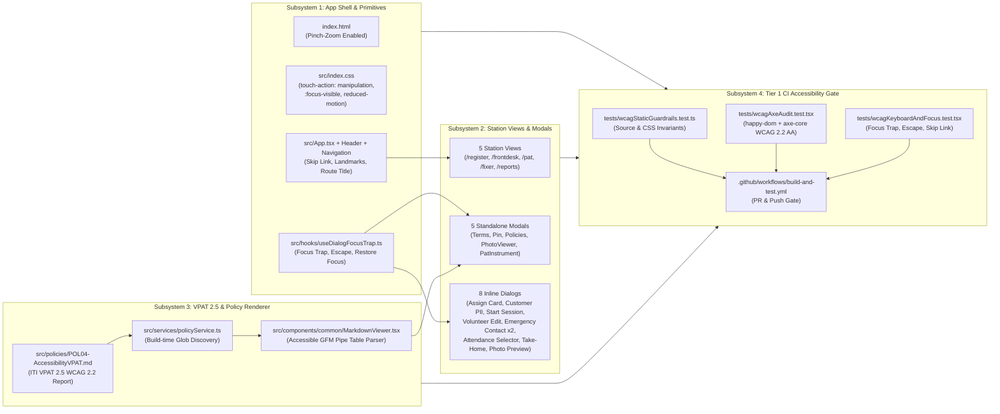

# Design Specification: WCAG 2.2 Level AA Compliance, Automated Audit Gate, and VPAT 2.5 Policy (Issue #19)

**Status:** Implemented & Verified (Phase 4 Complete)  
**Author:** Antigravity & Human Co-Design  
**Related Issue:** [Issue #19 — WCAG Compliance: Audit the app against WCAG standards](https://github.com/rsg98/repair-cafe-manager/issues/19)

---

## Section 0: Project Overview, Goals & Non-Goals

### 0.1 Context & Problem Statement

The **Repair Café Session Management System** is a community-driven, offline-first Progressive Web App (PWA) used simultaneously by members of the public (visitors checking in broken household items on mobile phones or entrance tablets) and community volunteers/organisers operating physical stations (Front Desk, PAT Electrical Safety Station, Volunteer Fixer Station, and Community Impact Reports).

Community repair events bring together visitors and volunteers with a wide range of visual, motor, auditory, and cognitive abilities—frequently in busy community halls with varied lighting conditions and shared touch tablets. Furthermore, local councils, host venues, and UK community grant funders increasingly require demonstrable digital accessibility compliance aligned with **WCAG 2.2 Level AA** (the standard referenced by the UK Public Sector Bodies Accessibility Regulations and EN 301 549) alongside a formal **Voluntary Product Accessibility Template (VPAT®)** / **Accessibility Conformance Report (ACR)**.

An initial comprehensive audit of the application against **WCAG 2.2 Level AA** (further validated by three independent Phase 3 Goldfish engineering reviews) identified six systemic categories of conformance gaps:
1. **Viewport Scaling Lockout (WCAG 1.4.4 / 1.4.10):** `index.html` sets `maximum-scale=1.0, user-scalable=no`, preventing low-vision users from pinch-zooming on mobile and tablet devices.
2. **Unassociated Form Labels, Orphaned Group Labels & Missing Accessible Names (WCAG 1.3.1, 1.3.5, 2.5.3, 3.3.2, 4.1.2):** Multiple `<label>` elements across the 5 station views and modal forms lack programmatic `htmlFor`/`id` bindings; several `<label>` elements are used as visual headers over button/checkbox groups without associated form controls; standalone search/filter inputs and outcome toggle button groups lack explicit `aria-label` or `aria-pressed` states.
3. **Insufficient Text & Badge Color Contrast (WCAG 1.4.3):** Secondary captions, optional field hints, table placeholders, card badges (`CardToken.tsx`), and footer metadata use Tailwind `text-slate-400` (`#94a3b8` on `#ffffff` or `#f8fafc`, yielding a contrast ratio of $\approx 2.40:1$ to $2.54:1$) or `bg-slate-400 text-white` ($2.53:1$), falling below the mandatory $4.5:1$ Level AA threshold for normal text.
4. **Incomplete Modal Dialog Semantics & Focus Management (WCAG 2.1.1, 2.1.2, 2.4.3, 2.4.7, 2.4.11, 4.1.2):** Shared and inline modals lack uniform `role="dialog"`, `aria-modal="true"`, `aria-labelledby`, keyboard `Tab`/`Shift+Tab` focus trapping, `Escape` key dismissal, and focus restoration to the invoking control upon closure.
5. **Icon-Only Controls, Table Header Scope & Non-Keyboard Interactive Elements (WCAG 1.1.1, 1.3.1, 2.1.1, 4.1.2):** Several icon-only buttons (`Header.tsx` Sign Out, modal close buttons, queue action buttons) rely solely on `title` attributes or lack accessible names, clickable photo `` thumbnails in `FixerStationView.tsx` lack keyboard-focusable `<button>` semantics, `<th>` elements in `ReportsView.tsx` and `VolunteerRegisterPanel.tsx` lack `scope="col"`, and category progress bars lack `role="progressbar"` value attributes.
6. **Landmarks, Bypass Blocks, Dynamic Route Titles & Status Announcements (WCAG 1.3.1, 2.4.1, 2.4.2, 4.1.3):** The application shell lacks a keyboard *"Skip to main content"* bypass link, does not update `document.title` when navigating between stations, and omits `role="alert"` / `aria-live` regions on several dynamic error and safety banners.

Additionally, the repository currently has no automated accessibility regression tests in its Vitest suite (`tests/`) or GitHub Actions workflow (`.github/workflows/build-and-test.yml`), meaning future UI changes could inadvertently reintroduce WCAG violations.

---

### 0.2 Goals

1. **Achieve Full WCAG 2.2 Level AA Conformance Across All 5 Stations & Shared Components:**
   - Remediate all identified Level A and Level AA violations across the App Shell (`App.tsx`, `Header.tsx`, `Navigation.tsx`), shared components/modals (`CardToken`, `TermsModal`, `PinModal`, `PoliciesModal`, `PhotoViewerModal`, `PatInstrumentModal`, `SafetyBanner`, `OfflineNotice`, `UpdateBanner`, `MarkdownViewer`), and all five operational views (`CustomerRegisterView`, `FrontDeskView` + `VolunteerRegisterPanel` + `SessionAttendanceBar`, `PatStationView`, `FixerStationView`, `ReportsView`).
2. **Preserve Tablet Keypad Ergonomics & Credit Card Autofill Suppression While Unlocking Pinch-Zoom:**
   - Remove `maximum-scale=1.0, user-scalable=no` from `index.html` and apply `touch-action: manipulation` in `src/index.css` so rapid taps on the Card Lookup and PIN keypads never trigger accidental double-tap zoom while intentional two-finger pinch-zoom works up to $200\%+$.
   - Preserve the Issue #28 iOS Safari `CreditCardAutoFill` suppression contract (`REPAIR_ITEM_LOOKUP_INPUT_PROPS` in `FrontDeskView`, `PatStationView`, and `FixerStationView`) so input `id`, `name`, and `aria-label` attributes never contain the substring `"card"`.
3. **Establish a Fast, Zero-Cost Tier 1 Enduring Accessibility Gate in CI/CD:**
   - Integrate an automated WCAG 2.2 Level AA verification suite into Vitest (`npm test`) combining:
      - **Layer 1 (Static Source & Token Guardrails):** Fast deterministic assertions over `index.html`, `src/index.css`, and component source files to prevent regressions in viewport settings, low-contrast utility classes (`text-slate-400` on readable text), and modal/form invariants.
      - **Layer 2 (Component DOM + `axe-core` Audits):** Render every station view and modal in `happy-dom` using React's `createRoot` + `act` and run `axe-core` configured for WCAG 2.0, 2.1, and 2.2 Level A & AA tags (`wcag2a`, `wcag2aa`, `wcag21a`, `wcag21aa`, `wcag22aa`) with zero violations.
      - **Layer 3 (Behavioral Keyboard & Focus Management Tests):** Verify modal focus trapping (`Tab` / `Shift+Tab`), `Escape` key dismissal, focus restoration, nested dialog stack behavior, skip-link navigation, and dynamic route title updates.
   - Configure `.github/workflows/build-and-test.yml` to run on all Pull Requests and branch pushes so accessibility regressions block merges automatically without incurring slow or costly headless browser downloads.
4. **Publish an In-App ITI VPAT® 2.5 WCAG Edition Policy Document:**
   - Author a comprehensive Accessibility Conformance Report following the **ITI VPAT® 2.5 WCAG Edition** specification in `src/policies/POL04-AccessibilityVPAT.md`.
   - Extend `MarkdownViewer.tsx` to render GitHub Flavored Markdown (GFM) pipe tables as accessible semantic HTML tables (`<table>`, `<thead>`, `<th scope="col">`, `<tbody>`, `<td>`).
   - Whitelist `!src/policies/POL04-AccessibilityVPAT.md` in `.gitignore` so the VPAT is tracked in version control and automatically available inside the in-app **Repair Café Policies** modal and Front Desk Policies tab (`PoliciesModal.tsx`).

---

### 0.3 Non-Goals

1. **WCAG 2.2 Level AAA Certification:**
   - While the VPAT 2.5 document will include Table 3 (Level AAA) for completeness in accordance with the ITI VPAT 2.5 template, we are not targeting strict Level AAA conformance (such as $7:1$ contrast on all decorative/brand elements or sign-language interpretation).
2. **Heavy Headless Browser E2E CI Pipelines (Playwright / Cypress / Pa11y-CI):**
   - To keep GitHub Actions execution fast ($< 30\text{ seconds}$) and avoid Chromium binary download wait times and CI minutes consumption, we will not introduce Playwright or Puppeteer into the CI workflow.
3. **Changes to Firestore Data Schema or Cloud Functions Business Logic:**
   - All WCAG 2.2 AA remediations, automated tests, and VPAT policy additions are strictly confined to the frontend presentation layer, static policy bundle, test suite, and CI workflow; no Firestore security rules, composite indexes, or backend Cloud Functions require modification.
4. **Third-Party External Widget Redesign (Google Sign-In OAuth Popup):**
   - The Google-hosted OAuth account chooser window is controlled by Google Identity Services and is outside the DOM boundary of the application.

---

## Section 1: System Architecture & Component Design

### 1.1 High-Level Component & Verification Topology

The architecture is organized into four cohesive subsystems that connect UI accessibility primitives, station view remediations, in-app VPAT policy rendering, and automated CI verification:



---

### 1.2 Subsystem 1: Shared Accessibility Primitives & App Shell

#### 1.2.1 Viewport & Global CSS Ergonomics (`index.html`, `src/index.css`)
- **Viewport Meta (`index.html`):**
  - Replace `width=device-width, initial-scale=1.0, maximum-scale=1.0, user-scalable=no` with `width=device-width, initial-scale=1.0` so mobile and tablet browsers allow pinch-zoom up to $200\%+$ (WCAG 1.4.4, 1.4.10).
- **Touch & Focus Rules (`src/index.css`):**
  - Apply `touch-action: manipulation` to all interactive elements (`button, a, input, select, textarea, label, [role="button"], [role="tab"]`) to prevent rapid taps on the PIN pad or Card Lookup numpad from triggering accidental double-tap zoom while preserving intentional two-finger pinch-zoom.
  - Define consistent `:focus-visible` outlines (`outline: 2px solid var(--color-brand-600); outline-offset: 2px`) so keyboard focus is always clearly discernible without cluttering pointer/touch interactions (WCAG 2.4.7, 2.4.11).
  - Add an `@media (prefers-reduced-motion: reduce)` block that disables non-essential CSS animations and transitions (`animation-duration: 0.01ms !important; transition-duration: 0.01ms !important; scroll-behavior: auto !important`) for users with vestibular motion sensitivities (WCAG 2.3.3).

#### 1.2.2 Reusable Dialog Focus & Keyboard Hook (`src/hooks/useDialogFocusTrap.ts`)
To eliminate duplicated keyboard and focus-management boilerplate across the 5 standalone modal components and 8 inline modal dialogs, we introduce a dedicated custom hook:

```
Interface UseDialogFocusTrapOptions:
  isOpen: boolean
  onClose?: () => void
  initialFocusRef?: RefObject<HTMLElement | null>

Function Signature:
  useDialogFocusTrap(options: UseDialogFocusTrapOptions) => RefObject<HTMLDivElement | null>
```

**Behavioral Contract:**
1. **Callback Reference Stability (`onCloseRef`):** Because callers frequently pass inline arrow functions (`onClose={() => setShowModal(false)}`) that create a new function reference on every keystroke/render, `useDialogFocusTrap` stores `onClose` in a `useRef` (`onCloseRef.current = onClose`) and its main `useEffect` depends **strictly on `[isOpen]`**. This guarantees typing inside modal inputs never re-triggers initial focus placement.
2. **Focus Capture & Initial Placement (Including Initial-Open Mounts):** Whether `isOpen` starts `true` on initial mount (`PinModal`, `PhotoViewerModal`) or transitions `false -> true`, record `document.activeElement` as the return target and append `dialogRef.current` to the module-level `activeDialogStack`. On the next microtask (`queueMicrotask`), if `dialogRef.current` is still open and does not already contain `document.activeElement`, move focus to:
   - `initialFocusRef?.current` (if provided), else
   - `dialogEl.querySelector<HTMLElement>('[autofocus], [data-autofocus="true"]')` (respecting inputs with `autoFocus`), else
   - the first enabled focusable descendant inside `dialogEl`, else
   - `dialogEl` itself (`tabIndex={-1}`).
3. **Focus Trapping (`Tab` / `Shift+Tab`):** Listen for `keydown` events while `isOpen === true` and `dialogEl` is the topmost element in `activeDialogStack`. Query all enabled focusable elements inside `dialogEl` (`a[href], button:not([disabled]), input:not([disabled]):not([type="hidden"]), select:not([disabled]), textarea:not([disabled]), [tabindex]:not([tabindex="-1"])`). When `Tab` is pressed on the last focusable element (or outside `dialogEl`), wrap focus to the first; when `Shift+Tab` is pressed on the first focusable element (or `dialogEl` itself), wrap focus to the last.
4. **Escape Dismissal (`Escape`):** When `Escape` is pressed on the topmost dialog and `onCloseRef.current` is defined, call `event.preventDefault()`, `event.stopPropagation()`, and `onCloseRef.current()` (WCAG 2.1.2).
5. **Out-of-Order Stack Cleanup & Focus Restoration:** When `isOpen` becomes `false` or the component unmounts, remove `dialogEl` from `activeDialogStack` via `splice(lastIndexOf(dialogEl), 1)`. If `activeDialogStack.length === 0` (no other modal has opened or remains open) and `previousActiveElement` is still connected in `document.body`, restore focus to `previousActiveElement`; if another dialog remains on `activeDialogStack`, ensure focus resides inside the new topmost dialog (WCAG 2.4.3).

#### 1.2.3 App Shell Landmarks, Skip Link & Route Titles (`src/App.tsx`, `Header.tsx`, `Navigation.tsx`)
- **Skip Link (`App.tsx`):** Render a visually hidden bypass link (`<a href="#main-content" className="sr-only focus:not-sr-only ...">Skip to main content</a>`) as the very first focusable element inside the root container that becomes visible on `:focus` and moves programmatic focus to `<main id="main-content" tabIndex={-1}>` on activation (WCAG 2.4.1).
- **Dynamic Document Title via `<RouteTitleSynchronizer />` (`App.tsx`):** Because `AppShell` renders `<BrowserRouter>` inside its return tree, render a dedicated child component `<RouteTitleSynchronizer />` **inside** `<BrowserRouter>` that calls `useLocation()` and updates `document.title` using `cafeConfig.cafeName` whenever `location.pathname` changes (WCAG 2.4.2):
  - `/register` $\rightarrow$ `Check-In Item | ${cafeConfig.cafeName}`
  - `/frontdesk` $\rightarrow$ `Front Desk Board | ${cafeConfig.cafeName}`
  - `/pat` $\rightarrow$ `PAT Safety Station | ${cafeConfig.cafeName}`
  - `/fixer` $\rightarrow$ `Volunteer Fixer Station | ${cafeConfig.cafeName}`
  - `/reports` $\rightarrow$ `Community Impact Reports | ${cafeConfig.cafeName}`
- **Semantic Landmarks (`Header.tsx`, `Navigation.tsx`, `App.tsx`):**
  - `<header>` for the top application bar, with `aria-hidden="true"` on decorative icons and `type="button" aria-label="Sign out"` on the icon-only Sign Out button (`Header.tsx` `L82–88`).
  - `<nav aria-label="Station navigation">` in `Navigation.tsx` with decorative icons marked `aria-hidden="true"`.
  - `<main id="main-content" tabIndex={-1}>` wrapping the active route view.
  - `<footer>` with AA-compliant text contrast (`text-slate-600` on both `L157` and `L171`).

---

### 1.3 Subsystem 2: Station Views & Modal Dialog Remediation Architecture

Every station view and modal follows five uniform architectural rules:

1. **Deterministic Form Control Association & Orphaned Group Label Remediation (WCAG 1.3.1, 3.3.2, 4.1.2):**
   - Every `<label>` for a form control (`<input>`, `<select>`, `<textarea>`) is paired with its control via a deterministic `htmlFor` / `id` attribute (including indexed IDs such as `register-item-${idx}-category` in multi-item loops).
   - Where `<label>` was previously used as a visual heading above a non-input button or checkbox group (`PatStationView` Visual Inspection & Outcome; `FixerStationView` Repair Outcome & Estimated Time Spent; `FrontDeskView` Attending Volunteers; `VolunteerRegisterPanel` Skills & Roles; `SessionAttendanceBar` Checked-In Volunteers), replace the orphaned `<label>` with `<span id="...">` paired with `<div role="group" aria-labelledby="...">`.
   - Standalone filter/search controls without a visible `<label>` receive explicit `aria-label` attributes.
   - Required fields expose `required` / `aria-required="true"`, and visitor personal inputs in `CustomerRegisterView.tsx` expose `autoComplete="given-name"` and `autoComplete="tel"` (WCAG 1.3.5).
2. **Preservation of Issue #28 iOS Credit Card Autofill Suppression (`REPAIR_ITEM_LOOKUP_INPUT_PROPS`):**
   - In `FrontDeskView.tsx` (`L899`), `PatStationView.tsx` (`L582`), and `FixerStationView.tsx` (`L469`), the numeric token inputs use `REPAIR_ITEM_LOOKUP_INPUT_PROPS` (`id="frontdesk-assign-item-token"`, `id="pat-repair-item-lookup"`, `id="fixer-repair-item-lookup"`).
   - In `FrontDeskView.tsx`'s Assign Card modal, pair `<label htmlFor="frontdesk-assign-item-token">` with the existing `id="frontdesk-assign-item-token"` and keep `aria-label="Assign repair item token"` so `tests/repairService.test.ts` (`isSafeFromCreditCardAutofill`) continues to pass 100%.
3. **Toggle & Custom Widget Semantics (WCAG 4.1.2):**
   - Multi-choice outcome button grids (PAT 1 outcomes, PAT 2 outcomes, Fixer repair outcomes), the PAT Visual Inspection toggle button (`PatStationView.tsx` `L902`), and quick repair-time duration buttons (`15m`, `30m`, `45m`, `60m`) expose `aria-pressed={isSelected}` inside labeled groups (`role="group" aria-labelledby="..."`).
   - Front Desk view switcher buttons (*Live Item Queue*, *Volunteer Register*, *Repair Café Policies*) expose `aria-pressed={activeView === ...}` within `<div role="group" aria-label="Front desk workspace views">`.
   - Category distribution bars in `ReportsView.tsx` expose `role="progressbar"`, `aria-valuenow={pct}`, `aria-valuemin={0}`, `aria-valuemax={100}`, and `aria-label`.
   - Clickable photo thumbnails in `FixerStationView.tsx` are wrapped in `<button type="button" aria-label="...">` elements rather than raw `` tags.
4. **Dialog Contract Across All 13 Modals (WCAG 2.1.2, 2.4.3, 4.1.2):**
   - All 5 standalone modals (`TermsModal`, `PinModal`, `PoliciesModal` when `!inline`, `PhotoViewerModal`, `PatInstrumentModal`) and all 8 inline modals (`FrontDeskView`: Assign Card, Customer PII Contact, Start New Session; `VolunteerRegisterPanel`: Emergency Contact, Add/Edit Volunteer; `SessionAttendanceBar`: Emergency Contact, Attendance Selector; `FixerStationView`: Take-Home Confirmation, Staged Photo Preview) attach `useDialogFocusTrap`, `role="dialog"`, `aria-modal="true"`, and `aria-labelledby="<heading-id>"`.
   - In `FrontDeskView.tsx`, all three `useDialogFocusTrap` calls are placed at the top of the component **above** the `!isAdmin` conditional early returns (`L219–267`) in strict compliance with React's Rules of Hooks.
5. **Live Status & Alert Regions (WCAG 4.1.3):**
   - Error banners and safety hazard alerts (`SafetyBanner` hazard states, form validation errors, lookup errors, PIN failure alerts) use `role="alert"`.
   - Connection, service worker, and informational status banners (`OfflineNotice`, `UpdateBanner`, `SafetyBanner` `PASS` state) use `role="status"` and `aria-live="polite"`.

---

### 1.4 Subsystem 3: In-App VPAT 2.5 Policy & Accessible GFM Table Renderer

#### 1.4.1 VPAT 2.5 Policy Document (`src/policies/POL04-AccessibilityVPAT.md`)
- Stored in `src/policies/POL04-AccessibilityVPAT.md` with YAML frontmatter:
  - `id: POL04`
  - `title: Accessibility Conformance Report (VPAT 2.5)`
  - `version: "2.5"`
  - `lastUpdated: "2026-10-19"`
  - `category: Accessibility`
  - `summary: Official Voluntary Product Accessibility Template (ITI VPAT 2.5 WCAG Edition) documenting conformance with WCAG 2.2 Level A and Level AA.`
- Whitelisted in `.gitignore` via `!src/policies/POL04-AccessibilityVPAT.md` so it is committed to the repository and bundled automatically by `src/services/policyService.ts`.

#### 1.4.2 GFM Pipe Table Parser in `MarkdownViewer.tsx`
To render the VPAT 2.5 criteria tables inside `PoliciesModal.tsx`, `MarkdownViewer.tsx` is extended with a deterministic table block parser:

```
Helper isTableStart(lines, idx):
  Returns true if idx + 1 < lines.length
  AND lines[idx].includes('|')
  AND /^\s*\|?(\s*:?-{3,}:?\s*\|)+\s*:?-{3,}:?\s*\|?\s*$/.test(lines[idx + 1])

Table Block Detection & Paragraph Boundary Rule:
  1. In the main line scanner, check isTableStart(lines, i) BEFORE falling through to paragraph collection.
  2. In the paragraph collection while-loop, also break when !isTableStart(lines, i) is false.
  3. When a table block is detected:
     a. Parse header cells from lines[i]
     b. Advance past delimiter row lines[i + 1]
     c. Collect subsequent contiguous lines containing '|' as body rows
     d. Render semantic HTML:
        <div className="my-4 overflow-x-auto rounded-xl border border-slate-200">
          <table className="w-full text-left border-collapse text-xs sm:text-sm">
            <thead><tr><th scope="col">...</th></tr></thead>
            <tbody><tr><td>...</td></tr></tbody>
          </table>
        </div>
```

---

### 1.5 Subsystem 4: Tier 1 Enduring Accessibility Verification & CI Pipeline

To ensure zero regressions without adding heavy browser dependencies to GitHub Actions, we add `"axe-core": "^4.10.2"` and `"happy-dom": "^20.9.0"` to `devDependencies` in `package.json`, render React 19 components in `happy-dom` using `react-dom/client` (`createRoot`) + `act` from `'react'`, and structure the verification suite into three fast Vitest layers:

| Test Suite | File | Scope & Execution Mechanism |
| :--- | :--- | :--- |
| **Layer 1: Static Source & Token Guardrails** | `tests/wcagStaticGuardrails.test.ts` | Inspects `index.html`, `src/index.css`, and view/component source files to assert: (1) viewport meta allows user scaling, (2) `touch-action: manipulation`, `:focus-visible`, and `prefers-reduced-motion` rules exist, (3) `text-slate-400` is never used on readable text elements, and (4) every `role="dialog"` has `aria-modal="true"` and `aria-labelledby`. |
| **Layer 2: Automated DOM `axe-core` Audit** | `tests/wcagAxeAudit.test.tsx` | Mounts representative states of all 5 station views (`CustomerRegisterView`, `FrontDeskView`, `PatStationView`, `FixerStationView`, `ReportsView`) and shared modals (`TermsModal`, `PinModal`, `PoliciesModal` rendering the VPAT, `PatInstrumentModal`, `PhotoViewerModal`, `SafetyBanner`) in `happy-dom` (`// @vitest-environment happy-dom`) and executes `axe.run(container, { runOnly: { type: 'tag', values: ['wcag2a', 'wcag2aa', 'wcag21a', 'wcag21aa', 'wcag22aa'] } })`, asserting `violations.length === 0`. |
| **Layer 3: Behavioral Keyboard & Focus Suite** | `tests/wcagKeyboardAndFocus.test.tsx` | Tests `useDialogFocusTrap` and modal components for `Tab` / `Shift+Tab` wrap-around, `Escape` dismissal, inline `onClose` reference stability while typing, nested dialog stack handling, focus restoration to trigger buttons, Skip Link activation & `<RouteTitleSynchronizer />` in `App.tsx`, and GFM table accessibility in `MarkdownViewer.tsx`. |

In `.github/workflows/build-and-test.yml`, we expand the workflow triggers to run on all `pull_request` events as well as pushes to `main` and `feature/**`, guaranteeing that `npm test` (including all three WCAG test suites) gates every change in under 15 seconds.

---

## Section 2: Detailed Design, Data Structures & Edge Cases

### 2.1 Detailed File-by-File WCAG 2.2 Level AA Remediation Matrix

#### 2.1.1 Viewport, Global CSS & App Shell (`index.html`, `src/index.css`, `src/App.tsx`, `Header.tsx`, `Navigation.tsx`, `CardToken.tsx`)

| File | Current State / Violation | Detailed Remediation Specification | WCAG 2.2 Criteria |
| :--- | :--- | :--- | :--- |
| `index.html` | `<meta name="viewport" content="width=device-width, initial-scale=1.0, maximum-scale=1.0, user-scalable=no" />` blocks user pinch-zoom. | Change `content` attribute to `"width=device-width, initial-scale=1.0"`. | **1.4.4** Resize Text (AA)<br/>**1.4.10** Reflow (AA) |
| `src/index.css` | No `touch-action` rule; no `prefers-reduced-motion` media query; no global `:focus-visible` fallback ring. | 1. Add `touch-action: manipulation` on `button, a, input, select, textarea, label, [role="button"], [role="tab"]`.<br/>2. Add global `:focus-visible` outline rule (`outline: 2px solid var(--color-brand-600); outline-offset: 2px`).<br/>3. Add `@media (prefers-reduced-motion: reduce)` rule zeroing animation/transition durations. | **2.3.3** Animation<br/>**2.4.7** Focus Visible (AA)<br/>**2.4.11** Focus Not Obscured (AA) |
| `src/App.tsx` | 1. No skip-to-main-content link.<br/>2. `<main>` has no `id="main-content"` or `tabIndex={-1}`.<br/>3. `document.title` stays static across route changes.<br/>4. Footer (`L157`) and version badge (`L171`) use `text-slate-400` ($2.54:1$). | 1. Render `<a href="#main-content" className="sr-only focus:not-sr-only ...">Skip to main content</a>` as the first focusable child.<br/>2. Add `id="main-content" tabIndex={-1}` to `<main>`.<br/>3. Render `<RouteTitleSynchronizer />` inside `<BrowserRouter>` syncing `document.title` to current route name + `cafeConfig.cafeName`.<br/>4. Change footer (`L157`) and version span (`L171`) classes from `text-slate-400` to `text-slate-600` ($\ge 7.0:1$). | **1.4.3** Contrast (AA)<br/>**2.4.1** Bypass Blocks (A)<br/>**2.4.2** Page Titled (A) |
| `src/components/layout/Header.tsx` | 1. Decorative Lucide icons lack `aria-hidden="true"`.<br/>2. Sign Out icon-only button (`L82–88`) has `title="Sign Out"` but no `aria-label` or `type="button"`. | 1. Add `aria-hidden="true"` to decorative icons (`Wrench`, `Calendar`, `ShieldAlert`, `BookOpen`, `LogOut`).<br/>2. Add `type="button"` and `aria-label="Sign out"` to the Sign Out button. | **1.1.1** Non-text Content (A)<br/>**4.1.2** Name, Role, Value (A) |
| `src/components/layout/Navigation.tsx` | `<nav>` lacks an `aria-label` to distinguish station navigation from sub-navigation. | Add `aria-label="Station navigation"` to `<nav>` and `aria-hidden="true"` to each tab's decorative icon. | **1.3.1** Info and Relationships (A)<br/>**2.4.1** Bypass Blocks (A) |
| `src/components/common/CardToken.tsx` | 1. Unassigned `No Card` badge (`L12`) uses `text-slate-400` on `bg-slate-100` ($2.25:1$).<br/>2. Dimmed card token (`L29`) uses `bg-slate-400 text-white` ($2.53:1$). | 1. Change `No Card` badge (`L12`) from `text-slate-400` to `text-slate-600` ($\ge 5.7:1$).<br/>2. Change `dimmed` state (`L29`) from `bg-slate-400 text-white` to `bg-slate-600 text-white` ($\ge 6.3:1$). | **1.4.3** Contrast (AA) |

---

#### 2.1.2 Shared Common Components & Modals (`src/components/common/*`, `src/components/pat/PatInstrumentModal.tsx`)

| Component | Current State / Violation | Detailed Remediation Specification | WCAG 2.2 Criteria |
| :--- | :--- | :--- | :--- |
| `TermsModal.tsx` | Missing `role="dialog"`, `aria-modal="true"`, `aria-labelledby`, focus trap, and `Escape` handler. Close `X` button (`L24`) lacks `aria-label` and uses `text-slate-400`. | Wire `useDialogFocusTrap({ isOpen, onClose })`. Add `role="dialog" aria-modal="true" aria-labelledby="terms-modal-title"` to dialog container, `id="terms-modal-title"` to `<h2>`, `type="button" aria-label="Close terms and conditions"` and `text-slate-500` to Close `X` button. | **2.1.2** No Keyboard Trap (A)<br/>**2.4.3** Focus Order (A)<br/>**4.1.2** Name, Role, Value (A) |
| `PinModal.tsx` | Missing `role="dialog"`, `aria-modal="true"`, `aria-labelledby`, and focus trap. Close `X` and `Delete` backspace buttons lack `aria-label`. PIN digit boxes have no screen-reader status announcement. Error alert lacks `role="alert"`. | Wire `useDialogFocusTrap({ isOpen, onClose: submitting ? undefined : onClose })`. Add `role="dialog" aria-modal="true" aria-labelledby="pin-modal-title"`, `id="pin-modal-title"` on `<h3>`, `type="button" aria-label="Close PIN dialog"` on Close `X` button, `aria-label="Backspace"` on Delete key, `aria-hidden="true"` on visual PIN digit boxes with sibling `<span className="sr-only" role="status" aria-live="polite">{pin.length} of 4 digits entered</span>`, and `role="alert"` on the error banner. Remove duplicate `ESCAPE` branch in `PinModal`'s window `keydown` handler (handled by `useDialogFocusTrap`) and only trigger `SUBMIT` on `Enter` when `pin.length === 4` or the submit button is focused. | **2.1.1** Keyboard (A)<br/>**4.1.2** Name, Role, Value (A)<br/>**4.1.3** Status Messages (AA) |
| `PoliciesModal.tsx` | When `!inline`, missing `role="dialog"`, `aria-modal="true"`, `aria-labelledby`, focus trap, and `Escape` handler. Close `X` button lacks `aria-label`. Sidebar heading (`L81`) and empty state (`L162`) use `text-slate-400`. | Wire `useDialogFocusTrap({ isOpen: !inline && isOpen, onClose })`. When `!inline`, add `role="dialog" aria-modal="true" aria-labelledby="policies-modal-title"`. Add `id="policies-modal-title"` to `<h3>`, `type="button" aria-label="Close policies viewer"` to Close `X` button, `aria-current={isSelected ? 'true' : undefined}` to policy list buttons, and change `text-slate-400` to `text-slate-600`. | **1.4.3** Contrast (AA)<br/>**2.1.2** No Keyboard Trap (A)<br/>**4.1.2** Name, Role, Value (A) |
| `PhotoViewerModal.tsx` | Has `role="dialog"`, `aria-modal="true"`, `aria-labelledby`, but lacks focus trap/`Escape` hook. Prev/Next buttons have `title` without `aria-label`; thumbnail buttons lack `aria-label`/`aria-pressed`; error banner lacks `role="alert"`. | Wire `useDialogFocusTrap({ isOpen: true, onClose })`. Add `aria-label="Previous photo"` and `aria-label="Next photo"` to carousel arrows, `aria-label={`Select photo ${idx + 1}`}` and `aria-pressed={idx === safeIndex}` to thumbnail buttons, and `role="alert"` to error banner. | **2.1.1** Keyboard (A)<br/>**4.1.2** Name, Role, Value (A)<br/>**4.1.3** Status Messages (AA) |
| `PatInstrumentModal.tsx` | Has `role="dialog"`, `aria-modal="true"`, `aria-labelledby`, but lacks focus trap/`Escape` hook. `(Optional)` labels (`L255`, `L340`) and empty state (`L183`) use `text-slate-400`. Error banner lacks `role="alert"`. | Wire `useDialogFocusTrap({ isOpen, onClose })`. Change `(Optional)` and empty-state spans from `text-slate-400` to `text-slate-600`. Add `role="alert"` to error banner. | **1.4.3** Contrast (AA)<br/>**2.4.3** Focus Order (A)<br/>**4.1.3** Status Messages (AA) |
| `SafetyBanner.tsx` | Has 4 return branches (`DANGER_DO_NOT_ENERGIZE` `L13`, `FAIL_REPAIRABLE_CORD` `L37`, `UNTESTABLE` `L61`, `PASS` `L85`) without live-region roles. | Add `role="alert"` to the 3 hazard/warning branches (`DANGER_DO_NOT_ENERGIZE`, `FAIL_REPAIRABLE_CORD`, `UNTESTABLE`), `role="status"` to the `PASS` branch, and `aria-hidden="true"` to all decorative icons. | **4.1.3** Status Messages (AA) |
| `OfflineNotice.tsx` & `UpdateBanner.tsx` | `OfflineNotice.tsx` lacks live-region semantics; `UpdateBanner.tsx` (`L79–84`) has button text `"Later"` with mismatched `aria-label="Dismiss update notice"` (violating WCAG 2.5.3 Label in Name). | Add `role="status" aria-live="polite"` to `OfflineNotice.tsx`. In `UpdateBanner.tsx`, update the dismiss button `aria-label` to `"Later — dismiss update notice"`. | **2.5.3** Label in Name (A)<br/>**4.1.3** Status Messages (AA) |

---

#### 2.1.3 Station 1: Customer Self-Registration (`src/views/CustomerRegisterView.tsx`)

| Element / Control | Remediation Specification | WCAG 2.2 Criteria |
| :--- | :--- | :--- |
| **Error Alert Banner (`L271`)** | Add `role="alert"` so validation or submission failures are announced immediately. | **3.3.1** Error Identification (A)<br/>**4.1.3** Status Messages (AA) |
| **Your First Name (`L288-298`)** | Pair `<label htmlFor="register-first-name">` with `<input id="register-first-name" autoComplete="given-name" ... />`. | **1.3.1** Info and Relationships (A)<br/>**1.3.5** Identify Input Purpose (AA) |
| **Contact Phone (`L302-312`)** | Pair `<label htmlFor="register-contact-phone">` with `<input id="register-contact-phone" autoComplete="tel" ... />`. Replace `(Optional — for collection notification)` class `text-slate-400` with `text-slate-600`. | **1.3.5** Identify Input Purpose (AA)<br/>**1.4.3** Contrast Minimum (AA) |
| **Per-Item Loop Controls (`L345-420`)** | For item at index `idx`:<br/>• Remove Item button (`L345`): Add `type="button"` and `aria-label={`Remove item ${idx + 1}`}`.<br/>• Category (`L360`): Pair `<label htmlFor={`register-item-${idx}-category`}>` with `<select id={`register-item-${idx}-category`}>`.<br/>• Power Type (`L376`): Pair `<label htmlFor={`register-item-${idx}-power`}>` with `<select id={`register-item-${idx}-power`}>`.<br/>• Brand & Model (`L396`): Pair `<label htmlFor={`register-item-${idx}-brand`}>` with `<input id={`register-item-${idx}-brand`}>`.<br/>• Fault Description (`L410`): Pair `<label htmlFor={`register-item-${idx}-fault`}>` with `<textarea id={`register-item-${idx}-fault`}>`. | **1.3.1** Info and Relationships (A)<br/>**3.3.2** Labels or Instructions (A)<br/>**4.1.2** Name, Role, Value (A) |

---

#### 2.1.4 Station 2: Front Desk Operations (`FrontDeskView.tsx`, `VolunteerRegisterPanel.tsx`, `SessionAttendanceBar.tsx`)

| Component & Control | Remediation Specification | WCAG 2.2 Criteria |
| :--- | :--- | :--- |
| **`FrontDeskView.tsx` Hook Placement (`L215`)** | Place all three `useDialogFocusTrap` calls (`assignCardModalRef`, `customerPiiModalRef`, `startSessionModalRef`) **above** the `!isAdmin` conditional early returns (`L219–267`) to obey React Rules of Hooks. | **Architecture / Rules of Hooks** |
| **`FrontDeskView.tsx` View Switcher (`L515-555`)** | Wrap the 3 sub-view buttons (*Live Item Queue*, *Volunteer Register*, *Repair Café Policies*) in `<div role="group" aria-label="Front desk workspace views">` and add `aria-pressed={activeView === ...}` to each button. | **4.1.2** Name, Role, Value (A) |
| **`FrontDeskView.tsx` Queue Search & Status Filter (`L631`, `L652`)** | Add `aria-label="Search queue by customer name, card number, reference token, or item"` to the search `<input>` and `aria-label="Filter queue by item status"` to the status `<select>`. | **1.3.1** Info and Relationships (A)<br/>**4.1.2** Name, Role, Value (A) |
| **`FrontDeskView.tsx` Queue Action Buttons & Contrast (`L290`, `L725`, `L813`, `L826`, `L962`, `L1026`)** | Add `aria-label={`View photos for ${r.item.brandModel}`}` to Camera button (`L813`) and `aria-label={`View customer contact details for ${r.referenceToken}`}` to Phone button (`L826`). Replace `text-slate-400` on `(optional)` (`L290`, `L1026`), `—` (`L725`), and `No phone provided` (`L962`) with `text-slate-600`. | **1.4.3** Contrast (AA)<br/>**4.1.2** Name, Role, Value (A) |
| **`FrontDeskView.tsx` 3 Inline Modals (`L880`, `L934`, `L980`)** | 1. **Assign Physical Card Modal (`L880`):** Attach `assignCardModalRef`, `role="dialog" aria-modal="true" aria-labelledby="assign-card-modal-title"`, and pair `<label htmlFor="frontdesk-assign-item-token">` with the existing `id="frontdesk-assign-item-token"` (preserving `REPAIR_ITEM_LOOKUP_INPUT_PROPS` for Issue #28).<br/>2. **Customer Contact Details Modal (`L934`):** Attach `customerPiiModalRef`, `role="dialog" aria-modal="true" aria-labelledby="customer-pii-modal-title"`, and `aria-label="Close customer contact details"` on the `X` button.<br/>3. **Start Today's Repair Café Modal (`L980`):** Attach `startSessionModalRef`, `role="dialog" aria-modal="true" aria-labelledby="start-session-modal-title"`, pair `htmlFor`/`id` for Session Name (`start-session-name`), Session Date (`start-session-date`), Daily Volunteer PIN (`start-session-pin`), convert the Attending Volunteers header (`L1068`) to `<span id="start-session-volunteers-label">` + `role="group" aria-labelledby="start-session-volunteers-label"`, and add `aria-label="Filter volunteers for session attendance"` on the volunteer search input (`L1086`). | **1.3.1** Info and Relationships (A)<br/>**2.1.2** No Keyboard Trap (A)<br/>**2.4.3** Focus Order (A)<br/>**4.1.2** Name, Role, Value (A) |
| **`VolunteerRegisterPanel.tsx`** | 1. Search `<input>` (`L264`): Add `aria-label="Search volunteers by name, email, or skill"`.<br/>2. Role `<select>` (`L274`): Add `aria-label="Filter volunteers by role"`.<br/>3. Table headers (`L324–329`): Add `scope="col"` to all 6 `<th>` elements.<br/>4. Edit/Delete icon buttons (`L449–465`): Add `aria-label={`Edit ${v.name}`}` and `aria-label={`Remove ${v.name}`}`.<br/>5. Replace `text-slate-400` on `No email` (`L359`) and `Not provided` (`L371`, `L376`) with `text-slate-600`.<br/>6. **Emergency Contact Modal (`L476`)** & **Add/Edit Volunteer Modal (`L529`):** Attach `useDialogFocusTrap`, `role="dialog" aria-modal="true" aria-labelledby="..."`, pair `htmlFor`/`id` on Full Name (`vol-full-name`), Contact Phone (`vol-phone`), Email (`vol-email`), Emergency Contact Name (`vol-ec-name`), Emergency Phone (`vol-ec-phone`), Relationship (`vol-ec-relation`), and convert Skills (`L620`) and Roles (`L646`) group headers from orphaned `<label>` to `<span id="...">` + `role="group" aria-labelledby="..."`. | **1.3.1** Info and Relationships (A)<br/>**1.4.3** Contrast (AA)<br/>**2.4.3** Focus Order (A)<br/>**4.1.2** Name, Role, Value (A) |
| **`SessionAttendanceBar.tsx`** | 1. Quick check-in `<input>` (`L182`): Add `aria-label="Check in volunteer by name or skill"`.<br/>2. Checked-In Volunteers group header (`L197`): Convert orphaned `<label>` to `<span id="checked-in-volunteers-label">` + `role="group" aria-labelledby="checked-in-volunteers-label"`.<br/>3. **Emergency Contact Modal (`L306`)** & **Update Session Attendance Modal (`L359`):** Attach `useDialogFocusTrap`, `role="dialog" aria-modal="true" aria-labelledby="..."`, `aria-label` on close `X` buttons, and `aria-label="Filter volunteers by name or role"` on the modal search input (`L373`). | **1.3.1** Info and Relationships (A)<br/>**2.4.3** Focus Order (A)<br/>**4.1.2** Name, Role, Value (A) |

---

#### 2.1.5 Station 3 & Station 4: PAT Electrical Safety (`PatStationView.tsx`) & Volunteer Fixer (`FixerStationView.tsx`)

| Station View | Remediation Specification | WCAG 2.2 Criteria |
| :--- | :--- | :--- |
| **`PatStationView.tsx`** | 1. Add `role="alert"` to lookup error/notice banners (`L601–624`).<br/>2. Pair `htmlFor`/`id` across all PAT form fields: Appliance Class (`pat-appliance-class`, `L839`), BS 1363 Plug Fuse Rating (`pat-fuse-rating`, `L857`), DC Test Voltage (`pat-test-voltage`, `L879`), Earth Continuity (`pat-earth-ohms`, `L922`), Insulation Resistance (`pat-insulation-mohms`, `L942`), and PAT Notes (`pat-safety-notes`, `L1100`).<br/>3. Convert Visual Inspection Check (`L901`) from orphaned `<label>` to `<span id="pat-visual-check-label">` and add `aria-labelledby="pat-visual-check-label"` and `aria-pressed={visualPass}` to the toggle `<button>` (`L902`).<br/>4. Convert Outcome header (`L962`) from orphaned `<label>` to `<span id="pat-outcome-group-label">`, wrap PAT 1 (`L970`) and PAT 2 (`L1060`) outcome buttons in `role="group" aria-labelledby="pat-outcome-group-label"`, and add `aria-pressed={...}` to each outcome button. | **1.3.1** Info and Relationships (A)<br/>**3.3.2** Labels or Instructions (A)<br/>**4.1.2** Name, Role, Value (A)<br/>**4.1.3** Status Messages (AA) |
| **`FixerStationView.tsx`** | 1. Add `role="alert"` to lookup error/notice banners (`L488–511`).<br/>2. Convert Repair Outcome (`L552`) and Estimated Time Spent (`L664`) headers from orphaned `<label>` to `<span id="...">` and wrap their button grids in `role="group" aria-labelledby="..."` with `aria-pressed={...}` on each button.<br/>3. Add `aria-label="Custom repair time in minutes"` to the custom minutes `<input>` (`L685`).<br/>4. Pair `htmlFor`/`id` on Item Weight (`fixer-weight-kg`, `L699`), Technical Diagnosis (`fixer-diagnosis`, `L720`), Repair Actions & Notes (`fixer-repair-notes`, `L734`), and Parts/Materials Used (`fixer-parts-used`, `L748`).<br/>5. Pair `<label htmlFor="fixer-item-photos-input">` (`L765`) with `<input id="fixer-item-photos-input" type="file" aria-label="Upload item photos">` (`L776`) so `axe-core` passes in `happy-dom`.<br/>6. Wrap clickable saved/staged photo `` thumbnails (`L827`, `L885`) in `<button type="button" aria-label="...">` controls.<br/>7. Attach `useDialogFocusTrap`, `role="dialog" aria-modal="true"`, and `aria-labelledby` to both the **Take-Home Confirmation modal** (`L952–1032`, plus `htmlFor="take-home-custody-name"` / `id="take-home-custody-name"` on `L989–995`) and the **Staged Photo Preview modal** (`L1036`). | **1.1.1** Non-text Content (A)<br/>**1.3.1** Info and Relationships (A)<br/>**2.1.1** Keyboard (A)<br/>**2.4.3** Focus Order (A)<br/>**4.1.2** Name, Role, Value (A) |

---

#### 2.1.6 Station 5: Community Impact Reports (`src/views/ReportsView.tsx`)

| Element / Control | Remediation Specification | WCAG 2.2 Criteria |
| :--- | :--- | :--- |
| **KPI Card Subtitle (`L117`) & Empty State (`L339`)** | Replace `text-slate-400` on KPI card subtitle (`L117`) and empty category text (`L339`) with `text-slate-600`. | **1.4.3** Contrast Minimum (AA) |
| **Category Breakdown Progress Bars (`L359-364`)** | Add `role="progressbar"`, `aria-valuenow={pct}`, `aria-valuemin={0}`, `aria-valuemax={100}`, and `aria-label={`${cat} share of items: ${pct}%`}` to the category bar container. | **1.3.1** Info and Relationships (A)<br/>**4.1.2** Name, Role, Value (A) |
| **Session Archive Table Headers (`L420-430`)** | Add `scope="col"` to all `<th>` elements (`Session Date`, `Event Name`, `Items`, `Fixed`, `Success %`, `Diverted (kg)`, `Vol. Hours`, and conditional `Session Type`). | **1.3.1** Info and Relationships (A) |

---

### 2.2 `useDialogFocusTrap` Detailed Behavioral Specification & Edge Cases

To handle single-dialog and nested-dialog scenarios cleanly across both desktop keyboards and tablet switch/screen-reader navigation:

1. **Active Modal Stack Tracking & Out-of-Order Cleanup:**
   - Front Desk views can open an inline modal (e.g., *Add/Edit Volunteer Modal* $\rightarrow$ *PoliciesModal*, or *Volunteer Register* $\rightarrow$ *Emergency Contact Modal*).
   - `useDialogFocusTrap` maintains a module-level stack of active dialog container references (`activeDialogStack: HTMLElement[]`). Only the **topmost** dialog (`activeDialogStack[activeDialogStack.length - 1]`) intercepts `Tab`, `Shift+Tab`, and `Escape` keyevents, preventing double-closing when a child dialog is dismissed via `Escape`.
   - On cleanup, remove `dialogEl` via `const idx = activeDialogStack.lastIndexOf(dialogEl); if (idx !== -1) activeDialogStack.splice(idx, 1);`. Restore focus to `previousActiveElement` only when `activeDialogStack.length === 0`.
2. **Dynamic Focusable Descendants & `autoFocus` Respect:**
   - Because modals like `PhotoViewerModal` load photos asynchronously after opening, focusable elements are queried dynamically on each `Tab` press rather than cached once on mount.
   - Initial focus checks `initialFocusRef?.current ?? dialogEl.querySelector<HTMLElement>('[autofocus], [data-autofocus="true"]') ?? focusables[0] ?? dialogEl`.
3. **Inline Mode Bypass (`PoliciesModal`):**
   - When `PoliciesModal` is rendered with `inline={true}` inside the Front Desk *Repair Café Policies* tab, `isOpen` passed to `useDialogFocusTrap` is `false` (`!inline && isOpen`), ensuring focus is never trapped when browsing policies inline.

---

### 2.3 `MarkdownViewer` Accessible GFM Table Parser Specification

When `MarkdownViewer` encounters a GFM pipe table in `src/policies/POL04-AccessibilityVPAT.md`:
1. **Row Splitting Rule:** A pipe-delimited line `| Col A | Col B | Col C |` is trimmed of leading and trailing outer `|` characters and split on unescaped `|` characters into trimmed cell strings.
2. **Delimiter Row Validation & Paragraph Loop Termination:** `isTableStart(lines, i)` verifies line `i` contains `|` and line `i + 1` matches `/^\s*\|?(\s*:?-{3,}:?\s*\|)+\s*:?-{3,}:?\s*\|?\s*$/`. Both the main block loop and the paragraph collection `while` loop check `isTableStart(lines, i)` so tables immediately following text lines are never swallowed into `<p>` blocks.
3. **Semantic Output Structure:**
   - Outer wrapper: `<div className="my-4 overflow-x-auto rounded-xl border border-slate-200">` (omitting duplicate unnamed `role="region"` landmarks so multiple tables on a single page pass `axe-core` landmark uniqueness rules).
   - Header cells: `<th scope="col" className="px-3.5 py-2.5 bg-slate-100 text-slate-900 font-bold border-b border-slate-200">{parseInline(cell)}</th>`.
   - Body cells: `<td className="px-3.5 py-2.5 text-slate-700 border-b border-slate-100 align-top">{parseInline(cell)}</td>`.

---

### 2.4 ITI VPAT® 2.5 WCAG Edition Specification (`src/policies/POL04-AccessibilityVPAT.md`)

The VPAT document will conform to the **Information Technology Industry Council (ITI) VPAT® Version 2.5 WCAG Edition** structure:
1. **YAML Frontmatter:** `id: POL04`, `title: Accessibility Conformance Report (VPAT 2.5)`, `version: "2.5"`, `lastUpdated: "2026-10-19"`, `category: Accessibility`.
2. **Product & Assessment Metadata Section:**
   - Name of Product/Version: *Repair Café Session Management System (v1.0 — Sutton Repair Café Reference Instance)*.
   - Report Date, Product Description, Contact Information, Evaluation Methods Used (*Automated `axe-core` WCAG 2.2 Level A/AA DOM testing across all 5 operational stations and modal dialogs, static source/contrast token verification, and manual keyboard/screen-reader navigation testing*).
   - Applicable Standards/Guidelines: *Web Content Accessibility Guidelines (WCAG) 2.0, 2.1, and 2.2 (ISO/IEC 40500)*.
3. **Conformance Terminology Table:** Standard ITI definitions for *Supports*, *Partially Supports*, *Does Not Support*, *Not Applicable*, and *Not Evaluated*.
4. **WCAG 2.x Report Tables:**
   - **Table 1: Success Criteria, Level A** — All 32 WCAG 2.0 / 2.1 / 2.2 Level A criteria (including **3.2.6 Consistent Help** and **3.3.7 Redundant Entry**) with Conformance Level and specific Remarks & Explanations referencing the Repair Café stations.
   - **Table 2: Success Criteria, Level AA** — All 24 WCAG 2.0 / 2.1 / 2.2 Level AA criteria (including **2.4.11 Focus Not Obscured (Minimum)**, **2.5.7 Dragging Movements**, **2.5.8 Target Size (Minimum)**, and **3.3.8 Accessible Authentication (Minimum)**) with Conformance Level and detailed Remarks.
   - **Table 3: Success Criteria, Level AAA** — Standard Level AAA table noting *Supports* where met (e.g., **2.1.3 Keyboard (No Exception)**, **2.3.3 Animation from Interactions**, **2.4.8 Location**) and *Not Evaluated* / *Not Applicable* elsewhere.

---

### 2.5 Tier 1 Automated Accessibility Test Suite & Mocking Design

1. **`tests/wcagStaticGuardrails.test.ts` (Layer 1 — Fast Static & Source Invariants):**
   - Reads `index.html` and asserts `<meta name="viewport">` does **not** contain `user-scalable=no` or `maximum-scale=1`.
   - Reads `src/index.css` and asserts `touch-action: manipulation`, `:focus-visible`, and `prefers-reduced-motion: reduce` are present.
   - Scans all `.tsx` files in `src/views/` and `src/components/` to verify that every occurrence of `role="dialog"` is accompanied by `aria-modal="true"` and `aria-labelledby`.
   - Scans `.tsx` files to ensure `text-slate-400` is never applied to readable text labels, captions, or table fallback strings (only allowed on decorative icons or disabled/placeholder states).
2. **`tests/wcagAxeAudit.test.tsx` (Layer 2 — `happy-dom` + `axe-core` WCAG 2.2 AA Scans):**
   - Uses `// @vitest-environment happy-dom` and renders components via `react-dom/client` (`createRoot`) + `act` from `'react'` with deterministic mocks for Firebase hooks/services (`useSession`, `useAuth`, `repairService`, `volunteerService`, `patInstrumentService`).
   - Helper `expectNoWcagViolations(container)` invokes `axe.run(container, { runOnly: { type: 'tag', values: ['wcag2a', 'wcag2aa', 'wcag21a', 'wcag21aa', 'wcag22aa'] } })` and formats any violation with its rule ID, impact, help URL, and offending DOM nodes.
   - Renders and audits:
     - `App` shell + `Header` + `Navigation` + `OfflineNotice` + `UpdateBanner` + `SafetyBanner` + `CardToken`
     - `CustomerRegisterView` (multi-item registration form + error banner state)
     - `FrontDeskView` (Live Item Queue + Assign Card modal + Customer PII modal + Start Session modal + `VolunteerRegisterPanel` + `SessionAttendanceBar`)
     - `PatStationView` (Active item loaded with PAT 1 & PAT 2 inspection form)
     - `FixerStationView` (Active item loaded with outcome selector, duration buttons, diagnosis inputs, photo thumbnails, and Take-Home / Staged Photo modals)
     - `ReportsView` (KPI cards, category progress bars, and session archive table)
     - Shared Modals: `TermsModal`, `PinModal`, `PoliciesModal` (rendering `POL04-AccessibilityVPAT.md` with GFM tables), `PatInstrumentModal`, and `PhotoViewerModal`.
3. **`tests/wcagKeyboardAndFocus.test.tsx` (Layer 3 — Behavioral Keyboard & Focus Verification):**
   - Verifies `useDialogFocusTrap` traps `Tab` forward from last to first element, traps `Shift+Tab` backward from first to last element, preserves input focus across re-renders when `onClose` is an inline arrow function, closes only the topmost dialog on `Escape` when nested, and restores focus to the trigger button when closed.
   - Verifies Skip Link activation and `<RouteTitleSynchronizer />` dynamic `document.title` updates in `App.tsx`.
   - Verifies `MarkdownViewer` renders GFM pipe tables from `POL04-AccessibilityVPAT.md` as semantic `<table>`, `<thead>`, `<th scope="col">`, and `<tbody>` elements.
4. **Policy Service Test Update (`tests/policyService.test.ts`):**
   - Updates `tests/policyService.test.ts` (`L95–111`) so `getPolicies()` always asserts `ids` contains `'POL04'` and `getPolicyById('POL04')?.title` contains `'Accessibility Conformance Report'`, while checking `POL01`–`POL03` when present locally on disk.

---

## Section 3: Implementation Plan & File Manifest

### 3.1 Ordered Implementation Work Packages

The implementation is sequenced into six deterministic work packages so that shared hooks, renderers, and primitives exist before station views and automated tests consume them:

1. **Work Package 1 — Dependencies, Viewport Scaling & Global CSS (`package.json`, `index.html`, `src/index.css`):**
   - Add devDependencies to `package.json`: `"axe-core": "^4.10.2"` and `"happy-dom": "^20.9.0"`.
   - Remove `maximum-scale=1.0, user-scalable=no` from `index.html`.
   - Add `touch-action: manipulation` on interactive controls, global `:focus-visible` outlines, and `@media (prefers-reduced-motion: reduce)` rules in `src/index.css`.
2. **Work Package 2 — Shared Accessibility Hook & GFM Table Renderer (`src/hooks/useDialogFocusTrap.ts`, `src/components/common/MarkdownViewer.tsx`):**
   - Implement `useDialogFocusTrap` with `onCloseRef` stability, topmost-dialog stack tracking, dynamic focusable descendant querying, `Tab` / `Shift+Tab` wrap-around, `Escape` dismissal, and focus restoration.
   - Extend `MarkdownViewer.tsx` to detect and parse GFM pipe tables into responsive semantic `<table>` / `<thead>` / `<th scope="col">` / `<tbody>` / `<td>` elements while preserving existing inline formatting (`parseInline`).
3. **Work Package 3 — App Shell, Shared Banners, Badges & Standalone Modals:**
   - Update `src/App.tsx` (Skip-to-main-content link, `<main id="main-content" tabIndex={-1}>`, `<RouteTitleSynchronizer />` inside `<BrowserRouter>` using `cafeConfig.cafeName`, AA footer/version contrast `text-slate-600`).
   - Update `src/components/layout/Header.tsx` (`type="button" aria-label="Sign out"` on Sign Out button, `aria-hidden="true"` on decorative icons), `src/components/layout/Navigation.tsx` (`aria-label="Station navigation"`, `aria-hidden="true"` on tab icons), and `src/components/common/CardToken.tsx` (`text-slate-600` on `No Card` and `bg-slate-600 text-white` on `dimmed`).
   - Update `src/components/common/SafetyBanner.tsx` (`role="alert"` on hazard states, `role="status"` on `PASS`), `OfflineNotice.tsx` (`role="status" aria-live="polite"`), and `UpdateBanner.tsx` (`aria-label="Later — dismiss update notice"`).
   - Update standalone modals (`TermsModal.tsx`, `PinModal.tsx`, `PoliciesModal.tsx`, `PhotoViewerModal.tsx`, `PatInstrumentModal.tsx`) with `useDialogFocusTrap`, complete dialog ARIA attributes, icon-button `aria-label`s, live PIN/error regions, and `text-slate-600` contrast.
4. **Work Package 4 — Station 1–5 View Remediations:**
   - Remediate `CustomerRegisterView.tsx` (`htmlFor`/`id` bindings, `autoComplete`, `role="alert"`, `text-slate-600` contrast, remove-item `aria-label`).
   - Remediate `FrontDeskView.tsx` (hooks above `!isAdmin` returns, workspace switcher `aria-pressed`, search/filter `aria-label`s, queue action `aria-label`s, `text-slate-600` contrast, and `useDialogFocusTrap` + `role="dialog"` + `htmlFor`/`id` across 3 inline modals while preserving `id="frontdesk-assign-item-token"`), `VolunteerRegisterPanel.tsx` (`v.name` `aria-label`s, `<th scope="col">`, `text-slate-600` contrast, group labels, and 2 inline modals), and `SessionAttendanceBar.tsx` (check-in input `aria-label`, group label, and 2 inline modals).
   - Remediate `PatStationView.tsx` (all PAT 1 & PAT 2 form `htmlFor`/`id` bindings, Visual Inspection `aria-pressed`, outcome group `aria-labelledby` + `aria-pressed`, `role="alert"` banners).
   - Remediate `FixerStationView.tsx` (outcome and quick-duration `aria-labelledby` + `aria-pressed` groups, custom minutes and file input `htmlFor`/`id` + `aria-label`s, `<button>` wrappers for clickable photo thumbnails, and `useDialogFocusTrap` on both the Take-Home Confirmation modal and Staged Photo Preview modal).
   - Remediate `ReportsView.tsx` (`text-slate-600` contrast on KPI subtitle and empty state, `role="progressbar"` attributes on category bars, `<th scope="col">` on archive table headers).
5. **Work Package 5 — ITI VPAT® 2.5 WCAG Edition Policy Document (`src/policies/POL04-AccessibilityVPAT.md`, `.gitignore`, `tests/policyService.test.ts`):**
   - Author `src/policies/POL04-AccessibilityVPAT.md` following the ITI VPAT® 2.5 WCAG Edition template covering WCAG 2.0, 2.1, and 2.2 Tables 1 (Level A), 2 (Level AA), and 3 (Level AAA).
   - Add `!src/policies/POL04-AccessibilityVPAT.md` to `.gitignore` so the public software VPAT is tracked in Git and always bundled into `PoliciesModal`.
   - Update `tests/policyService.test.ts` to assert that `POL04` is loaded by `getPolicies()` alongside any local operational policies.
6. **Work Package 6 — Tier 1 Automated Accessibility Suite, CI Workflow & Agent Guidelines:**
   - Create `tests/wcagStaticGuardrails.test.ts`, `tests/wcagAxeAudit.test.tsx`, and `tests/wcagKeyboardAndFocus.test.tsx`.
   - Update `.github/workflows/build-and-test.yml` to run on all Pull Requests and pushes to `main` and `feature/**`.
   - Update `AGENTS.md` to document the WCAG 2.2 Level AA guardrails, VPAT policy location, and automated test suite in the codebase file manifest.

---

### 3.2 Complete File Manifest

| File Path | Action | Responsibility |
| :--- | :--- | :--- |
| `package.json` | **Modify** | Add `axe-core` and `happy-dom` to `devDependencies`. |
| `index.html` | **Modify** | Remove `maximum-scale=1.0, user-scalable=no` from viewport meta tag (WCAG 1.4.4). |
| `src/index.css` | **Modify** | Add `touch-action: manipulation`, `:focus-visible` outline, and `prefers-reduced-motion` rules. |
| `src/hooks/useDialogFocusTrap.ts` | **Create** | Reusable modal focus trap, topmost-dialog stack manager, `Escape` handler, and focus restorer. |
| `src/components/common/MarkdownViewer.tsx` | **Modify** | Add accessible GFM pipe table parsing (`<table>`, `<thead>`, `<th scope="col">`, `<tbody>`, `<td>`). |
| `src/App.tsx` | **Modify** | Add Skip Link (`#main-content`), `<main id="main-content" tabIndex={-1}>`, `<RouteTitleSynchronizer />` (`cafeConfig.cafeName`), and `text-slate-600` footer contrast. |
| `src/components/layout/Header.tsx` | **Modify** | Add `type="button" aria-label="Sign out"` to Sign Out button and `aria-hidden="true"` to decorative icons. |
| `src/components/layout/Navigation.tsx` | **Modify** | Add `aria-label="Station navigation"` and `aria-hidden="true"` on tab icons. |
| `src/components/common/CardToken.tsx` | **Modify** | Upgrade `No Card` badge to `text-slate-600` and `dimmed` state to `bg-slate-600 text-white` (WCAG 1.4.3). |
| `src/components/common/SafetyBanner.tsx` | **Modify** | Add `role="alert"` on hazard banners, `role="status"` on `PASS`, and `aria-hidden="true"` on icons. |
| `src/components/common/OfflineNotice.tsx` | **Modify** | Add `role="status" aria-live="polite"`. |
| `src/components/common/UpdateBanner.tsx` | **Modify** | Update `"Later"` button `aria-label` to `"Later — dismiss update notice"` (WCAG 2.5.3). |
| `src/components/common/TermsModal.tsx` | **Modify** | Wire `useDialogFocusTrap`, `role="dialog"`, `aria-modal="true"`, `aria-labelledby`, and close `aria-label`. |
| `src/components/common/PinModal.tsx` | **Modify** | Wire `useDialogFocusTrap`, dialog ARIA attributes, close/backspace `aria-label`s, live PIN status, and `role="alert"`. |
| `src/components/common/PoliciesModal.tsx` | **Modify** | Wire `useDialogFocusTrap` (when `!inline`), dialog ARIA attributes, close `aria-label`, `aria-current`, and `text-slate-600` contrast. |
| `src/components/common/PhotoViewerModal.tsx` | **Modify** | Wire `useDialogFocusTrap`, carousel button `aria-label`s, thumbnail `aria-pressed`, and `role="alert"`. |
| `src/components/pat/PatInstrumentModal.tsx` | **Modify** | Wire `useDialogFocusTrap`, `text-slate-600` contrast on `(Optional)`/empty state, and `role="alert"`. |
| `src/views/CustomerRegisterView.tsx` | **Modify** | Add `htmlFor`/`id` bindings, `autoComplete`, `text-slate-600` contrast, remove-item `aria-label`, and `role="alert"`. |
| `src/views/FrontDeskView.tsx` | **Modify** | Add workspace switcher `aria-pressed`, search/filter `aria-label`s, action `aria-label`s, `text-slate-600` contrast, and `useDialogFocusTrap` + `htmlFor`/`id` across 3 inline modals (above `!isAdmin` returns). |
| `src/components/frontdesk/VolunteerRegisterPanel.tsx` | **Modify** | Add search/filter/action (`v.name`) `aria-label`s, `<th scope="col">`, `text-slate-600` contrast, and `useDialogFocusTrap` + `htmlFor`/`id` across 2 inline modals. |
| `src/components/frontdesk/SessionAttendanceBar.tsx` | **Modify** | Add check-in `aria-label`, group label, `useDialogFocusTrap`, dialog ARIA attributes, and search `aria-label` across 2 inline modals. |
| `src/views/PatStationView.tsx` | **Modify** | Add `htmlFor`/`id` bindings on all PAT form fields, Visual Inspection `aria-pressed`, outcome `aria-pressed` groups, and `role="alert"` banners. |
| `src/views/FixerStationView.tsx` | **Modify** | Add outcome/duration `aria-pressed` groups, `htmlFor`/`id` bindings, `<button>` thumbnail wrappers, and `useDialogFocusTrap` on Take-Home and Staged Photo modals. |
| `src/views/ReportsView.tsx` | **Modify** | Add `text-slate-600` contrast on KPI subtitle/empty state, `role="progressbar"` on category bars, and `<th scope="col">` on archive table headers. |
| `src/policies/POL04-AccessibilityVPAT.md` | **Create** | Official ITI VPAT® 2.5 WCAG Edition report covering WCAG 2.0, 2.1, and 2.2. |
| `.gitignore` | **Modify** | Add `!src/policies/POL04-AccessibilityVPAT.md` so the VPAT policy is tracked in Git. |
| `tests/policyService.test.ts` | **Modify** | Update `getPolicies()` test assertions to verify `POL04` is bundled and active. |
| `tests/wcagStaticGuardrails.test.ts` | **Create** | Layer 1 static source & CSS accessibility invariant tests. |
| `tests/wcagAxeAudit.test.tsx` | **Create** | Layer 2 `happy-dom` + `axe-core` WCAG 2.2 Level AA automated audits for all 5 stations & modals. |
| `tests/wcagKeyboardAndFocus.test.tsx` | **Create** | Layer 3 behavioral keyboard focus-trap, `Escape`, Skip Link, and GFM table accessibility tests. |
| `.github/workflows/build-and-test.yml` | **Modify** | Trigger CI test & build gate on all `pull_request` events and pushes to `main` and `feature/**`. |
| `AGENTS.md` | **Modify** | Document WCAG 2.2 AA architecture, VPAT 2.5 policy, and accessibility test files in the agent guide. |

---

### 3.3 Verification & Host Execution Protocol

In compliance with `AGENTS.md` Section 1.1 (**Prohibited Host Commands: NEVER execute `npm`, `npx`, `node`, `yarn`, or `pnpm` on this host**):
- All code and test files will be authored and statically verified.
- Once implementation and the Phase 4 Goldfish Mean Code Review are complete, the exact terminal commands (`npm install`, `npm test`, and `npm run build`) will be provided for the human user to execute in their external terminal.
